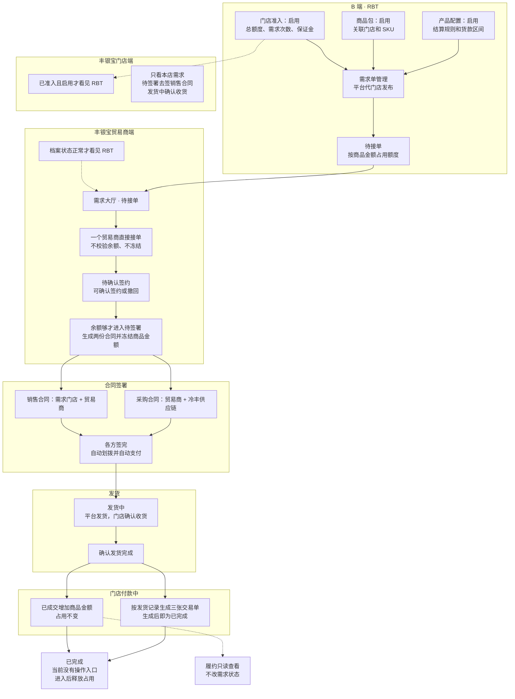
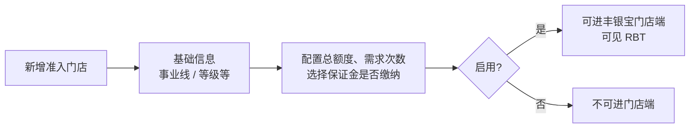
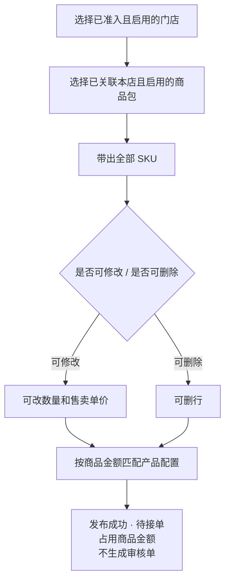
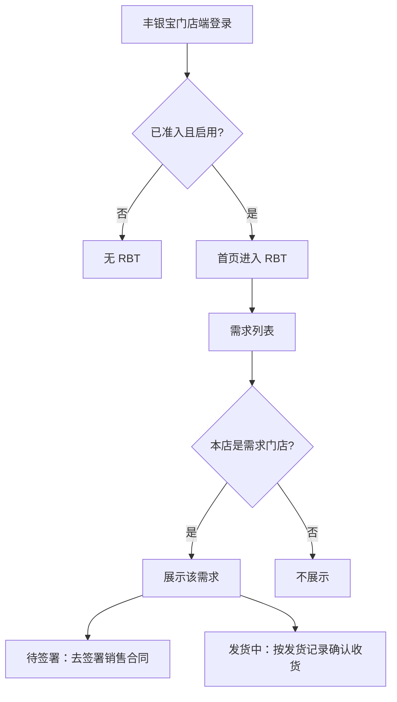
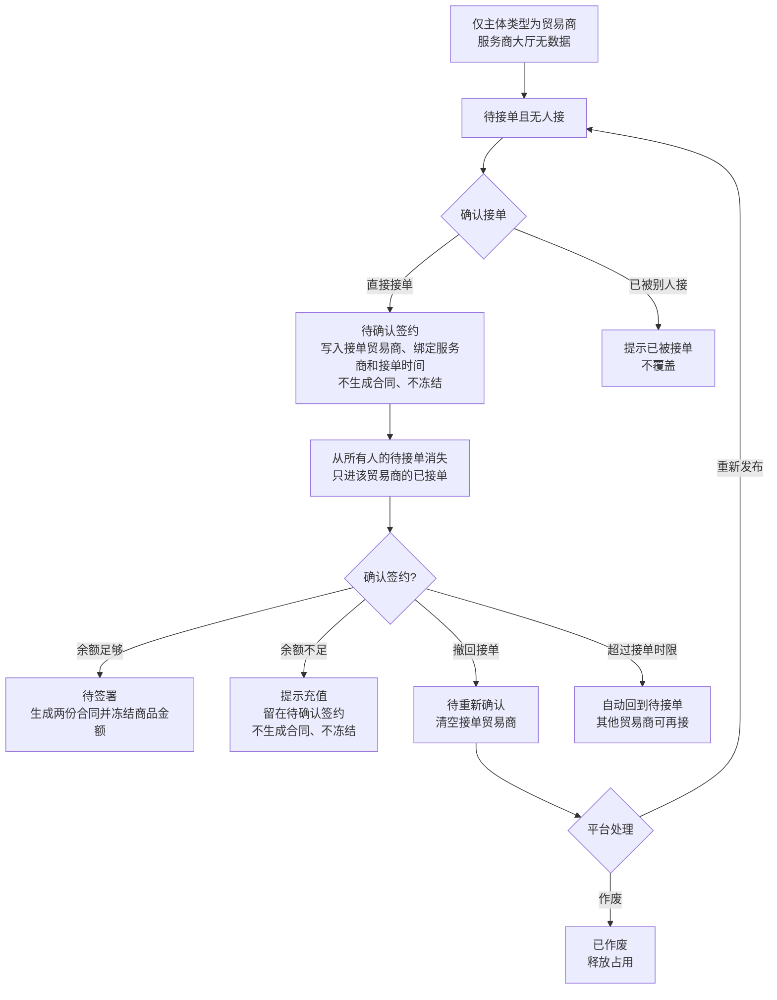
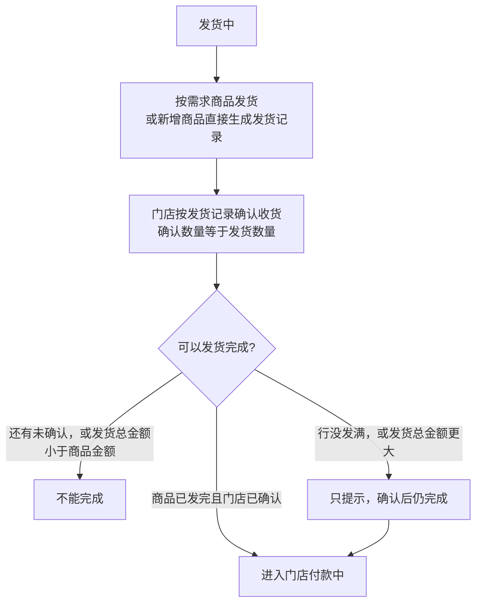
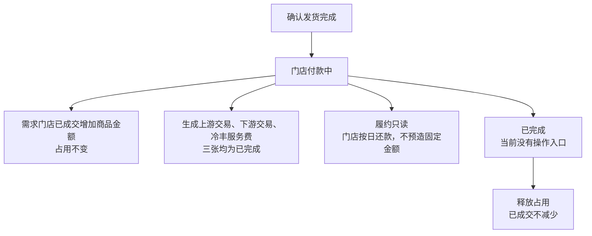

# 整体业务流程图

> 按当前 RBT 原型与 PRD 整理：门店准入、商品包、产品配置、贸易商档案、需求单管理、丰银宝门店端、丰银宝贸易商端、交易单、履约。
>
> 日期：2026-11-23
>
> 需求由平台在需求单管理代门店发布，发布后直接待接单。贸易商确认签约且余额够本单商品金额时，生成两份合同并冻结商品金额，只冻一次。合同各方签完后，用这笔已冻结金额自动划拨并自动支付，需求进入发货中。此时不生成交易单、不增加已成交。确认发货完成后再进入门店付款中，按发货记录生成三张交易单。不生成采购单、销售单，也不下发 WMS 采购入库单。采购单、销售单、需求初审、需求复核都不再走这条链路。
>
> 原型里的「切换门店」只方便演示，不改变下面的业务路径。

## 1. 端到端总览

主链路：

待接单 → 待确认签约 → 待签署 → 发货中 → 门店付款中 → 已完成

旁路：

* 待重新确认：贸易商在待确认签约撤回接单。必须填写原因。清空接单贸易商和这次带上的服务商，不回到待接单。平台可作废，或重新发布后才回到待接单。
* 接单超时：需求单管理配置了接单时限后，待确认签约超过该分钟数仍未确认签约，自动回到待接单。清空接单时间、贸易商、服务商，备注记「接单超时，自动撤回」。其他贸易商可以再接。已经确认签约的不再退回。
* 已作废：平台在待接单、待确认签约、待重新确认、待签署可作废。发货中及之后不能作废。已产生的合同签署状态变为已作废，并释放占用。
* 已驳回：只保留历史单据，不能再新驳回。历史驳回也释放占用。

接单不校验余额，也不冻结。接单成功时，把该贸易商档案里绑定的服务商写入需求单。确认签约时先看余额是否够本单商品金额。不够就留在待确认签约，不生成合同，也不冻结。够了才进入待签署，生成两份合同并冻结本单商品金额，同一需求只冻一次。之后的确认签署不再看余额，也不再冻结。撤回和接单超时都发生在冻结之前，并清掉这次带上的服务商。各方签完后，用这笔已冻结金额自动划拨并自动支付，需求进入发货中。冻结、划拨作用在贸易商余额上，不改变门店占用额度。

## 2. 分阶段说明

### 2.1 门店准入（B 端 · 门店准入管理）

* 可用额度 = 门店总额度 − 已占用。已成交不扣可用额度。可用额度小于 0 时按 0 展示。
* 需求次数为正整数，默认 1。本店未结束需求达到该次数后不能再发布。未结束含待接单、待确认签约、待重新确认、待签署、发货中、门店付款中、已完成。不含已作废、已驳回。
* 保证金选「是」必须上传凭证。未缴纳或还没选择的门店不能发布需求。凭证在需求单详情查看。

### 2.2 商品包与产品配置（B 端）

金额口径：

* 商品金额 = 仍保留的各行数量 × 售卖单价。
* 总金额 = 商品金额 × 门店结算系数。已成交按商品金额，不按总金额，也不按实发。
* 服务费 = 总金额 − 商品金额。
* 贸易商应收 = 商品金额 × 贸易商结算系数，不能高于门店实付。
* 冷丰差额 = 门店实付 − 贸易商应收。
* 服务商应收 = 商品金额 ×（服务商结算系数 − 1），从冷丰差额里拿，不能超过这笔差额。需求上确认有服务商才计提；确认没有时这部分留在冷丰，冷丰应收 = 冷丰差额 − 服务商应收。
* 占用额度按商品金额，不按总金额。

发布校验：

* 商品包至少有一条启用中的产品配置，否则「商品未关联产品配置」。
* 商品金额落在货款区间内，否则「售价不在产品配置的货款区间内」。
* 需求门店保证金已缴纳，否则「保证金未缴纳，无法发布需求」。
* 可用额度大于 0，且商品金额小于等于可用额度。
* 未结束需求未达到该店需求次数，否则「需求次数已达上限，无法发布需求」。
* 比例付须能取到各渠道结算比例，否则「请先在产品配置中维护各渠道结算比例」。

渠道比例在发布时记到需求单。POS、直播、商城各有默认比例；POS 还可配堂食、外卖、团购。待接单到门店付款中可以改本单比例，不改需求状态，也不改产品配置。

### 2.3 贸易商档案（业务伙伴）

档案不在 RBT 侧栏维护。贸易商在业务伙伴的贸易商档案，服务商在服务商档案。贸易商状态为「正常」时，登录丰银宝贸易商端才看得到 RBT。冻结、未建档或非正常不能进入。服务商状态为「正常」时可以登录同一端，但需求大厅没有数据，也不能接单。正式环境用丰银宝当前登录主体，接单和已接单都按贸易商名称识别。

### 2.4 平台代门店发布

门店端不再发布需求，也不再取消需求。平台在需求单管理「新建需求单」，替已准入且启用的门店发布。单据归该门店，门店端列表能看到。

* 是否可修改为「是」：这一行的数量须为 1～999 的整数，售卖单价须大于 0。售卖金额随数量和单价重算。
* 是否可修改为「否」：数量和售卖单价只用商品包上的值。
* 是否可删除为「是」：可以删行，删掉的行不再计入商品金额。至少保留一件商品。
* 发布成功生成需求单号 `XQ` + 五位序号，写入商品、商品金额、服务费、总金额、产品和各渠道结算比例。创建人是当前平台账号。

### 2.5 门店端只查看和配合签署、收货

* 列表只展示需求门店为当前门店的需求。
* 待签署时，需求门店只签销售合同，不能代签采购合同。
* 发货中可确认收货。确认数量等于发货数量，不能改少。确认后这条发货记录不能再删。
* 发货中不出现补缴凭证。进入门店付款中或已完成、并且发货金额大于商品金额时，才可上传。未上传显示待补缴，不拦住平台确认发货完成。

### 2.6 初审与复核（已取消）

需求不再经过初审，也不再自动审核，更不再复核。平台代门店发布成功后状态就是待接单。不生成审核单，审核中心不再新出现「需求单审核」。已经是「已驳回」的历史单仍可查看。支付完成后也不再进入待复核。

### 2.7 贸易商接单

* 两个页签都显示本页条数，没有数据时也是 0。
* 待接单只含状态为待接单、且还没有接单贸易商的需求。
* 已接单只含当前贸易商接过的单，并显示接单后的状态和接单时间。
* 点击接单后直接进入待确认签约，并把该贸易商档案里绑定的服务商写入需求单。接单成功可稍后处理，或去已接单确认签约。
* 确认签约前弹出说明。余额不够本单商品金额时，提示当前余额和需支付金额，点「我知道了」不改状态，不生成合同，也不冻结。余额足够时，生成两份合同并冻结商品金额。
* 撤回原因必填，可点选需求单管理配置的快捷原因，也可以自己写。没配置快捷原因时只能自己写。取消不改状态。
* 待重新确认从已接单消失，也不出现在待接单。撤回时清掉这次带上的服务商。重新发布会清空撤回原因。
* 没保存过接单时限时，不自动退回。

### 2.8 合同签署

确认签约且余额足够后，生成两份合同并冻结本单商品金额，两件事同一步完成。需求单管理用弹窗看进度。冷丰供应链在该弹窗确认采购合同，不代门店或贸易商签。门店、贸易商各自在自己的端内签。

| 合同 | 谁签 | 在哪签 |
| --- | --- | --- |
| 销售合同 | 需求门店、接单贸易商 | 门店端、贸易商端 |
| 采购合同 | 接单贸易商、冷丰供应链 | 贸易商端、需求单管理弹窗 |

* 一份合同双方都确认后，该份为已签署，否则为待签署。
* 冻结已经在确认签约时完成，销售合同和采购合同不各冻一笔。贸易商、门店、冷丰供应链点「确认签署」都不再校验余额，也不再冻结。
* 两份合同的各方都签完时，用这笔已冻结金额自动划拨并自动支付，需求进入发货中。不再停在待付款，也不再由贸易商选择在线支付或线下支付。
* 这时不生成交易单，也不给门店增加已成交。发货中仍占用额度，且不能作废。

### 2.9 发货中

各方签完并自动划拨、自动支付后进入发货中。发货在需求单详情操作，确认收货在门店端。

* 发货信息在发货中显示「新增商品」「发货」「发货完成」。同一商品可以分多次发。本次发货金额按本次数量 × 售卖单价计算。
* 累计发货数量或金额超过该行时只提示，仍保存。门店确认前可以删除这条发货记录后重发。
* 新增商品不写入需求商品明细，也不改商品金额、服务费、总金额和占用额度。这些记录同样等门店确认。
* 发货完成被拦住的情况：还有发货记录未确认，或发货总金额小于需求单商品金额。
* 某一行没发满数量或金额，或发货总金额大于商品金额，只提示，确认后仍进入门店付款中。发货中新增的商品没有需求行，不参与「没发满」这条对比。
* 进入门店付款中或已完成之后，发货总金额大于商品金额时，补缴凭证显示在发货信息下方。可上传图片或 PDF。未上传显示待补缴，也不拦住进入门店付款中。发货中不显示补缴凭证。

### 2.10 门店付款中、交易单与履约

确认发货完成进入门店付款中时：

* 按发货记录生成三张交易单。商品数量和金额取自发货记录。没有发货记录的历史单仍按需求商品生成。服务费只按需求单商品金额计算：下游是商品金额 ×（贸易商结算系数 − 1），冷丰服务费是商品金额 ×（门店结算系数 − 贸易商结算系数）。多发不加大服务费。同一张需求只生成一套。
* 三张交易单生成后即为已完成。不生成采购单、销售单，也不下发 WMS 采购入库单，不回写收货状态，不进门店订货汇总或采购需求汇总。
* 按需求单商品金额给需求门店增加已成交。已成交不扣可用额度。占用要等到已完成才释放。
* 门店付款中表示贸易商已经付款，门店按日还款。比例付按当日实际营业计算，不预造未来固定金额。各端不能在页面上把门店付款中改成已完成。

| 交易单 | 付款方 | 收款方 | 收货方 | 明细 |
| --- | --- | --- | --- | --- |
| 上游交易 | 接单贸易商 | 冷丰供应链 | 需求门店 | 各商品按实发数量和实发金额。没有发货记录时按需求商品 |
| 下游交易 | 需求门店 | 接单贸易商 | 需求门店 | 各商品按实发，末尾加一行「服务费」。这一行是需求单商品金额 ×（贸易商结算系数 − 1），多发不加大 |
| 冷丰服务费 | 需求门店 | 冷丰供应链 | 需求门店 | 只有一行「服务费」。这一行是需求单商品金额 ×（门店结算系数 − 贸易商结算系数），多发不加大 |

服务费不是单据字段，也不展示结算系数。冷丰向真实供应商的采购不由这张需求生成。

履约页只列出门店付款中和已完成的需求，只读查看。不生成还款计划、结算单或逾期处置。起算、舍入、退款跨期和完成条件待确认。已完成只表示需求状态，当前没有从门店付款中进入已完成的操作入口。一旦进入已完成，释放需求门店的已占用；已成交不因释放而减少。

## 3. 状态与额度

| 节点 | 需求状态 | 说明 | 额度 |
| --- | --- | --- | --- |
| 发布成功 | 待接单 | 渠道比例已按产品配置记到需求单。不经过初审，不生成审核单 | 需求门店已占用 +商品金额 |
| 贸易商接单 | 待确认签约 | 写入接单贸易商、该贸易商绑定的服务商和接单时间。不校验余额，不生成合同，不冻结 | 占用不变 |
| 确认签约且余额足够 | 待签署 | 生成销售合同和采购合同，并冻结本单商品金额，只冻一次。余额不足则留在待确认签约，不生成合同，不冻结 | 占用不变 |
| 各方确认签署 | 仍为待签署 | 只写入对应合同的签署。不再校验余额，也不再冻结 | 占用不变 |
| 撤回接单 | 待重新确认 | 必须填写原因。清空接单贸易商。发生在冻结之前 | 占用不变 |
| 接单超时 | 待接单 | 清空接单时间、贸易商、服务商。发生在冻结之前 | 占用不变 |
| 重新发布 | 待接单 | 清空撤回原因后，其他贸易商可以再接 | 占用不变 |
| 各方签署完成 | 发货中 | 自动划拨并自动支付。不生成交易单，不增加已成交。不能作废 | 占用不变 |
| 确认发货完成 | 门店付款中 | 按发货记录生成三张已完成交易单。货款按实发，服务费按需求单商品金额。不生成采购单，不下发入库单 | 占用不变；仅需求门店已成交 +商品金额 |
| 平台作废 | 已作废 | 仅待接单、待确认签约、待重新确认、待签署。已产生的合同变为已作废 | 释放占用 |
| 已完成 | 已完成 | 当前没有操作入口。履约上的完成依据待确认 | 释放占用；已成交不减少 |
| 历史驳回 | 已驳回 | 不能再新驳回 | 释放占用 |

可用额度始终是：门店总额度 − 已占用。

进行中、仍占用额度的状态：待接单、待确认签约、待重新确认、待签署、发货中、门店付款中。

## 4. 相关原型与 PRD

| 阶段 | 原型 | PRD |
| --- | --- | --- |
| 门店准入 | `RBT/rbt_admit_store.html` | `2-门店管理PRD.md` |
| 商品包 | `RBT/rbt_product_package.html` | `5-商品包与产品配置PRD.md` |
| 产品配置 | `RBT/rbt_installment.html` | `5-商品包与产品配置PRD.md` |
| 贸易商档案 | 业务伙伴 · 贸易商档案 | `3-贸易商档案PRD.md` |
| 服务商档案 | 业务伙伴 · 服务商档案 | `4-服务商档案PRD.md` |
| 需求单管理 | `RBT/rbt_demand.html` | `6-需求发布流程PRD.md` |
| 需求单发货 | `RBT/rbt_demand.html` | `9-需求单发货PRD.md` |
| 交易单 | `RBT/rbt_trade.html` | `9-需求单发货PRD.md` |
| 丰银宝门店端 | `RBT/rbt_h5_store.html` | `8-门店端查看签署与收货PRD.md` |
| 贸易商接单 | `RBT/rbt_h5_trader.html` | `7-贸易商接单流程PRD.md` |
| 履约 | `RBT/rbt_performance.html` | 本页只读，完成条件待确认 |
| 需求初审（已取消） | `MDM/mdm_audit_rbt_demand.html` 仅保留历史记录 | — |
