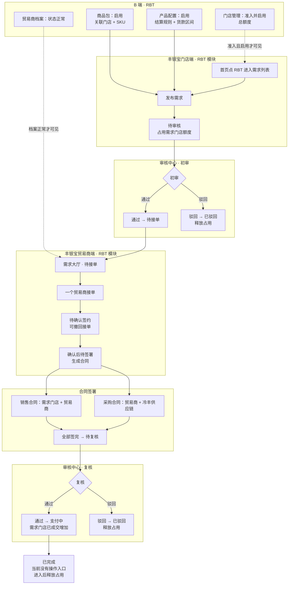
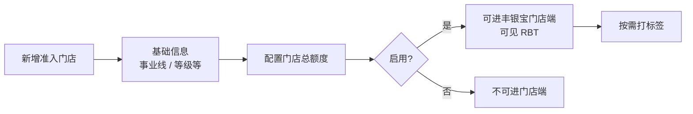
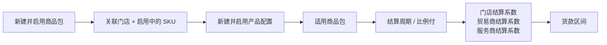
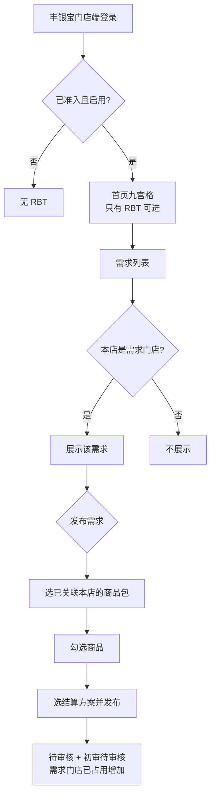
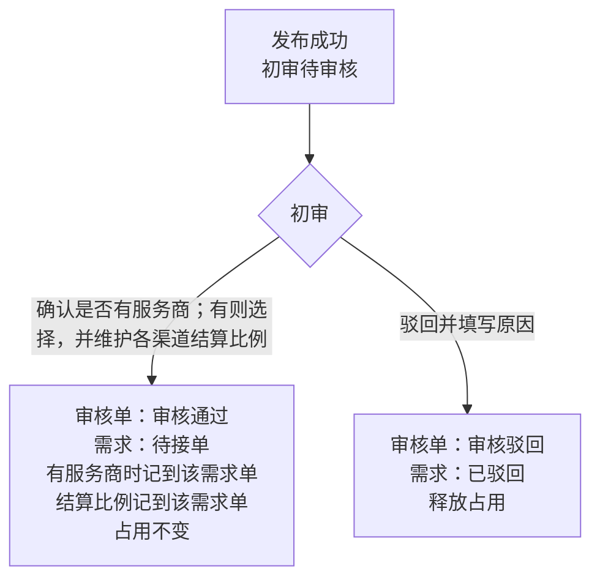
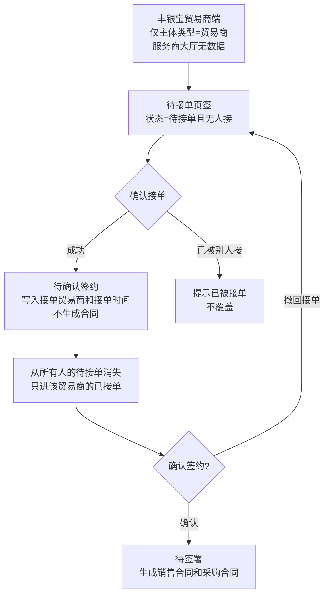
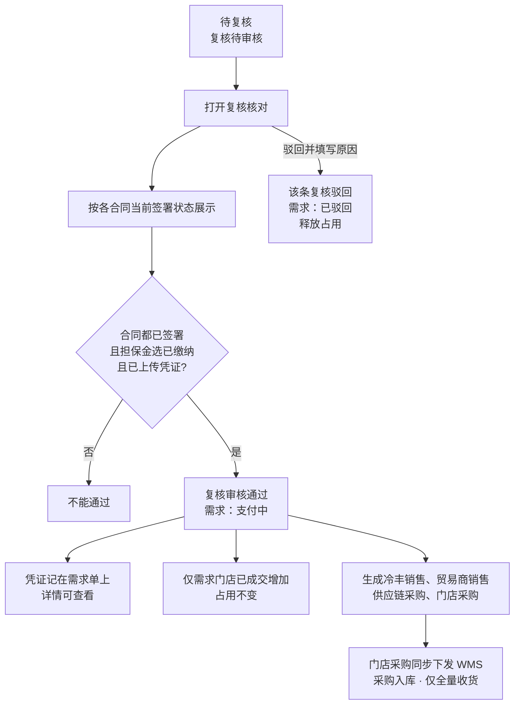

# 整体业务流程图

> 依据当前原型与 PRD：门店准入、商品包、产品配置、贸易商档案、丰银宝门店端、丰银宝贸易商端、需求单管理、审核中心、采购单、销售单。
>
> 日期：2026-11-13
>
> 原型演示用的「切换门店」「一键签署」不进入本图。复核后的采购单、销售单按《需求复核后单据方案》方案一生成，并补冷丰销售单。

## 1. 端到端总览

主链路：

待审核 → 待接单 → 待确认签约 → 待签署 → 待复核 → 支付中 → 已完成

旁路：已作废（门店仅待审核取消，或平台在支付中之前作废）、已驳回（初审或复核驳回）。作废和驳回都释放占用额度。确认签约前，接单贸易商可撤回，需求回到待接单。

## 2. 分阶段说明

### 2.1 门店准入（B 端 · 门店管理）

* 可用额度 = 门店总额度 − 已占用。已成交不扣可用额度。

### 2.2 商品包与产品配置（B 端）

发布时门店实付 = 商品金额 × **门店结算系数**，占用额度和已成交按门店实付。贸易商所得 = 商品金额 × 贸易商结算系数，不能高于门店实付。差额归冷丰。服务商计提 = 商品金额 ×（服务商结算系数 − 1），从冷丰差额里拿，不能超过这笔差额。

发布校验：

* 商品包至少有一条启用中的产品配置，否则「商品未关联产品配置」
* 售价合计落在货款区间内，否则「售价不在产品配置的货款区间内」
* 需求门店的可用额度 ≥ 总金额

### 2.3 贸易商档案（业务伙伴）

档案状态为「正常」时，该贸易商登录丰银宝贸易商端后才看得到 RBT 模块。冻结、未建档或非正常不展示。正式环境用丰银宝当前登录贸易商，接单和已接单都按贸易商名称识别。

### 2.4 门店端发布与列表

列表上的操作：

* 「取消」：仅需求门店本人，且仅待审核。取消后状态为已作废，释放占用；待审核的初审按驳回处理，意见为「需求已作废」。待审核之后没有取消入口。
* 「作废」：需求单管理在支付中之前可作废。需求变为已作废；已产生的合同签署状态变为已作废。审核单里已经审核通过的不变，仍待审核的按驳回处理并记录意见。
* 「去签署」：状态为待签署时，需求门店签署销售合同。待确认签约时还没有合同。

### 2.5 初审（审核中心）

需求单管理在待审核、待复核时可点「审核」，跳到审核中心并带上需求单号，不预填审核状态。

### 2.6 贸易商接单

两个页签都显示本页条数，没有数据时也是 0。只有主体类型为贸易商的账号能看见全部待接单和自己已接的单。主体类型为服务商的账号登录后需求大厅没有数据，也不能接单。发布需求的门店只看自己发布的需求。已接单只含当前贸易商接过的单，并显示接单后的状态和接单时间。待确认签约显示「确认签约」「撤回接单」。待签署显示「去签署」。

### 2.7 合同签署

确认签约之后才有两份合同。需求单管理用弹窗查看进度，冷丰供应链在该弹窗确认采购合同，不代门店或贸易商签。门店、贸易商各自在自己的端内签。

| 合同 | 谁签 | 在哪签 |
| --- | --- | --- |
| 销售合同 | 需求门店、接单贸易商 | 门店端、贸易商端 |
| 采购合同 | 接单贸易商、冷丰供应链 | 贸易商端、需求单管理弹窗 |

一份合同双方都确认后，该份为已签署，否则为待签署。两份合同的各方都签完，需求变为待复核，审核中心新增一条「复核」待审核。原来的初审记录保持审核通过。

### 2.8 复核（审核中心）

原型里复核弹窗把合同固定显示成已签署，正式规则仍按实时签署状态拦截。担保金由审核员在复核时确认是否缴纳并上传凭证，门店端没有缴纳入口。

### 2.9 支付中与已完成

复核通过后需求停在支付中，同时生成冷丰销售单、贸易商销售单、供应链采购单、门店采购单。门店向贸易商的采购单同步下发 WMS 采购入库单：关联单号=需求单号；不允许差异收货，只允许全量收货；入库完结后该门店采购单和对应贸易商销售单改为已完成。冷丰销售和供应链采购生成后即为已完成，商品售价用原始售价。门店采购的商品售价 = 原始售价 × 门店结算系数，贸易商销售的商品售价 = 原始售价 × 贸易商结算系数。购销单写明付款方、收货方、实际发货方，不展示配送方式、计价、门店结算系数、成交单价、入库单号；明细只展示按上述规则算出的商品售价。各端已接单或需求列表只展示状态，不能在页面上把支付中改成已完成。

一旦进入已完成，释放需求门店的已占用；已成交不因释放而减少。这一步当前没有操作入口。

## 3. 状态与额度

| 节点 | 需求状态 | 审核 | 额度 |
| --- | --- | --- | --- |
| 发布成功 | 待审核 | 初审待审核 | 需求门店已占用 +总金额 |
| 初审通过 | 待接单 | 初审审核通过，本单结算比例记到需求单 | 占用不变 |
| 初审驳回 | 已驳回 | 初审审核驳回 | 释放占用 |
| 需求门店取消（仅待审核） | 已作废 | 待审核的初审驳回，意见「需求已作废」 | 释放占用 |
| 平台作废（支付中之前） | 已作废 | 已通过的审核单不变；待审核的驳回并记录意见。已产生的合同签署状态变为已作废 | 释放占用 |
| 贸易商接单 | 待确认签约 | 初审仍为审核通过 | 占用不变 |
| 确认签约 | 待签署 | 初审仍为审核通过 | 占用不变 |
| 撤回接单 | 待接单 | 初审仍为审核通过 | 占用不变 |
| 各方签署完成 | 待复核 | 新增复核待审核 | 占用不变 |
| 复核通过 | 支付中 | 复核审核通过 | 占用不变；仅需求门店已成交 +总金额 |
| 复核驳回 | 已驳回 | 复核审核驳回 | 释放占用 |
| 已完成 | 已完成 | 复核保持审核通过 | 释放占用；已成交不减少 |

可用额度始终是：门店总额度 − 已占用。

## 4. 相关原型与 PRD

| 阶段 | 原型 | PRD |
| --- | --- | --- |
| 门店准入 | `RBT/rbt_admit_store.html` | `门店管理PRD.md` |
| 商品包 | `RBT/rbt_product_package.html` | `商品包PRD.md` |
| 产品配置 | `RBT/rbt_installment.html` | `产品配置PRD.md` |
| 贸易商档案 | 业务伙伴 · 贸易商档案 | `贸易商档案PRD.md` |
| 丰银宝门店端 | `RBT/rbt_h5_store.html` | `门店端移动端PRD.md` |
| 丰银宝贸易商端 | `RBT/rbt_h5_trader.html` | `贸易商端移动端PRD.md` |
| 需求台账与签署进度 | `RBT/rbt_demand.html` | `需求单管理PRD.md` |
| 初审与复核 | `MDM/mdm_audit_rbt_demand.html` | `需求单审核PRD.md` |
| 复核后销售单 | `RBT/rbt_sales.html` | `销售单PRD.md` |
| 复核后采购单 | `RBT/rbt_purchase.html` | `采购单PRD.md` |
| 复核后单据方案 | — | `需求复核后单据方案.md` |
