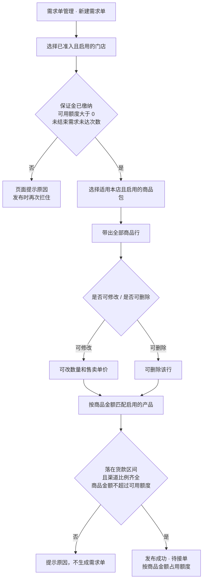

# 需求发布流程PRD

| 版本号 | 修改人 | 修改时间 | 修改内容 |
| --- | --- | --- | --- |
| V1.0 | 符洪斌 | 20261123 | 新建文档 |

## 1. 需求描述

### 1.1 发布从哪进入

顶部导航最后两项为「RBT」「RBT-移动端」。进入 RBT 后，左侧菜单为「首页」「门店准入管理」「商品包」「产品配置」「需求单管理」「交易单」「履约」。

原型页面：`RBT/rbt_demand.html`

本页是需求单全量台账，可查询、看列表，也可代门店发布。门店端不再发布需求，也不再取消需求。平台点「新建需求单」，替已准入且启用的门店发布。单据归该门店，门店端列表能看到。

发布成功后状态就是「待接单」。不经过初审，不生成审核单，不生成采购单、销售单，也不下发 WMS 入库单。接单见《贸易商接单流程PRD》。发货见《需求单发货PRD》。签约不在本文。

### 1.2 查询与列表

页签为「需求单管理」。列表同时包含平台代发的需求，以及仍留在数据里的历史单据。切回本页、窗口重新获得焦点时刷新，并大约每 30 秒刷新一次，便于看到接单、签署之后的最新状态。

#### 1.2.1 查询

查询条件按以下顺序展示。需求单号、门店、产品、贸易商、服务商为包含匹配，不区分大小写。状态为精确匹配。条件可只填一部分。未选条件不限。

- 需求单号：匹配需求单号
- 门店：匹配门店名称或门店编码
- 状态：下拉，占位「请选择状态」。选项依次为待接单、待确认签约、待重新确认、待签署、发货中、门店付款中、已完成、已作废、已驳回
- 产品：匹配产品名称或产品编码
- 贸易商：匹配接单贸易商名称
- 服务商：匹配服务商名称或服务商编码
- 「查询」按当前条件刷新，并回到第 1 页
- 「重置」清空条件，恢复全部记录

默认每页 20 条。没有命中时展示空列表。

#### 1.2.2 列表

列按以下顺序展示。没有值时为「—」。金额前加 ¥。

- 需求单号：链接，在当前页打开详情，地址不变。字段见 1.2.4
- 门店
- 状态：标签。已完成为绿色；已作废、已驳回为灰色；待确认签约、待重新确认、发货中为橙色；门店付款中为红色；待接单、待签署为默认标签
- 产品：产品名称
- 结算周期
- 结算方式
- 结算比例：有渠道比例时显示「详情」，点击弹出结算比例详情，标题为需求单号和门店名称。点关闭、点遮罩或按 Esc 关闭。待接单、待确认签约、待签署、发货中、门店付款中另有「改比例」，保存后只改本单比例，不改需求状态，也不改产品配置。没有比例且当前状态不能改时为「—」
- 贸易商：接单贸易商。未接单时为「—」
- 服务商：接单时写入该贸易商档案里绑定的服务商。未接单、或这次没有带上服务商时为「—」
- 接单时间：未接单时为「—」
- 商品金额：各商品售卖金额合计
- 服务费：总金额 − 商品金额。这里的总金额是门店实付
- 总金额：商品金额 × 门店结算系数。已成交按商品金额，不按总金额，也不按实发。占用额度按商品金额
- 贸易商应收、冷丰应收、服务商应收：紧跟总金额。贸易商应收 = 商品金额 × 贸易商结算系数。冷丰差额 = 商品金额 × 门店结算系数 − 贸易商应收。确认有服务商时，服务商应收 = 商品金额 ×（服务商结算系数 − 1），从冷丰差额里拿；确认没有时服务商应收为 0，这笔留在冷丰应收。冷丰应收 = 冷丰差额 − 服务商应收。算不出时为「—」
- 撤回原因：贸易商撤回接单时填写。重新发布后清空
- 备注：接单超时自动撤回时记「接单超时，自动撤回」
- 创建人
- 创建时间
- 更新人
- 更新时间

操作列固定在右侧，每行都显示「签署」「重新发布」「作废」。不满足条件时置灰。

- 「签署」：仅待签署可点。点击在当前页打开合同签署，不跳转其他页面
- 「重新发布」：仅待重新确认可点，见 1.5
- 「作废」：待接单、待确认签约、待重新确认、待签署可点。确认文案：「确认作废「需求单号」？作废后释放占用额度。」确认后状态变为已作废，释放占用。已经生成的销售合同、采购合同签署状态变为已作废。操作记录记「作废，状态：原状态 → 已作废」，变更人记为「平台」。门店付款中、已完成、已作废、已驳回、发货中置灰

#### 1.2.3 列表上方按钮

- 「新建需求单」：见 1.4
- 「接单时间配置」：打开「接单时间配置」。接单时限为大于 0 的整数，单位分钟。没填、填 0 或小数就保存，提示「请填写大于 0 的整数分钟」，不保存。保存成功提示「接单时间配置已保存」。没保存过时不自动退回。超时怎么退回，见《贸易商接单流程PRD》
- 「撤回原因配置」：打开「撤回原因配置」。还没有原因时展示「还没有撤回原因，贸易商只能自己填写。」输入最多 30 个字。空着点添加，提示「请填写撤回原因」。超过 30 个字，提示「撤回原因不超过 30 个字」。与已有原因相同，提示「该原因已存在」。保存成功提示「撤回原因已保存」。保存后贸易商撤回时可以点选这些原因，也可以自己填写；没配置时只能自己填写。撤回时原因仍必填，贸易商自己写最长 100 个字

#### 1.2.4 详情

点击需求单号打开右侧抽屉，标题「需求单详情」。点关闭、点遮罩或按 Esc 关闭。抽屉里还有合同预览、发货、新增商品、发货完成时，Esc 先关这一层。

头部为需求单号和状态标签，下面两行是「门店：门店名称（门店编码）」「商品包：商品包名称（商品包编码）」。已完成为绿色；已作废、已驳回为灰色；待确认签约、待重新确认、待签署、发货中为橙色；门店付款中为红色；待接单为默认标签。

页签「基础信息」「操作记录」。本页打开的详情没有审核通过、审核驳回。

**基础信息**从上到下依次是：

门店额度：门店总额度、已占用、可用额度。这是该门店当前额度，不是这一张单自己的占用。金额带 ¥ 和千分位，两位小数。

基础信息字段，按这个顺序：需求单号、门店、状态、产品、商品包、结算周期、结算方式、接单贸易商、服务商、接单时间、撤回原因、备注、创建人、创建时间、更新人、更新时间。门店、产品、商品包写成「名称（编码）」。比例付并且已经有渠道比例时，基础信息里不再单列结算比例，改在下方「结算比例」区展示。不是比例付时，这里多一行结算期数。

金额信息一行七列：商品金额、已发货金额、服务费、总金额、贸易商应收、冷丰应收、服务商应收。已发货金额是各条发货记录金额之和，没有发货记录时为 ¥0.00。三方应收口径与列表相同。

商品明细列：商品编码、商品名称、售卖单价、商品数量、售卖金额。没有商品时展示「暂无商品」。售卖金额 = 数量 × 售卖单价。

发货信息：状态是发货中，或者已经有发货记录时才出现。发货、新增商品、删除、发货完成和补缴凭证见《需求单发货PRD》。

结算比例：本单已有渠道比例时才出现。待接单、待确认签约、待签署、发货中、门店付款中可点「修改结算比例」，保存后只改本单，不改状态，也不改产品配置。

关联合同：确认签约之前展示「暂无关联合同」。待签署及之后列出销售合同、采购合同。列：协议、编号、签署方、签署状态。协议名称可点开「合同预览」，点关闭、点遮罩或按 Esc 关闭。作废后若曾经生成过合同，签署状态为已作废，预览末尾为「本合同已作废。」

保证金缴纳凭证：取需求门店在准入里上传的凭证。未缴纳时缴纳状态为「未缴纳」。已缴纳展示缴纳状态、凭证文件、上传人、上传时间；图片直接预览，PDF 为「查看凭证」。没有文件时展示「暂无保证金缴纳凭证」。

关联交易单：门店付款中、已完成才出现。没有时展示「暂无关联交易单」。列：单号、付款方、收款方、收货方、总金额、状态。点单号关掉需求详情，打开该交易单详情。

**操作记录**列：变更内容、变更人、变更时间。没有记录时展示「暂无操作记录」。

### 1.3 发布主流程

金额在这一步的口径：

- 商品金额 = 仍保留的各行数量 × 售卖单价。
- 总金额 = 商品金额 × 所匹配产品的门店结算系数，四舍五入到分。
- 服务费 = 总金额 − 商品金额。
- 占用额度按商品金额，不按总金额。已成交不在发布时增加。

### 1.4 平台代门店发布需求

点「新建需求单」在当前页打开弹窗，标题「新建需求单」。点遮罩不关闭。点「取消」关闭，不保存。

弹窗顶部说明：平台代门店发布需求。单据归该门店，按商品金额占用额度，发布后直接进入待接单。其中「商品金额」为强调字样。

弹窗分三块：门店、商品、结算。底部按钮为「取消」「发布需求」。

#### 1.4.1 选择门店

门店必选。下拉只含准入列表里状态为启用的门店，展示「门店名称（门店编码）」。未选时商品包不可选，占位「请先选择门店」，商品表空文案也是「请先选择门店」。

换门店后，已选商品包、商品行和结算选择全部清空。

选中门店后展示：

- 门店总额度
- 已占用
- 可用额度：总额度 − 已占用，小于 0 时按 0 展示。已成交不扣可用额度
- 未结束需求：已占用次数 / 需求次数。未结束含待接单、待确认签约、待重新确认、待签署、发货中、门店付款中、已完成。不含已作废、已驳回。需求次数没填或不是正整数时按 1
- 保证金：已缴纳，或未缴纳。只有明确选过「是」才算已缴纳

下面三种情况会在门店区直接提示，点发布时再用同一句拦住：

- 保证金未缴纳或还没选择：`保证金未缴纳，无法发布需求`
- 可用额度不大于 0：`可用额度不足，无法发布需求`
- 未结束需求已达到需求次数：`需求次数已达上限，无法发布需求`

可用额度大于 0，但商品金额超过可用额度时，门店区不提示。这句留到点发布时校验。

未选门店就发布，提示「请选择门店」。

#### 1.4.2 选择商品包和商品行

商品包必选。选项是启用中、并且适用当前门店的商品包，展示「商品包名称（商品包编码）」。

适用规则与商品包一致：按门店配置的，看是否勾了这家店；按 RBT 标签配置的，看这家店是否带上其中任一标签。禁用的商品包不出现。

没有可选商品包时，下拉仍不可用，占位「暂无本门店的商品包」。已选门店但还没选商品包时，商品表空文案为「请先选择商品包」。未选商品包就发布，提示「请选择商品包」。

选中商品包后，带出该包全部商品。表列：商品编码、商品名称、规格、商品数量、售卖单价、售卖金额、操作。

规格展示为「1 + 单位 + 规格」。单位或规格缺一项时只展示有的那一项，都没有时为「—」。

售卖金额 = 数量 × 售卖单价。数量或单价还无效时这一格为「—」。

表下汇总：共几种、几件、商品金额。有一行数量或单价无效时，商品金额为「—」，结算区提示「请填写有效的商品数量和售卖单价」。

商品行能不能改，只看商品包上的「是否可修改」「是否可删除」：

- 是否可修改为「是」：数量、售卖单价出现输入框。数量只保留整数，最大 999。售卖单价只保留数字和一个小数点，最多两位小数
- 是否可修改为「否」：数量和售卖单价只读，用商品包上的值
- 是否可删除为「是」：操作列是「删除」，删掉的行不再计入商品金额
- 是否可删除为「否」：操作列是「—」
- 商品包没写这两项时，按可改、可删处理

发布时：

- 一行都没留下：提示「请至少保留一件商品」
- 数量不是 1 到 999 的整数：提示「商品数量须为 1 到 999 的整数」
- 售卖单价为空、不是最多两位小数的正数：提示「请填写售卖单价」

#### 1.4.3 匹配产品

商品行都有效后，用商品金额去匹配产品配置。

候选产品必须同时满足：

- 状态为启用
- 适用商品包里有当前商品包的名称或编码
- 商品金额落在该产品货款区间内，含上下限

这个商品包一条启用产品都没有，结算区提示「商品未关联产品配置」，发布时同一句拦住。

有产品，但商品金额都不在货款区间内，提示「售价不在产品配置的货款区间内」。

匹配到之后：

- 产品：只读，展示「产品名称（产品编码）」。还没匹配到时为「—」
- 结算周期：必填。当前产品只有日结。只有一种时直接展示，不出现下拉；多于一种才下拉，并优先选日结。发布时没有周期，提示「请选择结算周期」
- 结算方式：必填。当前产品只有比例付。只有一种时直接展示。换周期后重选方式。发布时没有方式，提示「请选择结算方式」
- 结算期数：只有结算方式不是比例付时才出现。比例付不出现这一项，也不保存期数。需要期数却没选时，提示「请选择结算期数」
- 商品金额、服务费、总金额：匹配成功后展示。总金额算不出来时，发布提示「总金额计算失败」

比例付发布时，把该产品的渠道结算比例抄到本需求单。POS、直播、商城都要有大于 0 且不超过 100 的默认比例；POS 如有堂食、外卖、团购，一并抄上。抄不下来时提示「请先在产品配置中维护各渠道结算比例」。本弹窗不能改比例，之后在需求单上改比例不改产品配置。

商品金额大于可用额度时，提示「商品金额须小于等于可用额度」，不发布。比较到分。

#### 1.4.4 发布成功

校验通过后生成需求单，单号前缀 XQ，后接 5 位数字，取当前最大号加 1。

写入：需求门店、商品包、商品行、商品金额、服务费、总金额、产品、结算周期、结算方式、渠道结算比例。状态为待接单。不写贸易商、服务商、接单时间。

创建人、更新人记为「用户名」。操作记录记「平台代门店发布需求单」。

同时按商品金额增加该门店已占用。可用额度随之减少。

成功提示「需求已发布，已进入待接单」，关闭弹窗并刷新列表。连续点发布不会生成两张单。

需求数据读不出来时，提示「需求数据未就绪」，不发布。

#### 1.4.5 当前演示门店

五家准入门店里，按商品包原价都不能直接发布。商品包上的行都是不可修改、不可删除，金额减不下来。

| 门店 | 保证金 | 总额度 | 已占用 | 可用额度 | 能选到的商品包 | 点发布时 |
| --- | --- | --- | --- | --- | --- | --- |
| 西湖中心生鲜店 ONS00001 | 已缴纳 | 50000 | 50000 | 0 | 汉言开业铺货包，商品金额 50000 | 可用额度不足，无法发布需求 |
| 东城和平里生鲜店 ONS00002 | 已缴纳 | 40000 | 40000 | 0 | 门店形象配置包，商品金额 40000 | 可用额度不足，无法发布需求 |
| 河东大桥道自提点 ONS00003 | 未缴纳 | 50000 | 30000 | 20000 | 开业运营服务包，商品金额 30000 | 保证金未缴纳，无法发布需求 |
| 五角场体验店 ONS00004 | 已缴纳 | 40000 | 0 | 40000 | 汉言开业铺货包，商品金额 50000 | 商品金额须小于等于可用额度 |
| 余杭仓前便利店 ONS00005 | 未缴纳 | 30000 | 0 | 30000 | 无 | 保证金未缴纳，无法发布需求 |

五角场这一条，门店区不出现红色提示，因为保证金已缴纳、可用额度 40000、未结束需求 0 / 1。选中汉言开业铺货包后，产品匹配到开业铺货日结（货款区间 20.00–50000.00）。商品金额 50000，总金额按门店结算系数 1.60 算出 80000，服务费 30000。点发布仍被可用额度拦住。

若把五角场额度调到不少于 50000，同一张单可以发布：状态待接单，已占用增加 50000，渠道比例按开业铺货日结的 POS、直播、商城默认 10.00 写入。

### 1.5 重新发布

贸易商在待确认签约撤回接单后，需求进入待重新确认，不回到待接单，其他贸易商也看不到。

只有待重新确认可以点「重新发布」。确认文案：「确认重新发布「需求单号」？发布后需求回到待接单，可被贸易商继续接单。」

确认后：

- 状态回到待接单
- 清空接单贸易商、接单时间、撤回原因，以及上次接单带上的服务商
- 占用额度不变，不重新占用一次
- 操作记录记「重新发布，状态：待重新确认 → 待接单」，变更人记为「平台」

其他状态的「重新发布」置灰。重新发布不重选商品包，也不重算商品金额。
