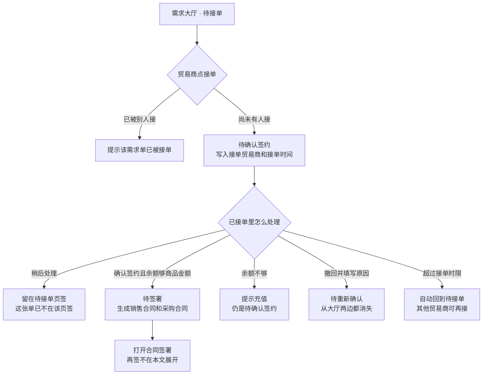

# 贸易商接单流程PRD

| 版本号 | 修改人 | 修改时间 | 修改内容 |
| --- | --- | --- | --- |
| V1.0 | 符洪斌 | 20261123 | 新建文档 |

## 1. 需求描述

### 1.1 接单从哪进入

贸易商在丰银宝贸易商端接单。原型页面：`RBT/rbt_h5_trader.html`。

登录是否放行见《贸易商档案PRD》《服务商档案PRD》。状态为「正常」的贸易商登录后，首页「基础工具」里点「需求大厅」。服务商状态为「正常」时可以登录同一端，两个页签都没有数据，也不能接单。

正式环境用丰银宝当前登录主体。接单和已接单按贸易商名称识别，名称取登录主体的证照名称。

门店占用额度在发布时已经按商品金额占用。接单、确认签约、撤回、接单超时都不改这笔占用，也不增加已成交。

### 1.2 接单主流程

这一步不看余额的是「接单」，接单也不冻结。确认签约时余额须够本单商品金额，够了才进入待签署并生成合同，此时尚未冻结。贸易商确认签署成功后冻结本单商品金额，只冻一次。各方签完后，用这笔已冻结金额自动划拨并自动支付。

### 1.3 需求大厅

首页「基础工具」点「需求大厅」进入，页头为「需求大厅」。默认停在「待接单」。

#### 1.3.1 列表

两个页签可切换，页签文案是「待接单(条数)」「已接单(条数)」。数字是该页签自己的条数，没有数据时也显示 0。服务商账号两个页签都是空的，空文案仍是「暂无待接单需求」「暂无已接单需求」。

**待接单**只含状态为待接单、且还没有接单贸易商的需求。按创建时间从新到旧排。

**已接单**只含接单贸易商名称等于当前登录贸易商的需求。待确认签约、待签署会在这里；发货中、门店付款中、已完成，以及仍挂着这个贸易商的已作废、已驳回也在这里。按接单时间从新到旧排，没有接单时间时用更新时间。

待重新确认已经清空接单贸易商，所以不在已接单，也不回到待接单。要等平台重新发布，见《需求发布流程PRD》。

每张卡片按这个顺序展示。没有值时为「—」。金额前加 ¥。

- 门店名称
- 状态：待接单页签固定显示「待接单」。已接单页签显示需求单上的真实状态。已完成用完成样式，已作废、已驳回用关闭样式
- 需求单号 · 商品包名称 商品包编码
- 总金额：这一格是贸易商应收，等于商品金额 × 该产品的贸易商结算系数。不是门店实付。算不出时为「—」
- 商品金额
- 服务费：上面的总金额 − 商品金额。这是贸易商系数高出 1 的部分，不是门店服务费。总金额算不出时为「—」
- 结算周期
- 结算方式

卡片底部操作：

- 待接单：「接单」。规则见 1.4
- 已接单且待确认签约：「撤回接单」「确认签约」。规则见 1.6、1.5
- 已接单且待签署：「去签署」
- 已接单的其他状态没有操作按钮

点卡片空白处打开详情。点按钮不进详情。

#### 1.3.2 详情

页头为「需求详情」。点返回回到需求大厅，仍停在进来时的页签。需求单已经不在时展示「需求单不存在」。

详情上方仍是同一张卡片，字段和列表一致，但不带接单、撤回、确认签约、去签署这些按钮。卡片下面再加：

- 创建时间
- 接单时间：只有接单贸易商就是当前账号时才出现。没有接单时间时为「—」。看别人待接单的详情不出现这一行

然后是「商品」。没有商品时展示「暂无商品」。每一行：

- 商品名称。没有名称时用商品编码
- 商品编码 · 商品规格。两项都没有时为「—」
- 售卖金额：数量 × 售卖单价。单价无效时为「—」
- ×数量 · 售卖单价。数量不是大于 0 的数时按 1 展示

结算方式不是比例付，并且已经选了结算方式时，最下面再展示「结算期数」，文案为期数加「期」。没有期数时为「—期」。比例付不展示结算期数，也不展示渠道结算比例。

详情里不能发货、不能改比例、不能看合同和交易单。这些在需求单管理的详情里，见《需求发布流程PRD》。

### 1.4 接单

待接单卡片上点「接单」，直接接，不再弹确认框。

同时满足才成功：

- 当前账号不是服务商。服务商点到时提示「服务商不能接单」
- 需求单还在。不在则提示「需求单不存在」
- 状态仍是待接单，并且还没有接单贸易商。否则提示「该需求单已被接单」，不覆盖原来的贸易商

成功后：

- 状态变为待确认签约
- 写入接单贸易商、手机号、接单时间
- 把该贸易商在贸易商档案里绑定的服务商写入需求单。档案里没有这个贸易商、或没有绑定服务商时，不写服务商，服务商应收为 0
- 清空撤回原因
- 不生成合同，不校验余额，此时不冻结
- 操作记录记「接单，状态：待接单 → 待确认签约」，变更人是接单贸易商名称
- 这张单从所有贸易商的待接单消失，只出现在该贸易商的已接单

成功弹窗标题「接单成功」。正文：「确定接单成功，需您在「已接单」里确认签约，一个需求单只能由一个贸易商接单」。

- 「稍后处理」：关掉弹窗，人还停在待接单页签。这张单已经不在这个页签
- 「去已接单确认」：关掉弹窗，切到已接单页签

### 1.5 确认签约

已接单里，待确认签约点「确认签约」，先弹出说明，此时还不改状态。

标题「确认签约」。正文：「确认后将生成相关合同，进入合同签署页面」。

- 「稍后处理」：关掉弹窗，状态仍是待确认签约
- 「去签署」：先看余额，再确认

余额须大于等于本单商品金额。演示余额按贸易商名称取，没单独改过时：

| 贸易商 | 演示余额 |
| --- | --- |
| 杭州鲜达贸易有限公司 | 100000.00 |
| 上海冷链融资租赁有限公司 | 200000.00 |
| 宁波海丰商业保理有限公司 | 50000.00 |

其他名称按 0。余额够才继续，此时尚未冻结。

不够时弹窗标题「余额不足」。正文：「当前余额 ¥金额，本单需支付商品金额 ¥金额。余额不足，请尽快充值后再确认签署。」商品金额对不上时，正文改为「暂时无法核对商品金额，请稍后再试」。点「我知道了」关掉，状态仍是待确认签约，不生成合同。

余额够，并且仍是待确认签约、接单贸易商就是当前账号，才确认成功：

- 状态变为待签署
- 生成销售合同、采购合同。销售合同双方是需求门店和接单贸易商，采购合同双方是接单贸易商和冷丰供应链。单号分别是 XS、CG 加需求单号里的数字
- 两份合同此时都是待签署
- 此时尚未冻结
- 操作记录记「确认签约，状态：待确认签约 → 待签署」
- 打开「合同签署」页，已接单页签保持在已接单

不是这个贸易商，或状态已经不是待确认签约，提示「当前不能确认签约」。

合同页面上谁签哪一份，不在本文展开。贸易商在已接单对待签署点「去签署」，或从上面的确认直接进入签署页。点「确认签署」前再看一次余额，不够仍用上面的余额不足文案，并且不写入签署。这次签署成功后冻结本单商品金额，只冻一次。各方都签完后，用这笔已冻结金额自动划拨并自动支付，需求进入发货中。

### 1.6 撤回接单

只有待确认签约、并且接单贸易商是当前账号，才能撤回。确认签约之后不能撤回。

点「撤回接单」打开弹窗。标题「撤回接单」。正文：「撤回后需平台重新确认，确认前不能再次接单」。

原因必填，最多 100 个字。需求单管理里配置过的撤回原因会显示成可点选项，点一下填进输入框，也可以自己改。没配置时没有选项，只能自己写。配置项本身不超过 30 个字，重复的不出现。

- 「取消」：不改状态
- 没填就点「确认撤回」：提示「请填写撤回原因」
- 超过 100 个字：提示「撤回原因不超过 100 个字」
- 状态或贸易商已经对不上：提示「当前不能撤回」

撤回成功：

- 状态变为待重新确认
- 清空接单贸易商、手机号、接单时间，以及这次接单带上的服务商
- 撤回原因记在需求单上
- 提示「已撤回接单，待平台重新确认」
- 操作记录记「撤回接单，原因：原因内容，状态：待确认签约 → 待重新确认」，变更人是撤回时的贸易商名称
- 这张单从已接单消失，也不会出现在待接单。占用额度不变

### 1.7 接单超时

接单时限在需求单管理「接单时间配置」里保存，单位是分钟，须为大于 0 的整数。没保存过、或保存的不是这种分钟数时，不自动退回。

从接单时间起算。需求仍是待确认签约，并且已经超过该分钟数：

- 状态回到待接单
- 清空接单时间、贸易商、手机号、服务商
- 备注记「接单超时，自动撤回」。原来已有备注时用「；」接在后面，同一句不重复
- 操作记录记「接单超时，自动撤回，状态：待确认签约 → 待接单」，变更人是系统
- 其他贸易商可以再接

已经确认签约、进入待签署及之后的，不再因超时退回。超时发生在冻结之前，占用额度不变。

### 1.8 示例

当前演示数据里，待接单只有 XQ00017。

河东大桥道自提点，商品包为开业运营服务包，产品为开业运营日结。商品金额 30000.00，贸易商结算系数 1.20。大厅上总金额显示 ¥36000.00，服务费显示 ¥6000.00，商品金额显示 ¥30000.00。门店实付 45000.00 不出现在这张卡片上。

杭州鲜达贸易有限公司余额 100000.00，大于 30000.00，可以接单并确认签约。接单后状态为待确认签约，服务商写入档案里绑定的「冷丰」，不生成合同，也不冻结。确认签约后变为待签署，生成 XS00017、CG00017，此时尚未冻结。河东大桥道自提点的已占用不因接单或确认签约变化。

同一张单若被第二家贸易商再点接单，提示「该需求单已被接单」。
