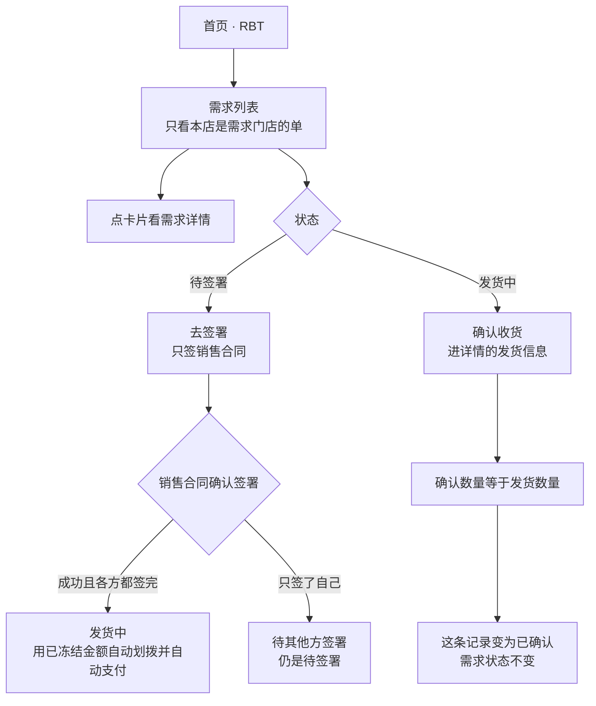

# 门店端查看签署与收货PRD

| 版本号 | 修改人 | 修改时间 | 修改内容 |
| --- | --- | --- | --- |
| V1.0 | 符洪斌 | 20261123 | 新建文档 |
| V1.1 | 符洪斌 | 20261126 | 冻结改到贸易商确认签约，与生成合同同一步；门店确认签署不再触发冻结 |

## 1. 需求描述

### 1.1 从哪进入

门店在丰银宝门店端配合处理需求。原型页面：`RBT/rbt_h5_store.html`。

能登录的是已准入、并且状态为启用的门店。联系人手机号、法人手机号都可以进入对应门店。禁用的门店不出现在可选账号里。准入字段见《门店管理PRD》。

登录后首页「基础工具」里点「RBT」，进入需求列表。页头为「需求列表」。发布需求的按钮不展示。门店端不再发布需求，也不再取消需求。需求由平台代发，见《需求发布流程PRD》。

### 1.2 主流程

门店不接单，不签采购合同，也不把需求从发货中改成门店付款中。发货完成由平台在需求单详情操作。

### 1.3 需求列表

列表不做查询。只展示需求门店等于当前登录门店的需求，其他门店的单不出现。没有数据时展示「暂无需求」。顺序与需求数据一致。

每张卡片按这个顺序展示。没有值时为「—」。金额前加 ¥。

- 商品包名称
- 状态。已完成用完成样式，已作废、已驳回用关闭样式
- 需求单号 · 商品包编码
- 商品金额
- 结算周期
- 结算方式

卡片底部操作：

- 待签署：「去签署」
- 发货中：「确认收货」。点了打开需求详情，并滚到发货信息
- 其他状态没有操作按钮

点卡片空白处打开详情，不滚到发货信息。点按钮不按卡片空白处理。

### 1.4 需求详情

页头为「需求详情」。点返回回到需求列表。需求单已经不在，或不是本店的单，展示「需求单不存在」。

上方仍是卡片上的商品包、状态、单号、商品金额、结算周期、结算方式，不带去签署和确认收货。下面再加：

- 创建时间
- 接单时间：有接单时间才出现

然后是「商品」。没有商品时展示「暂无商品」。每一行：

- 商品名称。没有名称时用商品编码
- 商品编码 · 商品规格。两项都没有时为「—」
- 售卖金额：数量 × 售卖单价。单价无效时为「—」
- ×数量 · 售卖单价。数量不是大于 0 的数时按 1 展示

再下面是「发货信息」，见 1.6。

最后是结算：

- 比例付展示「结算比例」。每个一级渠道一行，右侧是默认比例；POS 如有堂食、外卖、团购，写在渠道名下面。没有比例时展示「暂无结算比例」
- 不是比例付、并且已经选了结算方式时，展示「结算期数」，文案为期数加「期」
- 还没结算方式时，这一块不出现

详情里不能改商品、不能改比例、不能作废。

### 1.5 配合签署

只有待签署的卡片有「去签署」。点进「合同签署」，返回回到需求列表。

页上先写需求单号、需求门店、商品金额、服务费、总金额、结算周期、结算方式。不是比例付时再写结算期数。

下面两张合同都看得到：

- 销售合同：需求门店、接单贸易商。合同编号 XS 加需求单号里的数字
- 采购合同：接单贸易商、冷丰供应链。合同编号 CG 加同一串数字

门店只是销售合同的签署方。待签署、并且本店还没签时，销售合同下有「确认签署」。采购合同没有这个按钮，门店不能代贸易商或冷丰供应链签。

门店确认签署不看余额，也不冻结。冻结发生在贸易商确认签约成功时，与生成销售合同、采购合同同一步，同一需求只冻一次。门店这边用的是已经冻上的金额。

- 签署成功、但还有人没签：提示「签署成功」。页上说明「你已签署，待其他方完成签署。」需求仍是待签署
- 已经签过再点：提示「你已签署」
- 两份合同的各方都签完：用这笔已冻结金额自动划拨并自动支付，需求进入发货中。提示「各方已完成签署，系统已自动划款，需求进入发货中」。不生成交易单，不增加已成交
- 状态已经不是待签署，或对不上签署方：提示「当前不能签署」

一方已签署显示「已签署」加签署时间。还没签显示「待签署」。贸易商名称还没有时显示「待接单」。

### 1.6 确认收货

发货由平台在需求单详情操作。门店只确认已经发出的记录。

列表上点「确认收货」，或在详情的发货信息里点某一条的「确认收货」，都在详情里完成。列表进来时会滚到发货信息。

每条发货记录展示：商品名称、待确认或已确认、发货数量、发货金额、物流单号、发货时间。没有发货记录时展示「暂无发货」。物流单号没有时为「—」。

- 发货中、并且这条还没确认：按钮「确认收货」
- 已经确认：展示「已确认 N 件」，N 是确认数量
- 已经不是发货中、并且这条还没确认：只显示「待确认」，不能再点

点「确认收货」先弹窗。正文：「请确认当前商品已到货或当前服务已完成」，下面是商品名称。

- 「取消」：不记收货
- 「确认收货」：确认数量等于发货数量，不能改少。这条变为已确认，平台不能再删。操作记录记「确认收货 商品名称 ×数量」，变更人是当前登录人；没有登录人姓名时用门店名称。提示「已确认收货」

确认一条不改变需求状态。全部确认后仍是发货中，要等平台点发货完成，才进入门店付款中。

状态不是发货中时提示「当前不能确认收货」。记录不在时提示「发货记录不存在」。已经确认过再点，提示「已经确认过」。

发货中不出现补缴凭证。进入门店付款中或已完成、并且发货金额合计大于商品金额时，发货信息下才出现「补缴凭证」。还没文件时显示「待补缴」，可「上传凭证」，支持图片或 PDF。上传成功提示「补缴凭证已上传」，并展示文件名。未上传不拦住确认收货，也不拦住平台发货完成。

### 1.7 示例

西湖中心生鲜店登录后，需求列表里能看到本店的单，看不到其他门店的单。

XQ00026 是发货中，商品包为汉言开业铺货包，商品金额 ¥50000.00。发货信息有两条：

- 汉言首批铺货，发货数量 1，发货金额 ¥22000.00，物流单号 SF1029384756，已由喻巧确认收货 1 件
- 门店设备辅料包，发货数量 1，发货金额 ¥16000.00，还没有物流单号，状态待确认，可以点确认收货

确认后这条变为已确认 1 件，XQ00026 仍是发货中。发货中不出现补缴凭证。两条合计 38000，也没有超过商品金额 50000。
