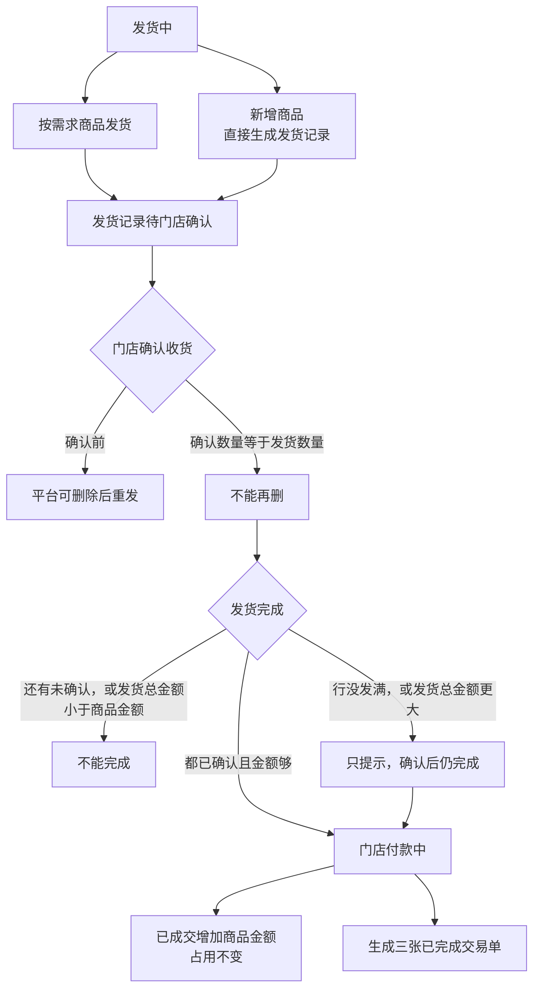

# 需求单发货PRD

| 版本号 | 修改人 | 修改时间 | 修改内容 |
| --- | --- | --- | --- |
| V1.0 | 符洪斌 | 20261123 | 新建文档 |

## 1. 需求描述

### 1.1 发货从哪进入

各方把销售合同、采购合同都签完后，用贸易商确认签署时冻结的金额自动划拨并自动支付，需求进入发货中。这时不生成交易单，不增加已成交。发货中仍按商品金额占用额度，并且不能作废。

发货在需求单管理的需求详情里操作。原型页面：`RBT/rbt_demand.html`。详情怎么打开见《需求发布流程PRD》。门店确认收货在丰银宝门店端，见《门店端查看签署与收货PRD》。发货完成后生成的交易单，在交易单列表查看，见 1.8。

发货中，发货信息标题下有「新增商品」「发货」「发货完成」。这三处以及删除发货记录的变更人记为「王丽」。还没有发货记录时，表内文案是「还没有发货记录」。

### 1.2 发货主流程

发货不改商品金额、服务费、总金额和占用额度。新增的商品不写进需求商品明细。

### 1.3 按需求商品发货

点「发货」打开「发货确认」。说明：勾选本次要发的商品，填写本次发货数量和物流单号。本次发货金额按本次发货数量 × 售卖单价自动计算。确认后按勾选行各生成一条发货记录。

可「全选」「反全选」。列：勾选、商品编码、商品名称、需求数量、售卖单价、售卖金额、已发货数量、已发货金额、本次发货数量、本次发货金额、物流单号。物流单号可不填。没有商品时展示「暂无商品」。改本次数量后，本次发货金额跟着重算。剩余没发完时，本次数量默认带出剩余数量；已经发满或发超时，默认带出 1。

- 没勾选就确认：提示「请勾选要发货的商品」，不保存
- 数量不是 1 到 999 的整数：提示「发货数量须为 1 到 999 的整数」
- 不是发货中：提示「当前不是发货中，不能发货」
- 勾的不是本单商品明细里的商品：提示「请选择需求单上的商品」

同一商品可以分多次发。累计数量超过该行需求数量，提示「累计发货数量超过该商品的需求数量」。累计金额超过该行售卖金额，提示「累计发货金额超过该商品的售卖金额」。两条可以一起出现。提示之后这次发货仍然保存，句尾加上「本次发货已保存。」

每条记录编号为 FH、需求单号里的数字、再加序号，例如 FH00026-1。写入商品、发货数量、发货金额、物流单号、发货时间。确认状态为未确认，确认数量为 0。操作记录记「发货 商品名称 ×数量 ¥金额」。

详情里的发货信息列：商品、商品编码、发货数量、发货金额、物流单号、确认数量、操作。未确认的确认数量为「—」。发货中且门店还没确认时，操作是「删除」。

点「删除」先确认「删除这条发货记录？」。成功后操作记录记「删除发货记录 商品名称 ×数量」。门店已确认收货时提示「门店已确认收货，不能删除」。记录不在时提示「发货记录不存在」。

### 1.4 新增商品

点「新增商品」打开「新增商品」。说明：只列出不在需求商品明细里的商品。确认后直接生成发货记录，不加入商品明细。可填写物流单号。

可按商品编码、商品名称包含查询，商品类目精确查询。「查询」过滤，「重置」清空条件。没有可加的商品时展示「暂无数据」。

列：勾选、商品图片、商品编码、商品名称、商品条码、商品单位、商品规格、采购价、商品数量、售卖单价、售卖金额、物流单号。数量默认 1，售卖单价带出选品库价格。售卖金额 = 数量 × 售卖单价。确认按钮文案是「添加」。

- 没勾选：提示「请勾选要新增的商品」
- 该商品已在需求明细里：提示「该商品已在需求单中，请用发货填写」
- 数量不是 1 到 999 的整数：提示「商品数量须为 1 到 999 的整数」
- 售卖单价不大于 0：提示「请填写售卖单价」

生成的发货记录同样等门店确认。不改商品金额、服务费、总金额和占用额度。操作记录记「新增发货商品 商品名称 ×数量 ¥金额」。

### 1.5 门店确认收货

门店在发货中按发货记录确认。确认数量等于发货数量，不能改少。确认后这条不能再删。确认一条不改变需求状态，全部确认后仍是发货中。

平台详情里，已确认的记录确认数量展示实际件数，操作变为「—」。还没确认、并且已经不是发货中时，也不能再删。

门店端的弹窗、提示和补缴入口见《门店端查看签署与收货PRD》。

### 1.6 发货完成

点「发货完成」打开「发货完成」。下面两条会拦住，按钮变成「关闭」，没有取消：

- 还有发货记录没被门店确认：还有 N 条发货记录待门店确认
- 已发货金额小于商品金额：发货总金额小于需求单商品金额

下面这些只提示，确定后仍进入门店付款中：

- 某一行发货数量未达到需求数量：商品名称 发货数量未达到需求数量
- 某一行发货金额未达到售卖金额：商品名称 发货金额未达到售卖金额
- 已发货金额大于商品金额：发货金额超过需求单商品金额

新增商品没有需求行，不参与「没发满」这句对比。它的金额会计入已发货金额。

没有要拦住、也没有要提示时，正文是「商品已发完，门店已确认。确认后进入门店付款中，并按发货记录生成交易单。」有提示时，正文先说这些只是提示，确定后仍进入门店付款中。

确认后：

- 状态变为门店付款中
- 操作记录记「确认发货完成，按发货记录生成交易单，状态：发货中 → 门店付款中」，变更人是「王丽」
- 需求门店已成交增加这张单的商品金额。不按总金额，也不按实发。已成交不扣可用额度。占用不变，要等到已完成才释放
- 按发货记录生成上游交易、下游交易、冷丰服务费，三张状态都是已完成。同一张需求只生成一套。另记「生成上游交易单、下游交易单、冷丰服务费单」
- 不生成采购单、销售单，也不下发 WMS 入库单

没有发货记录的历史单，仍按需求商品明细生成交易单。有发货记录时，商品数量和金额取各条发货记录按商品合计。服务费只按需求单商品金额计算，多发不加大：下游多一行商品金额 ×（贸易商结算系数 − 1），冷丰服务费单只有商品金额 ×（门店结算系数 − 贸易商结算系数）。

| 交易单 | 付款方 | 收款方 | 收货方 |
| --- | --- | --- | --- |
| 上游交易 | 接单贸易商 | 冷丰供应链 | 需求门店 |
| 下游交易 | 需求门店 | 接单贸易商 | 需求门店 |
| 冷丰服务费 | 需求门店 | 冷丰供应链 | 需求门店 |

进入门店付款中或已完成之后，已发货金额大于商品金额时，发货信息下面才出现补缴凭证。展示超出金额。还没文件时为「待补缴」，文案「还没有凭证，可上传图片或 PDF。」可上传或重新上传图片、PDF。未上传不拦住发货完成。发货中不显示这块。操作记录记「上传补缴凭证 文件名」。

当前没有从门店付款中进入已完成的操作。进入已完成才会释放占用，已成交不减少。

### 1.7 示例

XQ00026 是西湖中心生鲜店的发货中需求，商品包为汉言开业铺货包，商品金额 50000.00，总金额 80000.00。明细三行都是数量 1：汉言首批铺货 22000.00、门店设备辅料包 16000.00、门店拉新人力 12000.00。

已经有两条发货记录：

- FH00026-1 汉言首批铺货，数量 1，金额 22000.00，物流单号 SF1029384756，喻巧已确认 1 件，不能删除
- FH00026-2 门店设备辅料包，数量 1，金额 16000.00，还没有物流单号，待确认，可以删除后重发

这时点发货完成会被拦住：还有 1 条发货记录待门店确认，并且已发货金额 38000.00 小于商品金额 50000.00。门店拉新人力还没发，确认完成后也会提示这一行发货数量和发货金额未达到需求。已发货金额没有超过商品金额，发货中也不出现补缴凭证。

### 1.8 交易单列表

菜单「交易单」。原型页面：`RBT/rbt_trade.html`。页签为「交易单」。这里只查看，不能新建、作废或改状态。

进入门店付款中或已完成、并且已经有接单贸易商的需求，才会出现交易单。同一张需求一套三张，单号前缀 JY，后接 5 位数字，按当时已有最大号顺延。列表不展示「上游交易」「下游交易」「冷丰服务费」这几个类型名，用付款方、收款方和明细区分。按创建时间从新到旧排，时间相同再按单号从大到小。

查询条件按以下顺序。都是包含匹配，不区分大小写。条件可只填一部分。

- 交易单号
- 来源需求单
- 付款方
- 收款方
- 收货方：匹配收货方，也匹配需求门店名称
- 「查询」按当前条件过滤，并回到第 1 页
- 「重置」清空条件，恢复全部记录

默认每页 20 条。没有命中时展示空列表。

列按以下顺序。没有值时为「—」。总金额前加 ¥。

- 交易单号：链接，打开详情，见 1.9
- 来源需求单
- 付款方
- 收款方
- 收货方
- 总金额
- 状态：已完成为绿色。这里生成出来的三张都是已完成
- 创建人
- 创建时间

操作列每行一个「详情」，打开同一份详情。

### 1.9 交易单详情

点交易单号或「详情」，在当前页打开右侧抽屉，标题「交易单详情」。点关闭、点遮罩或按 Esc 关闭。

头部是交易单号和状态。已完成为绿色。下面两行是「来源需求单：需求单号」「收货方：收货方」。

基础信息按这个顺序：单号、状态、来源需求单、付款方、收款方、收货方、实际发货方、总金额、创建人、创建时间。总金额带 ¥ 和千分位，两位小数。来源需求单可点，点了关掉交易单详情，打开该需求单详情。需求单已经不在时，点击没有反应。

实际发货方：上游交易、下游交易都是冷丰供应链。冷丰服务费没有发货方，显示「—」。

商品明细列：商品编码、商品名称、商品售价、数量、金额。没有明细时展示「暂无商品」。货款行按实发；没有发货记录的历史单按需求商品。下游在货款后面加一行，名称是「服务费」，金额为需求单商品金额 ×（贸易商结算系数 − 1）。冷丰服务费只有这一行服务费，金额为需求单商品金额 ×（门店结算系数 − 贸易商结算系数）。多发不加大这两笔服务费。服务费这一行没有商品编码，显示「—」。

