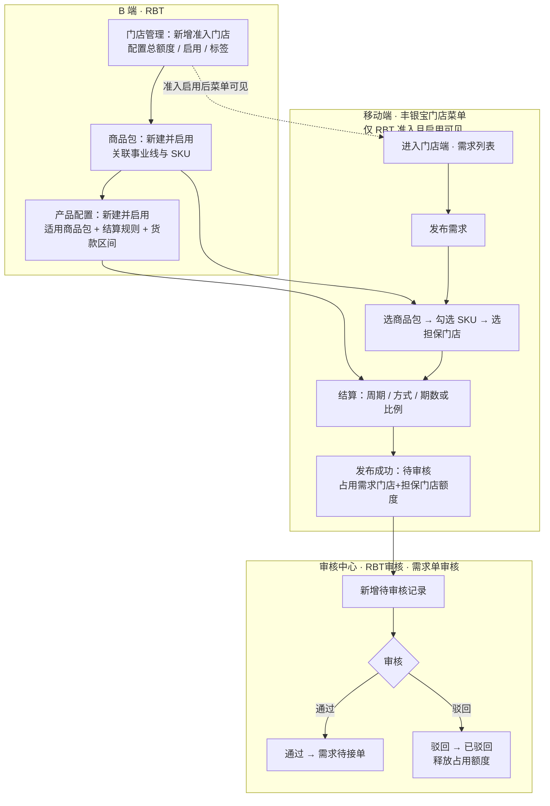
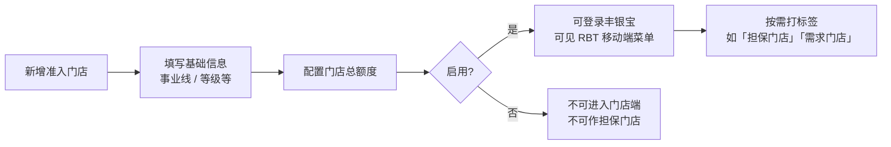
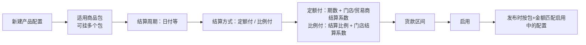
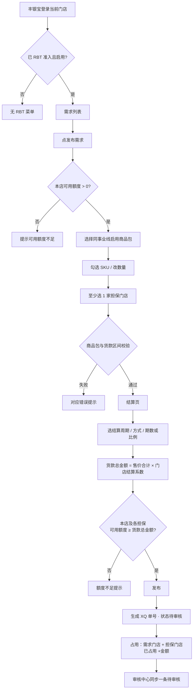
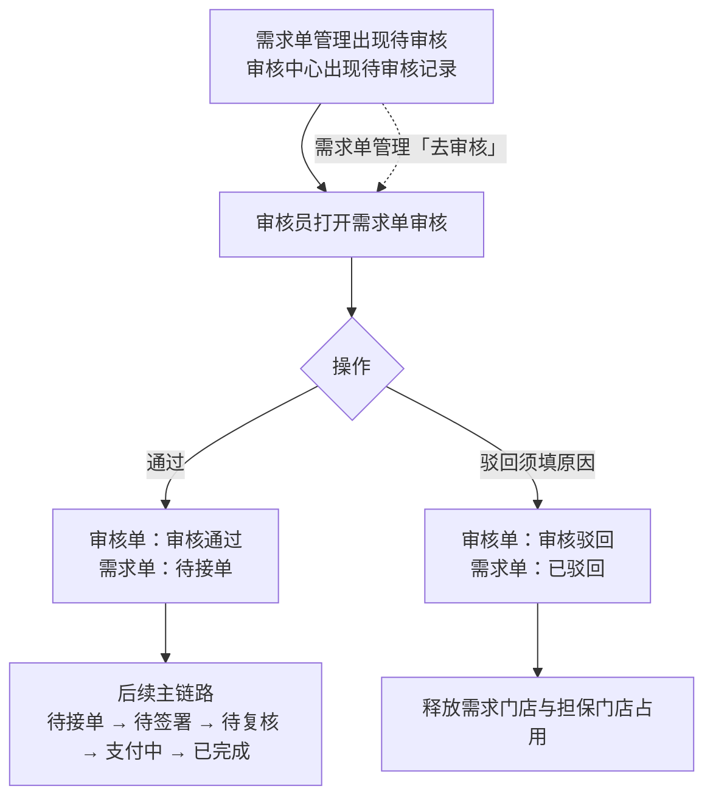

# 门店端业务流程图

> 依据当前原型逻辑整理：门店准入 → 新建商品包 → 关联产品配置 → 移动端发布需求 → 需求审核。  
> 日期：2026-11-10

## 1. 端到端总览

## 2. 分阶段说明

### 2.1 门店准入（B 端 · 门店管理）

要点：

* 可用额度 = 门店总额度 − 已占用（已成交不扣可用）
* 担保候选：启用 + 「担保门店」标签 + 非本店
* 一家担保可同时担保多家，以可用额度为限

### 2.2 新建商品包（B 端 · 商品包）

### 2.3 关联产品配置（B 端 · 产品配置）

匹配规则（发布校验）：

* 商品包已关联至少一条启用中的产品配置，否则提示「商品未关联分期配置」
* 所选 SKU 售价合计落在货款区间内，否则提示「售价不在分期配置的货款区间内」

### 2.4 门店进入移动端发布需求

可取消：仅「待审核」「待接单」；取消后释放占用。

### 2.5 需求审核（审核中心）

快捷入口：需求单管理在「待审核」「待复核」显示「去审核」，跳转审核页并带需求单号；审核状态不默认带值。

## 3. 状态与额度简表

| 节点 | 需求状态 | 审核单状态 | 额度 |
| --- | --- | --- | --- |
| 发布成功 | 待审核 | 待审核 | 需求门店+担保门店已占用 +货款总金额 |
| 审核通过 | 待接单 | 审核通过 | 占用不变 |
| 审核驳回 | 已驳回 | 审核驳回 | 释放占用 |
| 门店取消（待审核/待接单） | 已取消 | 已取消 | 释放占用 |
| 待签署及之后 | 主链路继续 | （首审已通过） | 至完成后释放占用；复核通过另计已成交 |

## 4. 相关原型与 PRD

| 阶段 | 原型 | PRD |
| --- | --- | --- |
| 门店准入 | `RBT/rbt_admit_store.html` | `门店管理PRD.md` |
| 商品包 | `RBT/rbt_product_package.html` | `商品包PRD.md` |
| 产品配置 | `RBT/rbt_installment.html` | `产品配置PRD.md` |
| 移动端发布 | `RBT/rbt_h5_store.html` | `门店端H5PRD.md` |
| 需求台账 | `RBT/rbt_demand.html` | `需求单管理PRD.md` |
| 需求审核 | `MDM/mdm_audit_rbt_demand.html` | `需求单审核PRD.md` |
