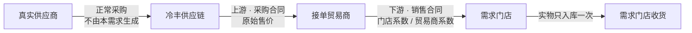
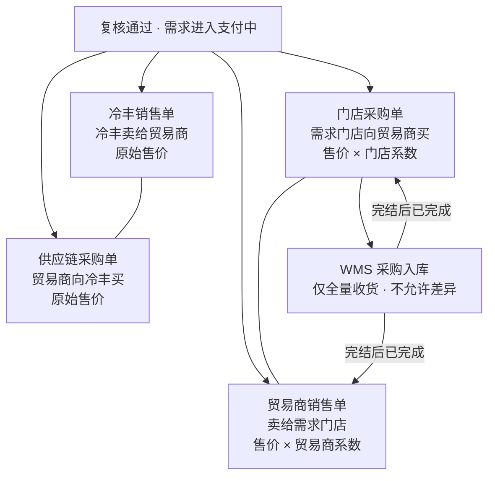
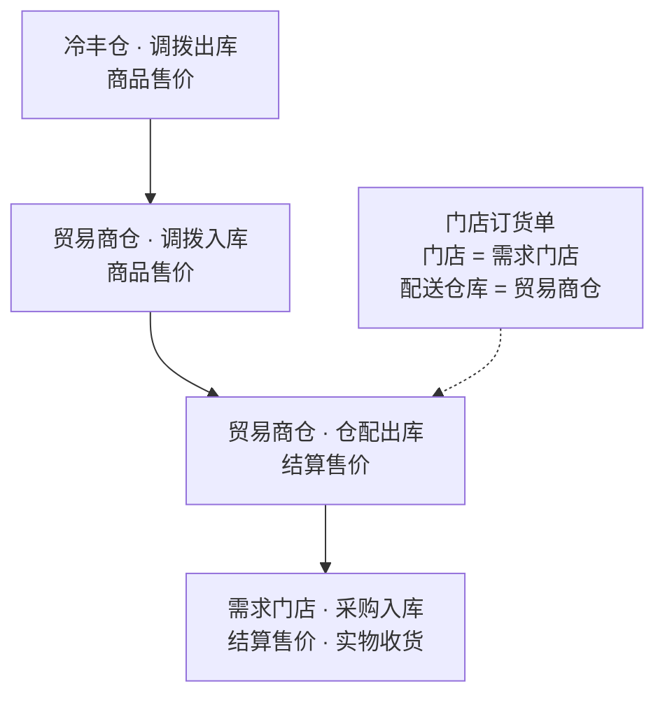
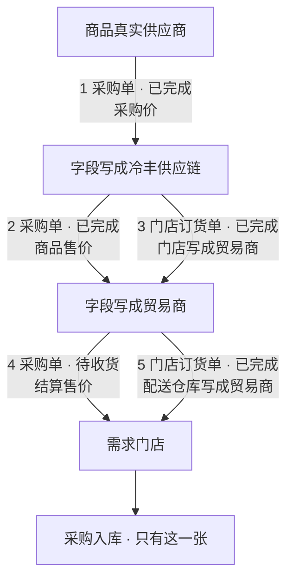

# 需求复核通过后的单据方案

整理日期：2026-11-13

用途：复核通过后要产生哪些单据、落在哪里。原型已按方案一落地，并补上冷丰销售单，使上下游两段买卖都有成对的采购单和销售单。方案二、方案三仍作对照。

## 1. 要定的事

需求单复核通过、进入「支付中」之后，同一笔货经过两段买卖：

| 段 | 合同 | 买方 | 卖方 | 价格 |
| --- | --- | --- | --- | --- |
| 上游 | 采购合同 | 接单贸易商 | 冷丰供应链 | 原始售价 |
| 下游 | 销售合同 | 需求门店 | 接单贸易商 | 门店采购按门店系数，贸易商销售按贸易商系数 |

上游冷丰销售、供应链采购的商品售价用原始售价，金额等于需求商品金额。门店采购的商品售价 = 原始售价 × 门店结算系数；贸易商销售的商品售价 = 原始售价 × 贸易商结算系数。系数取该需求产品配置，单价四舍五入到分。行金额 = 商品售价 × 数量，单据金额为各行金额合计。需求单总金额仍按商品金额 × 门店结算系数，用于占用额度和服务费。页面只展示商品售价，不展示系数。

三个方案都遵守：

* 一张需求生成一套单据，不进门店订货汇总，也不进采购需求汇总，避免和零售、代采并单。
* 实物只在需求门店入库一次。
* 单据上的货款是买卖价格；需求单的分期支付是另一笔账，不要各记一次应付。
* 冷丰向商品真实供应商的采购，留在正常采购里，不由这张需求自动再完成一张采购单。

## 2. 方案一：单独建采购单和销售单（当前原型）

在 RBT「需求单管理」下新增采购单、销售单两个列表，不使用现有「冷丰采购」里的采购单和门店订货单。

复核通过后生成：

| 单据 | 买方 | 卖方 | 付款方 | 收货方 | 实际发货方 | 价格 | 落点 | 状态 |
| --- | --- | --- | --- | --- | --- | --- | --- | --- |
| 冷丰销售单 | 接单贸易商 | 冷丰供应链 | 接单贸易商 | 需求门店 | 冷丰供应链 | 原始售价 | RBT 销售单 | 已完成 |
| 供应链采购单 | 接单贸易商 | 冷丰供应链 | 接单贸易商 | 需求门店 | 冷丰供应链 | 原始售价 | RBT 采购单 | 已完成 |
| 贸易商销售单 | 需求门店 | 接单贸易商 | 需求门店 | 需求门店 | 冷丰供应链 | 售价 × 贸易商结算系数 | RBT 销售单 | 待收货 |
| 门店采购单 | 需求门店 | 接单贸易商 | 需求门店 | 需求门店 | 冷丰供应链 | 售价 × 门店结算系数 | RBT 采购单 | 待收货 |

买方卖方管账，收货方和实际发货方管货。购销单不展示配送方式、计价、门店结算系数、成交单价，明细只展示按上表算出的商品售价。冷丰销售单和供应链采购单是同一笔上游买卖，明细相同，互相记下对方单号。门店采购单和贸易商销售单是同一笔下游买卖，互相记下对方单号，但商品售价分别按门店系数、贸易商系数计算，两张单的单价和金额不同。四张单都带来源需求单号。

门店向贸易商的采购单生成后，同步下发 WMS，只生成一张采购入库单：入库类型=采购入库，业务类型=采购直送，来源单号=门店采购单号，关联单号=需求单号，收货地=需求门店，供货方=接单贸易商。该入库单不允许差异收货，只允许按采购数量全量收货。入库单完结后，回写门店采购单和对应的贸易商销售单为已完成。中间段没有实物收货，所以冷丰销售、供应链采购生成后即为已完成。冷丰、贸易商不再各做一张出入库。购销单不展示入库单号，RBT 不打开入库单详情。

原型页面：`RBT/rbt_sales.html`、`RBT/rbt_purchase.html`。详见《销售单PRD》《采购单PRD》。

### 优点

* 上下游卖方都有自己的销售单，买卖关系清楚，不把贸易商写成门店或仓库。
* 不改仓库主数据，也不往现有采购单、门店订货单里塞单据。
* 两段价格可以分开写，不影响零售和代采。

### 问题

* 冷丰没有销售出库，贸易商没有入库和出库。中间段只有购销单据，没有库存凭证。
* 采购单、销售单是新单据。财务和采购如果只认现有采购单、门店订货单，台账对不上，要另外培训和取数。
* 列表、生成、与入库单的回写都要新做。

## 3. 方案二：建仓

给冷丰供应链、接单贸易商各建一个仓库。需求门店仍是门店，不把组织名称塞进仓库字段。

复核通过后生成：

| 单据 | 含义 | 价格 | 库存 |
| --- | --- | --- | --- |
| 冷丰仓调拨出库 | 冷丰卖给贸易商 | 商品售价 | 冷丰仓减少 |
| 贸易商仓调拨入库 | 贸易商向冷丰收货 | 商品售价 | 贸易商仓增加 |
| 门店订货单 | 门店=需求门店，配送仓库=贸易商仓 | 结算售价 | 不单独记库存 |
| 贸易商仓配出库 | 贸易商卖给需求门店 | 结算售价 | 贸易商仓减少 |
| 门店采购入库 | 需求门店收货 | 结算售价 | 需求门店增加 |

上游是两个仓库之间的调拨，不走现有「向供应商采购」。下游复用门店订货单、仓配出库和采购入库。贸易商仓数量一进一出，库存不留下。实物收货只认需求门店的入库单。

生成仍按这一张需求直接落单，不走截单，也不走采购需求汇总。

### 优点

* 每一段都有出有入，卖方出库、买方入库，货权和库存一致。
* 下游能复用现有门店订货、出库、入库的状态和收货操作。
* 贸易商、冷丰是仓库，不会冒充门店或供应商。
* 不会给真实供应商自动补一张已完成采购单。

### 问题

* 要维护冷丰仓、贸易商仓。贸易商仓只是过账，容易被当成真有库存。
* 上游不能复用现有采购单。现有采购单的卖方是供应商，不会给发货仓做出库。
* 门店订货单若被订货汇总扫进去，会和零售、代采并成一张采购单，必须用来源把这批单排除在外。
* 调拨单通常不承载买卖价格，要约定这两张调拨按商品售价记账。

## 4. 方案三：不建仓

不建仓库。复核通过后，往现有采购单、门店订货单里写五张单。冷丰供应链、贸易商只出现在收货地、供应商、门店、配送仓库这些字段上，不进仓库主数据，也不进门店档案。

| 单 | 字段 | 价格 | 复核后 |
| --- | --- | --- | --- |
| 1 采购单 | 收货地=冷丰供应链，供应商=商品档案上的供应商 | 采购价/基础单位 | 直接已完成，不入库 |
| 2 采购单 | 收货地=贸易商，供应商=冷丰供应链 | 商品售价 | 直接已完成，不入库 |
| 3 门店订货单 | 门店=贸易商，配送仓库=冷丰供应链 | 商品售价 | 直接已完成，不出库 |
| 4 采购单 | 收货地=需求门店，供应商=贸易商 | 结算售价 | 待收货，下发门店采购入库 |
| 5 门店订货单 | 门店=需求门店，配送仓库=贸易商 | 结算售价 | 直接已完成，不出库 |

2 和 3 表示冷丰卖给贸易商。4 和 5 表示贸易商卖给需求门店。1 表示冷丰向真实供应商记成本。来源记「需求复核生成」。1、2、3、5 不通知 WMS。只有 4 生成采购入库，收货进度只看 4。

### 优点

* 不建仓库，单据落在采购、订货同事已经在用的列表里。
* 新页面少，主要是复核通过后的生成规则，以及禁止这些单进入汇总。
* 实物入库仍只有需求门店一张，和直送一致。

### 问题

* 采购单和门店订货单都是买方要货。2 和 3 都是贸易商向冷丰要货，4 和 5 都是门店向贸易商要货。冷丰、贸易商没有自己的销售单或出库单，应收要拿对方的采购单反推。
* 1、2 直接已完成，单据表示冷丰、贸易商已经收货，仓库里没有这批货。对账或争议时，账面和实物不一致。
* 1 会让冷丰对真实供应商多出一笔已完成采购。这张需求和供应商之间没有合同；商品若已在正常采购里买过，成本会再记一次。
* 3、5 把贸易商写成门店、把冷丰和贸易商写成配送仓库。门店额度和订货汇总若认「门店」字段，会把贸易商当成门店。
* 4 按结算售价形成对贸易商的采购应付，需求单的分期仍在付同一笔钱，可能各记一次。

## 5. 对照

|  | 方案一 单独建购销单 | 方案二 建仓 | 方案三 不建仓 |
| --- | --- | --- | --- |
| 单据落点 | RBT 新列表；入库用现有入库单 | 现有调拨、门店订货、出库、入库 | 现有采购单、门店订货单、入库单 |
| 卖方有没有自己的单 | 两段都有销售单；冷丰没有出库 | 两段都有出库 | 没有，只有对方的采购/订货 |
| 中间段是否显示已收货 | 中间段不做出入库 | 贸易商仓一进一出，数量不留 | 1、2 直接已完成，但没有入库 |
| 是否改主数据 | 不建仓 | 新建冷丰仓、贸易商仓 | 不建仓，但字段里写入组织和贸易商 |
| 对现有订货/采购的干扰 | 小，不进这两类列表 | 中，订货单必须排除在汇总之外 | 大，列表里会出现非门店、非仓库 |
| 真实供应商 | 不自动生成采购 | 不自动生成采购 | 自动生成一张已完成采购单 |
| 开发量 | 新列表和新单据 | 建仓 + 调拨生成 + 排除汇总 | 生成规则 + 排除汇总 + 跳过 WMS |

## 6. 会上建议按这个顺序问

1. 财务认哪张单做应收、应付：新销售单、出库单，还是对方的采购单。
2. 中间的冷丰、贸易商要不要留下库存凭证。不要的话，方案一更干净；要的话，用方案二的一进一出，不用方案三的直接完成。
3. 真实供应商的成本是否允许由需求复核自动完成一张采购单。三个方案里只有方案三会这样做。
4. 结算售价进采购应付之后，分期还款如何避免同一笔钱记两次。这一点三个方案都要单独约定。

原型按方案一落地，并补冷丰销售单。中间段没有库存凭证；若后续要货权与库存一致，再按方案二给冷丰、贸易商建仓做出入库。
