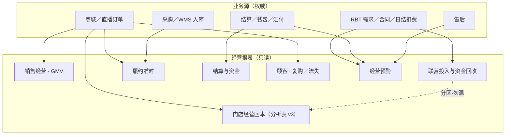
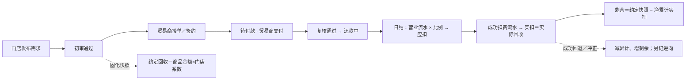
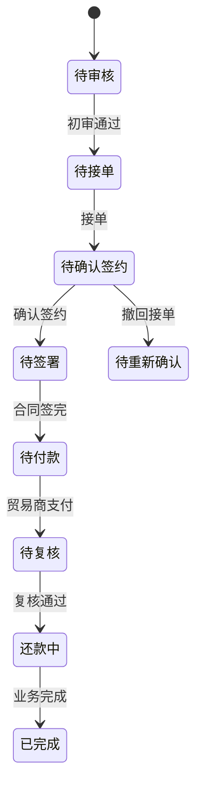
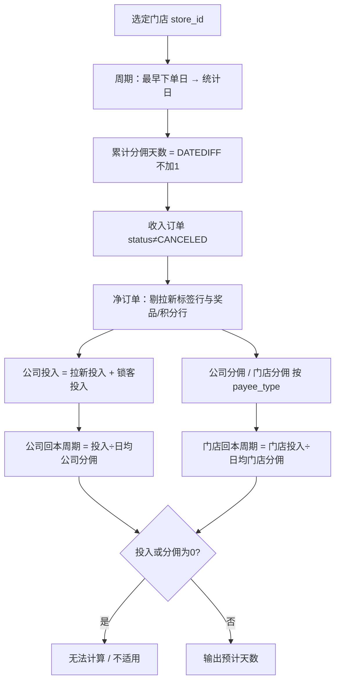
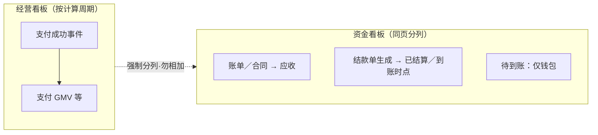
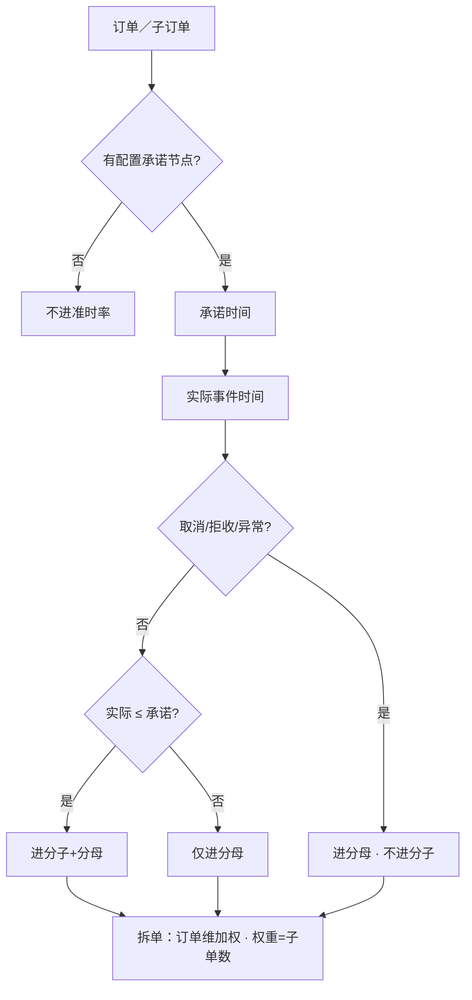
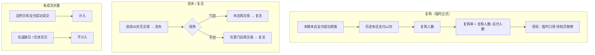
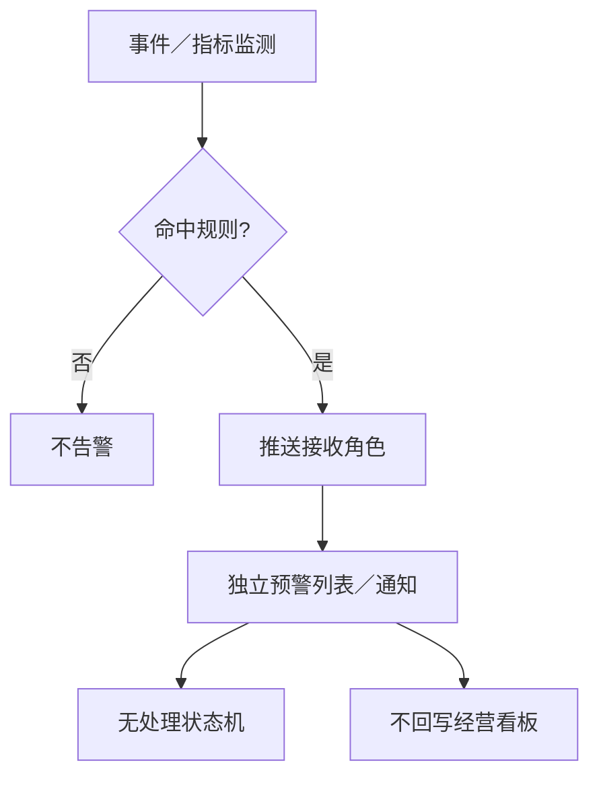
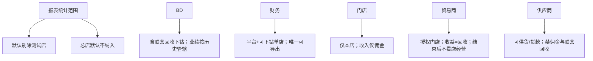

# 经营报表体系 · 已确认口径复核包

| 字段 | 内容 |
|---|---|
| 文档版本 | v1.1 |
| 日期 | 2026-11-20 |
| 用途 | 供业务／产品重新复核：流程图 + 已拍板需求逻辑 |
| 权威来源 | [03-待确认规则清单](03-待确认规则清单.md) v1.8 · [02-指标字典骨架](02-指标字典骨架.md) · 知页 RBT PRD |
| 范围说明 | 只汇总**已确认／部分确认中已拍板段**；P3b 字段名、P4 SLA 未纳入正式逻辑 |
| 约束 | 报表只读；不为交易另造规则；不以近似指标顶替暂缓项 |

---

## 0. 怎么用本文复核

1. 先看 **§1 总览图**：报表读哪些业务事实、两套「回本」如何分区。  
2. 按主题打开 **§2～§8**：每节 = **流程图** + **需求逻辑表**（编号对齐 Q-xxx）。  
3. 发现与业务不符：在对应 Q 编号下改口径，回写 03／02，勿只改本文。  
4. 文末 **§9 仍未定** 列出本期不做／待字段表项，避免误当成已上线规则。

---

## 1. 总览：业务事实 → 经营报表

**总原则**

| # | 逻辑 |
|---|---|
| 1 | 报表**不改**下单、支付、履约、结算、扣费流程，只追溯已有事实 |
| 2 | **联营资金回收** ≠ **门店经营回本**（命名分区、公式不同） |
| 3 | 经营金额与资金金额同看板时**强制分列**，并按**计算周期**切换 |
| 4 | 默认统计**剔除测试门店**；**总店默认不纳入** |
| 5 | 仅财务可导出；预警一期**不回写**经营看板 |

---

## 2. RBT 联营：投入 · 约定回收 · 日结扣费 · 剩余

### 2.1 业务流程图

### 2.2 需求逻辑（联营／回收）

| 编号 | 主题 | 已确认逻辑（复核点） |
|---|---|---|
| Q-JV-01 | 需求金额 | 按**提交成功时间**；不可代 GMV；分列商品金额／服务费／总金额；本期**不假设含税、不含运费** |
| Q-JV-02 | 贸易商应收 | ＝商品金额×贸易商结算系数；≠投入／结算／到账；系数≠日结扣费比例 |
| Q-JV-03 | 实际投入 | 按主体实际发生；贸易商上游采购按**原始售价**；**禁止**用贸易商应收顶投入 |
| Q-JV-04 | 约定回收 | ＝**门店应收**＝商品金额×门店结算系数；**审核通过后**快照；改比例不盖历史 |
| Q-JV-05 | 应扣 | 日结＋比例付；营业流水×比例；多单分别算后合计＞100%则**归一到 100%**；累计实扣以约定快照**封顶**；退款对基数影响二期 |
| Q-JV-06 | 实扣 | 仅成功流水；失败不计；部分成功只计成功部分 |
| Q-JV-07 | 实际回收 | **实扣＝实际回收**，同口径不重复累计 |
| Q-JV-08 | 剩余 | 约定快照 − 净累计实扣；减免／坏账须有成功流水才减 |
| Q-JV-11 | 回退／冲正 | 仅成功流水；减累计、增剩余；另记逆向；成功日记账；历史不回溯 |
| Q-JV-12 / TR-01 | 结束后 | 贸易商不再看该笔门店经营；结算明细**不限期可看、不导出**；**不保留**经营快照 |

---

## 3. 门店经营回本（分析表 v3）— 与联营分区

### 3.1 测算流程图

### 3.2 需求逻辑

| 编号 | 主题 | 已确认逻辑（复核点） |
|---|---|---|
| Q-JV-10 | 分区 | 「联营资金回收」与「门店经营回本」**分名分区**；公式不同，禁止共用「回本状态」 |
| Q-JV-09 | 预计周期 | **跟《门店回本分析》v3** 测算门店／公司回本周期；非固定还款期；随看板计算周期刷新 |
| — | 拉新／锁客 | 拉新：交易成功 + `SALE` + 标签 `PULL_NEW_PRODUCT`；锁客：福袋／签到／观看奖品行成本；积分兑换不算 |
| — | 分佣 | 公司：`payee_type ∉ (STORE,MERCHANT,SUPPLIER)`；门店：`∈ (STORE,MERCHANT)` |
| — | 暂缓 | 门店投入录入来源；门店端／贸易商端可见权限 |

---

## 4. 成交规模 · 结算资金 · 看板周期

### 4.1 经营 vs 资金

### 4.2 需求逻辑

| 编号 | 主题 | 已确认逻辑（复核点） |
|---|---|---|
| Q-SET-06 | 同看板 | 按**今日／昨日／近7天／近30天／自定义**计算周期设计（近7／30天截至昨日完整自然日）；经营与资金分列；周期内经营默认支付成功、资金默认结款单生成 |
| Q-SET-01～05 | 结算链 | 应收认账单／合同；结算用语与门店佣金统一；待到账仅钱包；到账≈结款→汇付；差异含手续费／未到账／冲正／调账（字段细节→P3b） |
| Q-REV-02 | 门店收入 | **仅佣金**，无非佣金收入 |
| Q-REV-04 | 贸易商 | 收益＝回收；另示应收；默认近 **30** 天 |
| Q-DATA-02 | 一期渠道范围 | 仅冷丰已有业务：平台零售（商城／直播）、代采进货、佣金／平台分配所得 |
| Q-DATA-05 | 频率 | 专题近实时；**结算资金每日统一结算**；钱包实时 |

---

## 5. 履约与准时率

### 5.1 流程图

### 5.2 需求逻辑

| 编号 | 主题 | 已确认逻辑（复核点） |
|---|---|---|
| Q-FUL-01 | 单位 | 发货／到店／签收／核销一期均按**子订单** |
| Q-FUL-02 | 承诺节点 | 零售自提／快递、直播、代采、RBT 入库等对照表（见 03·B2） |
| Q-FUL-03 | 准时 | 实际≤承诺；取消／拒收／异常进分母不进分子 |
| Q-FUL-04 | 核销 | 门店核销数＝公司自提核销量，同一时间口径 |
| Q-FUL-05 | 拆单 | 订单维加权；权重＝子单数；缺权＝1 |

---

## 6. 顾客：复购 · 流失 · 有成交天数

### 6.1 流程图

### 6.2 需求逻辑

| 编号 | 主题 | 已确认逻辑（复核点） |
|---|---|---|
| Q-CUST-01 | 复购 | 临时正式＝门店原型；须标注待知页替换 |
| Q-CUST-02 | 流失 | 30 天；门店／平台复活口径**分列** |
| Q-CUST-03 | 有成交天数 | 门店与贸易商共用；不计仅退款／仅进货日 |

---

## 7. 经营预警

### 7.1 流程图

### 7.2 需求逻辑（一期）

| 编号 | 规则 | 默认阈值／说明 |
|---|---|---|
| Q-AL-01 | GMV 下降 | ≥**20%**；连续 **2** 个同粒度周期（周／月／年） |
| Q-AL-02 | 无成交 | 连续 ≥**7** 天（周窗）／≥**15** 天（月窗）；停业闭店一期不做（无停用状态） |
| Q-AL-03 | 回收中断 | 仅中断 **7／14／30** 天；三档同角色；不做「变慢」 |
| Q-AL-04 | 应扣−实扣 | ≥**10%** 或 ≥**¥1,000** |
| Q-AL-05 | 应收−到账 | ≥**5%** 或逾期 ≥**3** 天 |
| Q-AL-06／07 | 库存／履约异常 | **一期不进入** |
| Q-AL-08 | 售后集中 | 滚动 **7** 天；≥**20** 单或 ≥**¥5,000**；一期仅门店 |
| Q-AL-09 | 处理／回写 | 有接收角色；无处理状态；不回写看板 |

---

## 8. 组织 · 角色 · 权限（要点）

| 编号 | 已确认逻辑（复核点） |
|---|---|
| Q-ORG-02 | 无门店组织归属变更流程；不实现历史重刷；BD 变更≠组织归属 |
| Q-ORG-03 | BD 历史业绩按**历史关系** |
| Q-ROLE-05 | **仅财务**可导出 |
| Q-TR-02 | 接单前／后菜单差异冻结为权限配置 |

---

## 9. 本期明确不做／仍待（勿当成已上线）

| 类型 | 内容 |
|---|---|
| 一期不做 | 库存不足预警；履约异常预警；停业闭店预警；预警回写看板；预警处理状态；经营快照（贸易商结束后） |
| 二期／暂缓 | 应扣退款基数；联营侧「剩余÷日均实扣」另模型（本期以回本表为准） |
| 实现缺口（P3b） | 落库字段名、结款单／钱包状态码、售后金额对照、测试店判定字段、BD 存档字段等；业务规则已定，待数据／研发补字段映射 |
| P4 | 实时／近实时 SLA、角色菜单字段细表、导出水印审计 |

---

## 10. 复核签批（可打印）

| 主题 | 复核人 | 结论（同意／修改点） | 日期 |
|---|---|---|---|
| §2 联营投入回收 |  |  |  |
| §3 门店经营回本 |  |  |  |
| §4 经营／资金看板 |  |  |  |
| §5 履约准时 |  |  |  |
| §6 顾客复购流失 |  |  |  |
| §7 预警 |  |  |  |
| §8 组织角色 |  |  |  |

---

## 修订

| 版本 | 日期 | 说明 |
|---|---|---|
| v1.1 | 2026-11-20 | 一期范围：撤出 POS；Q-DATA-02 改一期渠道范围；计算周期对齐五个日期选项 |
| v1.0 | 2026-11-16 | 首版：基于 03 v1.8 已确认口径整理流程图与需求逻辑，供复核 |
