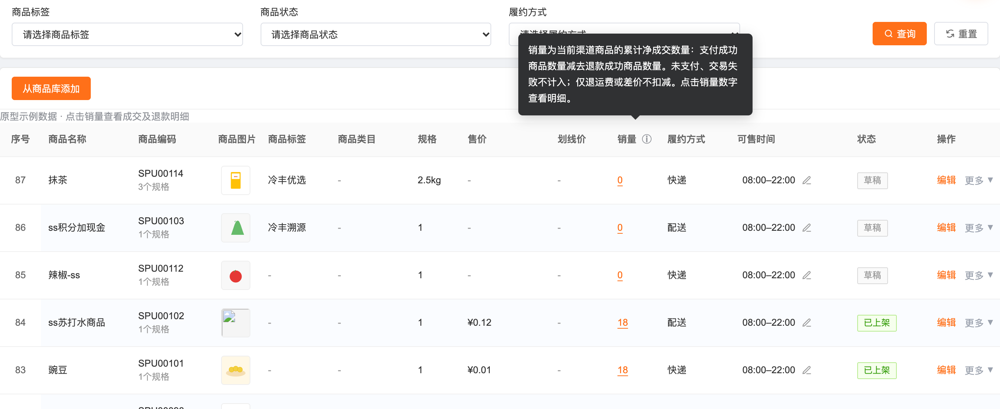
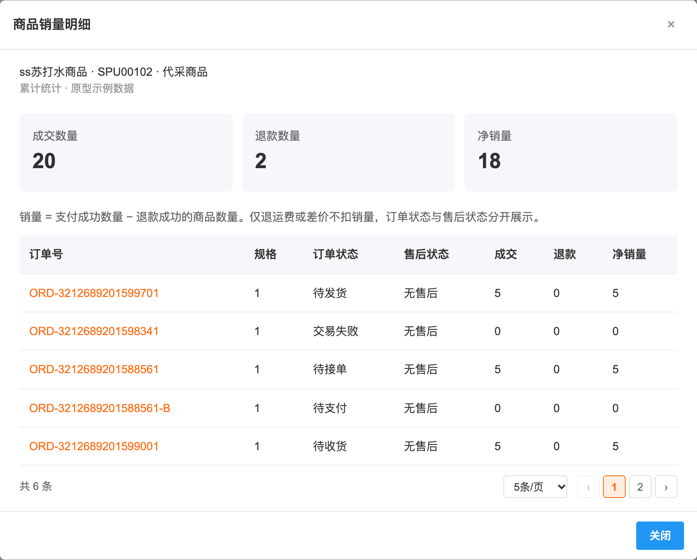
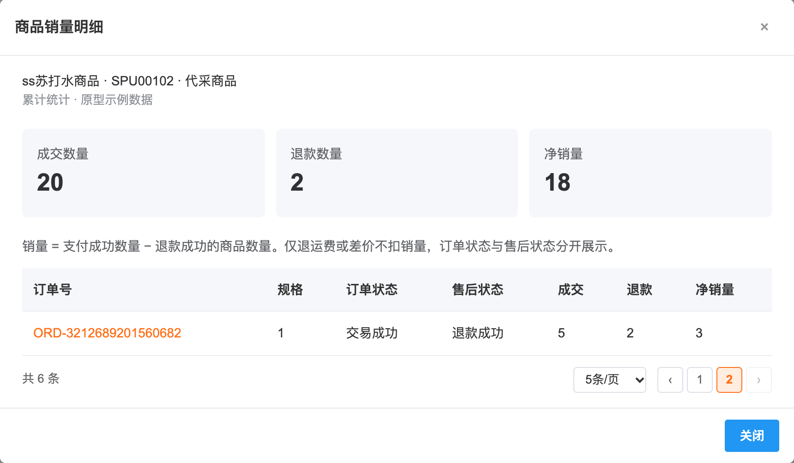
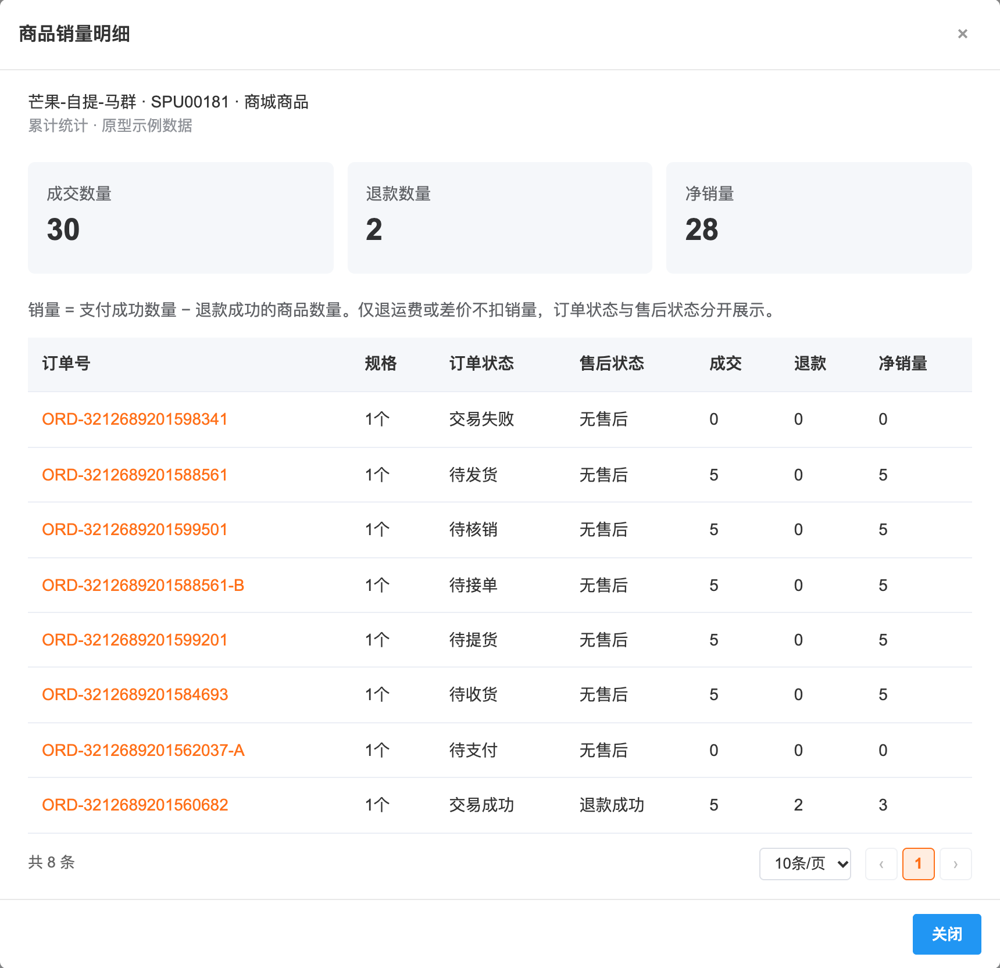

# 【759】商品销量

# 1. 后台业务 WEB 系统

## 1.1 概述

### 需求背景

商城商品和代采商品列表现有销量无法满足实际成交核对。积分商品先采购再入库，仓库需要结合真实销量、出库数量和库存安排盘点及采购。

### 需求目标

统一现有两个列表的销量口径，按支付成功和退款成功的商品数量自动统计。支持查看成交及退款明细。

## 1.2 管理范围

| 模块 | 页面 | 变更 |
| --- | --- | --- |
| 商城商品 | 商品 → 商城商品 → 商品列表 | 更新销量字段，增加销量明细 |
| 代采商品 | 商品 → 代采商品 → 商品列表 | 更新销量字段，增加销量明细 |

选品库沿用现有字段。本需求通过现有销量入口核对数据，采购、库存和盘点继续使用各自业务单据。

本需求仅调整商城商品、代采商品的销量统计与明细展示，不新增或调整商品审核流程，也不将历史商品列表中的审核流程扩展到两个销售渠道。商品审核状态不作为销量增减的判断条件；销量按支付成功（纯积分订单为兑换成功）增加、退款成功扣减对应商品数量，商品上下架、资料编辑不清零历史销量。

## 1.3 统计规则

1. 商城商品只统计关联商城商品的订单，代采商品只统计关联代采商品的订单。同一商品在两个渠道的销量分别统计。
2. 销量为累计净成交数量，等于支付成功商品数量减去退款成功商品数量。未支付、支付失败、支付前取消不计入。
3. 纯积分订单以兑换成功为成交节点，积分加现金订单以整单支付成功为成交节点。积分商品根据实际商品及订单归属计入，单笔交易仅计一次。
4. 部分退款只扣成功退款对应的商品数量。退款申请中、失败、驳回、取消不扣减。仅退运费或差价且未退商品数量时不扣减。
5. 按订单商品行、SKU 记录成交及退款数量，重复回调不重复累计。拆单或分批发货不增加成交次数。商品总销量汇总所属规格。
6. 同一商品多规格数量以售卖份数统计，明细保留规格及售卖单位。实物库存核对按 SKU 和对应单位进行，不跨不同单位直接合计。
7. 上下架及修改名称不清零。历史订单按下单时的渠道、商品及 SKU 关联保留，不能按同名商品匹配。删除再添加的历史归属以稳定渠道商品标识为准。
8. 后台真实销量由系统统计。商城、代采商品编辑中删除展示销量输入项和提交字段，历史配置不参与销量计算。
9. 历史数据可回溯时从订单和退款记录计算；无法回溯时显示“—”并说明数据缺失，不能把缺失当作零销量。
10. 售后补发不增加销量。

## 1.4 页面交互

销量明细弹窗复用商品模块通用弹窗样式，统一标题栏、关闭图标、内容间距、底部分隔线及关闭按钮。内容超出高度时仅正文滚动。

列表沿用“销量”列，提示累计净销量的计算方式。点击数字打开“商品销量明细”，展示商品名称、编码、所属渠道以及成交数量、退款数量、净销量。

明细逐行展示订单号、规格、订单状态、售后状态、成交数量、退款数量和净销量。明细表格底部带分页，显示总条数，支持 5、10、20 条/页切换和翻页，默认每页 5 条；无成交记录时不显示分页。正式对接时展示售卖单位和关联业务单号。关闭按钮、Esc 或点击遮罩退出，列表筛选和页码保留。

列表筛选条件、页码及每页条数在当前浏览器标签页内保持：关闭明细弹窗、进入编辑后返回或刷新页面，仍回到上次查询的条件和页码；点击重置恢复默认条件并回到第 1 页。保持的是点击查询后生效的条件，未点查询的输入不保留。筛选结果页数减少时，页码自动落到最后一页。无成交记录显示销量 0，明细提示暂无成交记录。

原型提供已成交、部分退款、待发货、未支付关闭及售后补发示例。所有示例明确标注，不写入业务订单或库存。正式数据由订单与仓储服务提供。

### 原型截图

代采商品列表：销量列与说明气泡（点击表头 ⓘ 打开）

代采商品销量明细（默认 5 条/页）

销量明细翻到第 2 页

商城商品销量明细（零售订单状态，10 条/页）

## 1.5 计算示例

| 事件 | 成交数量 | 退款数量 | 净销量 |
| --- | --- | --- | --- |
| 支付 12 份，退款成功 2 份 | 12 | 2 | 10 |
| 支付 5 份，尚未发货 | 5 | 0 | 5 |
| 未支付关闭 | 0 | 0 | 0 |
| 售后补发 | 0 | 0 | 0 |
| 合计 | 17 | 2 | 15 |

表头“销量”旁的说明标识点击后，在销量表头上方以气泡展示说明，气泡箭头指向销量列；再次点击标识、点击空白处、按 Esc 或滚动页面时关闭，也可通过键盘操作。提示文案为“销量为当前渠道商品的累计净成交数量：支付成功商品数量减去退款成功商品数量。未支付、交易失败不计入；仅退运费或差价不扣减。点击销量数字查看明细。”。

订单状态沿用对应渠道订单枚举：商城按零售订单展示待支付、待接单、待发货、待提货、待核销、待收货、交易成功、交易失败；代采展示待支付、待接单、待发货、待收货、交易成功、交易失败。订单列表中的“发起退货/退款”是售后筛选项，不作为订单状态。售后状态单独一列展示，沿用售后枚举（无售后、退款成功等），部分商品退款成功时售后状态为退款成功，订单状态不变。

本页面展示商品销量、成交和退款明细。仓库、仓储及出库功能由对应业务模块设计。

## 1.6 验收标准

- 商城、代采渠道销量分别统计，同一订单不重复计数。
- 支付后增加销量，部分退款成功后仅扣对应数量。
- 运费退款不扣数量，售后补发不增加成交。
- 重复支付或退款通知、拆单、分批发货均不重复计算。
- 商城、代采编辑中均无展示销量输入项，保存不提交该配置。
- 说明标识点击后在销量表头上方以气泡展示规则；明细超过一页时可翻页，订单状态与对应渠道订单枚举一致，售后状态单独展示。
- 关闭明细、编辑返回或刷新后，列表筛选、页码和每页条数保持不变；重置后回到默认。
- 草稿且没有交易时显示 0，历史数据缺失时按缺失处理。
- 列表数量与明细净销量合计一致，两个入口的样式及操作一致。
