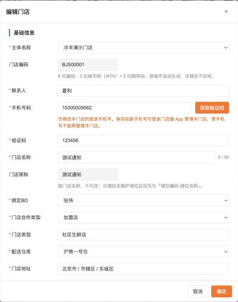
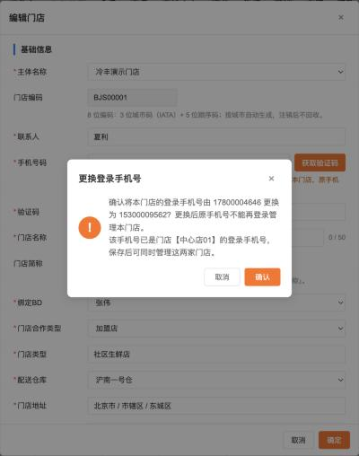
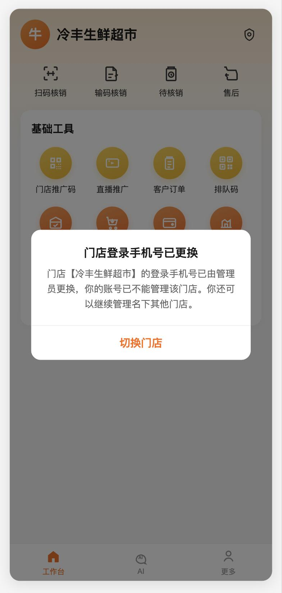
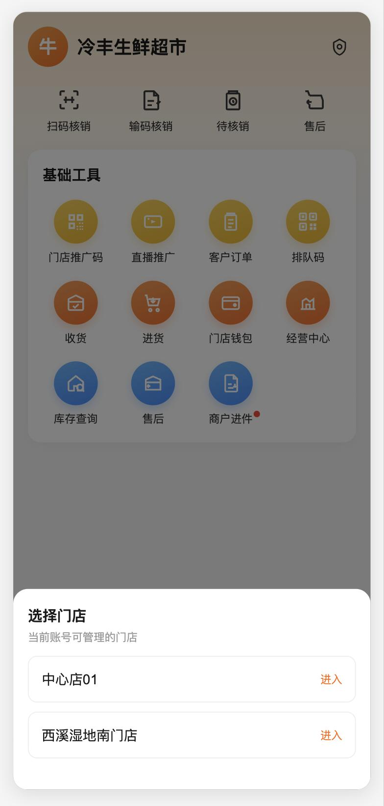
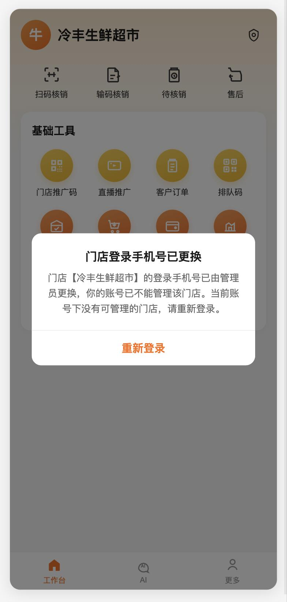
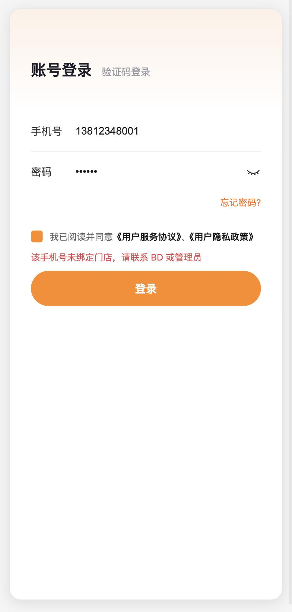

# 【857】门店档案手机号码可编辑

## 一、背景

门店档案创建时填写的「手机号码」，会同步创建门店端 App 的登录账号。现在门店档案的手机号码不能修改，需要支持更换手机号。更换手机号会涉及原手机号的状态，以及新手机号的登录账号。

本期在 **PC 管理后台的门店档案** 里放开「手机号码」编辑，**只对当前这一家门店生效**。门店端 App、BD App 不提供修改入口。

## 二、账号体系（知页口径）

依据知页《技术基线：能力授权基线》§1.1 和《主线一：身份与治理基线》§2：

- 平台是**一套统一的用户体系**。一个手机号对应一个平台用户（`sys_user` / Identity）。
- 同一个用户可以同时有多种身份：B 端的门店、仓库等业务挂靠（Affiliation），BD 等后台角色（Membership），C 端的会员档案（ConsumerProfile）。
- 门店端账号不是独立的一套账号，而是「这个手机号的用户 + 挂靠到某家门店」。门店会员、BD 用的也是同一个用户。
- 一个用户可以挂靠多家门店（知页《技术基线：资源实例级权限治理》§2.2、《运营APP-门店端》§3.4）。门店端 App 已有切换门店入口，登录后在名下门店之间切换。

所以，改门店手机号的实质是：**把这家门店的登录挂靠，从旧手机号的用户换到新手机号的用户上**。不修改任何一个用户本身的手机号，也不删除用户。

操作人只能更换其有管理权限的当前门店登录手机号。保存时校验当前门店的修改权限；无权限时禁止提交。不得同步修改其他门店的手机号、登录绑定及权限，也不修改任何用户账号本身的手机号。

## 三、入口

基础数据中心 → 门店档案 → 列表「编辑」→ 编辑门店弹窗 →「手机号码」。

- 新增门店：和现在一样，填写手机号码并获取验证码。保存后，这个手机号的用户挂靠到新门店；手机号还没有用户时，先创建用户。
- 编辑门店：手机号码默认带出当前完整号码（不脱敏），可以直接修改。

## 四、编辑规则

1. 打开编辑弹窗时不显示「验证码」行。手机号码和原号码一样时，保存不需要验证码。
2. 手机号码改成和原号码不一样后：
   - 手机号码下方出现提示：「仅修改本门店的登录手机号。保存后新手机号可登录门店端 App 管理本门店，原手机号不能再管理本门店。」
   - 出现「验证码」行，必填。点击「获取验证码」，验证码发到**新手机号**。原手机号不需要验证，因为是 PC 端管理员操作。

**点击「确定」时依次校验**（先于其他必填项校验）：

| 校验 | 不通过时的提示 |
| --- | --- |
| 手机号码不能为空 | 请输入手机号码 |
| 必须是 11 位手机号 | 请输入正确的 11 位手机号 |
| 验证码必填且正确 | 请输入验证码 / 验证码错误或已过期 |

手机号校验通过后，再按原有规则校验其他必填项（绑定 BD、门店地址、门头照等）。

**校验通过后弹出二次确认**（页面内弹窗，标题「更换登录手机号」）：「确认将本门店的登录手机号由 15312349562 更换为 13812340000？更换后原手机号不能再登录管理本门店。」新手机号已经是其他门店的登录手机号时，再加一句：「该手机号已是门店【XX】的登录手机号，保存后，新手机号对应的用户可管理当前门店及其原有门店；其他门店的手机号、资料和权限保持不变。」点「确认」后保存，点「取消」回到编辑弹窗，填写的内容保留。

**号码显示**：编辑弹窗、二次确认、保存成功提示都显示完整号码；门店档案列表、操作日志继续脱敏显示。

## 五、保存后的影响

| 对象 | 处理 |
| --- | --- |
| 本门店 | 「手机号码」改为新号；登录挂靠从旧手机号的用户移到新手机号的用户 |
| 新手机号 | 平台里还没有这个手机号的用户时，新建用户并挂靠本门店；已有用户（比如是会员、BD 或其他门店的负责人）时，直接给这个用户加上本门店的挂靠，原有身份不变 |
| 原手机号 | 只解除和本门店的挂靠。该用户还挂靠着其他门店时，仍能登录门店端 App 管理其他门店；没有其他门店挂靠时，不能再登录门店端 App（提示「该手机号未绑定门店」）。会员、BD 等其他身份不受影响，用户本身不删除、不停用 |
| 原手机号已登录的门店端 App | 见第六节 |
| 其他门店 | 不受影响，包括原手机号名下的其他门店 |
| 门店档案列表、详情 | 「手机号码」显示新号（脱敏） |
| 门店端 App、BD App、入驻审核详情 | 读取本门店手机号的地方，都显示新号 |
| 操作日志（689） | 记一条「修改门店」，变更明细为「手机号码：`153****9562` → `138****0000`」 |

以下内容**不随着改**，各自有自己的修改入口：

- 可提现手机号（门店端「手机号管理」换绑）
- 进件（汇付）里填写的手机号
- 已生成的合同签署任务、已签署的合同

## 六、门店端 App：原手机号正在登录时

PC 保存改号后，原手机号在门店端 App 上的登录状态按下面处理。App 在下一次打开页面或发起请求时拿到结果，不需要原手机号重新输入任何信息。

| 原手机号当时的状态 | App 上的处理 |
| --- | --- |
| 当前正在管理本门店，名下还有其他门店 | 弹窗「门店登录手机号已更换」：「门店【冷丰生鲜超市】的登录手机号已由管理员更换，你的账号已不能管理该门店。你还可以继续管理名下其他门店。」只有一个按钮「切换门店」，点击后弹出「选择门店」，列出名下其他门店，选中后进入该门店工作台 |
| 当前正在管理本门店，名下没有其他门店 | 弹窗「门店登录手机号已更换」：「……你的账号已不能管理该门店。当前账号下没有可管理的门店，请重新登录。」只有一个按钮「重新登录」，点击后退出登录，回到登录页，手机号自动带出原手机号 |
| 当前正在管理名下其他门店 | 不弹窗、不打断，切换门店时列表里不再有本门店 |

弹窗不能关闭，也不能点遮罩关闭，必须点按钮。

名下还有其他门店：

名下没有其他门店：

**登录页**：保持现有「账号登录（手机号 + 密码）/ 验证码登录（手机号 + 验证码）」两种方式。原手机号名下已经没有门店时，不论用哪种方式，账号校验通过后都提示「该手机号未绑定门店，请联系 BD 或管理员」，不能进入 App。原手机号还有会员、BD 身份时，不影响这些身份在各自端上的登录。

原型：门店 APP → 工作台右下角「857 改号演示」，可选「名下还有其他门店」「名下只有这一家门店」两种场景；登录页 `store-app/h5/login.html`，演示验证码 123456，密码任意。

## 七、异常情况

| 场景 | 处理 |
| --- | --- |
| 两个人同时编辑同一家门店 | 后保存的人提示「资料已被他人修改，请刷新后重试」 |
| 短信发送失败 | 提示「验证码发送失败，请稍后重试」，可以重新获取 |
| 新手机号的用户已被停用 | 不允许保存，提示「该手机号的账号已停用，请更换手机号」 |

## 八、验收

1. 编辑门店，手机号码不改，直接保存成功，不需要验证码。
2. 手机号码改成新号后出现提示和验证码行，验证码没填时不能保存。
3. 新手机号是全新号码：保存后用新号能登录门店端 App 并看到本门店，原手机号不能再管理本门店。
4. 新手机号已是会员或 BD：保存后用这个号能登录门店端 App 管理本门店，会员和 BD 身份不变。
5. 原手机号还管理着其他门店：保存后原手机号仍能登录门店端 App，只是看不到本门店。
6. 改号成功后，列表、详情显示新号，操作日志里有手机号码的变更前后值。
7. 门店端 App、BD App 里都没有修改门店手机号的入口。可提现手机号、进件手机号不受影响。
8. 原手机号正在门店端 App 管理本门店时 PC 改号：名下还有其他门店的，弹窗后只能切换到其他门店；名下没有其他门店的，弹窗后退出登录，再用原手机号登录提示「该手机号未绑定门店」。
