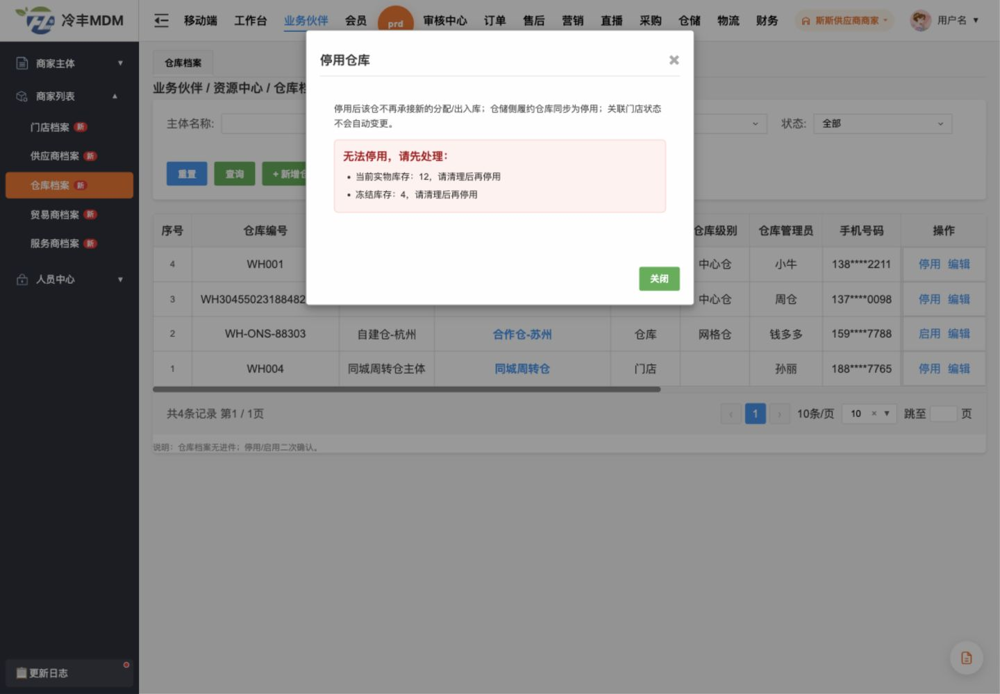

# 【940】门店与仓库档案停启用

## 一、目标与范围

门店与仓库支持可逆的停用、启用。停店停止该店新业务接入；停仓同步停止仓储作业，因此必须先清库和清理未完成义务。仓店不自动互相停用、启用。

范围：PC 门店档案、仓库档案、用户端切店及订单支付、门店／BD 工作台、仓储状态同步。门店与仓库档案的启停操作统一为「停用／启用」，列表状态统一为「已启用／已停用」，不再使用「冻结／解冻」作为档案启停用语。

## 二、公共操作

1. 操作列文字按钮“停用／启用”。有权限的运营才可操作；默认门店不允许停用。
2. 点停用先预检。有阻断时仅展示阻断清单和“关闭”，不展示风险确认表单。
3. 无阻断时展示影响清单；选择必填停用原因、勾选已知晓影响、输入名称后确认。原因为“其他”时补充说明。
4. 启用二次确认；门店须先校验有效配送仓。
5. 提交时重新读取状态、引用、单据及库存。检查失败、未知或期间新增阻断均不得提交，保留用户输入并展示最新原因。
6. 成功后同步列表、详情、下拉选项和各端状态。日志记录对象编号、前后状态、操作人、时间、原因；重复提交不能重复执行。

## 三、门店停用预检

| 条件 | 处理 |
|---|---|
| 系统默认门店 | 阻断 |
| 依赖该门店接单、提货、核销等作业的已支付未完结零售订单 | 阻断；覆盖待接单、待发货、待收货、待提货、待核销等阶段 |
| 未完结代采进货、未完结售后、提现处理中 | 阻断 |
| 不依赖该店作业、原快递链路仍有效的快递到家订单 | 不阻断停店；保留原单信息并继续支付和履约 |
| 待支付自提订单 | 不阻断；停用成功时系统关闭，释放库存占用和已占用权益 |
| 客户绑定数、账户余额、关联仓库 | 提示自动切店、保留资产与提现、仓库不联动停用 |

订单是否依赖门店按真实履约责任判断，不能仅凭“快递”标签放行。混合支付主单含无法继续履约的自提子单时，不允许原主单整体继续支付；关闭原待支付主单并释放对应占用，让用户重新确认可购商品，不静默拆金额继续扣款。

## 四、停用后的能力与客户端

| 能力／场景 | 行为与文案 |
|---|---|
| 新零售／新代采、充值及停用店余额账户支付 | 禁止；用户切换后按新门店业务规则操作，不冻结用户个人资产 |
| 提现、允许维护的资料、历史订单和合法售后 | 保留入口及原权限；工作台仅限制相关功能，不整体置灰 |
| 首页／切店页自动切换 | Toast：已切换门店至：XXX |
| 购物车／确认订单页尚未下单 | 尽量保留商品，刷新可售、价格与配送；Toast：已切换门店至：XXX，请确认商品及配送信息；不自动提交 |
| 待支付自提订单关闭 | 系统关闭／其他关闭；详情：订单已关闭，请重新选购；提供重新选购入口 |
| 旧页面点击已关闭订单支付 | 刷新状态并拦截；Toast：订单已关闭，请重新选购；不提示网络异常 |
| 快递到家且原链路有效 | 无需强调门店停用，正常支付与履约 |
| 停用前已发起支付，停用后才确认成功 | 快递且可履约则继续；无法履约的自提订单进入原路退款流程，显示真实退款状态 |
| 退款处理中 | 本订单无法继续履约，正在为你办理退款；退款成功后再展示成功，不把支付成功误报为支付失败 |
| 扫码／旧链接进入停用门店 | 禁止进入；提示“暂时无法进入该门店，请选择其他门店”，不重复弹出停业说明 |

关闭原因后台准确记录“自提门店停用”，不能记为用户取消或未实际发生的支付超时。已支付自提订单在停用前阻断；并发关闭、支付回调和退款按同一订单状态顺序处理，防止重复关单、扣款、释放或退款。

## 五、自动切换归属门店

1. 当前归属门店停用后，筛选该用户已绑定的其他启用普通门店，按首次绑定时间从早到晚选第一家；默认门店只作兜底，不参与普通门店排序。
2. 没有其他有效普通门店时自动切至系统默认门店，包括只绑定一家、其他门店全部停用两种情况。默认门店应唯一、启用且不能停用。
3. 首次绑定时间已有系统页面及用户实际测试依据，重复绑定不更新该时间。读取关系原始值，不用最近访问时间替代；相同时间用稳定关系编号次序，历史无时间则保留可信绑定顺序，不虚构时间。
4. 切换更新客户当前归属及选店上下文，保留原有绑定关系与首次绑定时间。历史订单仍属原交易门店；余额、会员权益、优惠券、历史订单归属于用户，不清空或重新生成。
5. 原门店重新启用后不自动把用户切回；用户可主动切换。
6. 默认店不可用或自动切换失败时不得选未绑定普通门店，也不得继续在停用店提交新单；保留个人资产、历史订单、售后入口并提示稍后重试。

## 六、仓库停用与启用

停仓后禁止新出库、入库、调拨、波次及其他库存变更作业，库存与历史只读。仓库档案为权威源，同步仓储同编号仓库。所有仓库选择入口排除停用仓；已有绑定保留可读，不能静默清空或改写旧业务。

### 6.1 硬阻断清单

| 检查维度 | 阻断条件 |
|---|---|
| 有效引用 | 仍有启用门店或其他仍会向本仓派发作业的有效配置；先改绑或解除 |
| 仓间 | 存在启用仓间 |
| 仓储作业 | 任何未完成出库、入库、调拨、库内、波次、任务均阻断停用。单据已完成、取消或关闭的，仍需由系统校验其关联库存占用、在途库存、收货差异及作业任务是否已处理完毕；存在未处理项时，阻止仓库停用 |
| 当前库存 | 任一货主、商品、储位仍有实物库存，包括冻结记录及异常／退货等储位 |
| 占用 | WMS 占用、全渠道出库预占、退货预占未清理 |
| 在途 | 在途单据或在途库存未清理 |
| 差异／异常 | 收货差异、负库存或失败／结果未知的库存事务未处理 |
| 关联义务 | 已受理退货、补送等虽未生成仓储单据但仍需本仓处理的义务未完成 |
| 检查结果 | 查询失败、超时、未知均阻断，不能按 0 处理 |

按仓库编号覆盖全部货主、商品和储位，逐项展示，不用正负抵消或将重叠数量相加判断清零。可用库存为 0 不能证明仓已清空；WMS 冻结标记与全渠道冻结数量分别按各自定义核查。

### 6.2 旧订单后续售后

停仓检查覆盖当前已经存在的未处理事项，不包括未来可能发起、目前尚未受理的售后，也不关闭用户未来合法售后入口。

本期不新增旧订单跨仓承接功能。门店更换配送仓不改变已生成订单及其售后的原仓信息。停仓后若旧订单售后需要原仓作业，应先按权限重新启用原仓，再按原流程处理。

若原仓实际已无法恢复作业，须另行制定异常处理方案；本期不承诺系统支持旧订单自动转仓。库存跨仓调拨不等于旧订单及售后责任跨仓承接。

### 6.3 启用门店校验

门店配置的必需配送仓已停用或无法确认可用时，阻止启店；先启仓或改绑有效仓再启店。仓店不自动互相启用。

## 七、页面与原型

| 页面 | 原型入口 |
|---|---|
| 门店档案 | [打开原型](../MDM/mdm_archive_store.html) |
| 仓库档案 | [打开原型](../MDM/mdm_archive_warehouse.html) |
| 用户切店 | [打开原型](../user-app/h5/switch-address.html) |
| 门店工作台 | [打开原型](../store-app/h5/home.html) |
| 用户订单列表／详情 | [打开原型](../user-app/h5/orders.html) |

原型数据仅供演示，不代表线上库存、资金或接口已经核验。页面沿用原有编辑、进件及手机号交接操作；档案启停统一走「停用／启用」，不与库存冻结、保证金解冻等资金／仓储术语混用。

### 停仓预检界面

演示仓仍有实物和冻结库存时，停用被硬阻断，仅提供关闭；数量为原型演示数据。

## 八、验收场景

1. 默认门店不可停；有自提已支付业务不可停；仅有效快递业务可停且可继续支付。
2. 待支付自提系统关闭；旧页再支付被拦截；真实超时与系统关闭原因区分。
3. 支付中并发停用后，自提成功回调进入退款处理中；重复回调不重复退款；有效快递不退款。
4. 有两个有效绑定普通门店时选首次绑定最早者；默认店虽更早也不抢占；其他店均停用则选默认。
5. 重复扫码不更新首次绑定时间；切店保留用户资产和旧订单；恢复原店不自动切回。
6. 配送仓停用则启店阻断；启仓后可启店；提交预检后新增阻断不能停用。
7. 可用量为 0 但有实物、冻结、占用、在途、退货预占或差异时均不能停仓；任何未完成作业阻断。
8. 无库存、无义务、无有效引用时可停仓并同步仓储；恢复两端一致。
9. 关键预检失败不放行；资料修改等其他操作不能绕过停用状态。
10. 停用工作台提现、历史与售后可达，新增业务不可用；原仓停用后的新售后可受理但不能绕过仓储停用执行入库。
