# 【直播优惠券】

## 一、背景

优惠券可指定「直播类目」作为适用商品范围。业务上「分类下无商品」通常指：该类目尚未落到直播场次，且场次也没有对应排品。但**优惠券侧**只能判断该类目之前有没有绑过商品档案——绑过则线上不判为空；**场次侧**再按本场排品类目是否命中券所选类目，决定提示与开播 / 发券拦截。

本需求明确：两套判断分开；场次可先绑券后排品；匹配只看本场排品 `categoryId` 与券所选直播类目（并集）；无匹配时提示，并在开播与实际发券时硬拦截。直接发券与福袋 / 签到 / 观看奖励等间接送券共用同一套场次匹配规则。

## 二、范围

| 终端 | 页面 | 变更 |
|------|------|------|
| B 端 MDM | 优惠券新建 / 编辑 | 直播类目可选；不在表单旁展示说明提示 |
| B 端 MDM | 直播场次编辑 | 可绑直播类目券；无匹配排品时提示，仍可保存 |
| B 端 MDM | 直播排品 | 无匹配时提示；补齐类目关联后提示消失 |
| B 端 MDM | 直播中控 | 无匹配时拦截开播；拦截直接发券及福袋 / 签到 / 观看奖励中的送券发放 |
| B 端 MDM | 营销模版配置 | 不再维护优惠券模板（券以优惠券库为准）；保留简要说明 |

## 三、核心规则

### 3.1 建券与「类目下有没有商品」

1. **业务含义**：直播类目未绑定场次，且场次未配置对应排品时，可理解为分类下无可用商品。
2. **优惠券侧（线上现状）**：只能判断该类目之前有没有绑过**商品档案**；只要绑过，线上**不会**判为空。
3. **场次侧（本需求）**：本场排品是否命中券所选直播类目，另做匹配；对不上则提示，并拦住开播、发券。
4. 审核通过并启用，且发放场景含「直播发券」（或全部场景）后，可在直播场次中选择绑定。
5. 优惠券 / 模版配置表单**不再展示**直播类目旁的说明提示。

### 3.2 参与范围 vs 商品匹配

| 维度 | 用途 |
|------|------|
| 场次直播类型、分发、可见范围 | 观众能不能看 / 能不能参与本场（沿用现有） |
| 券指定的直播类目 × 本场排品 `categoryId` | 券适用商品是否匹配（本需求） |

观看权限、是否上架、是否进小黄车、是否可售，均**不作为**类目匹配条件。

### 3.3 匹配判定

1. 仅当券为「指定类目」且所选类目含直播类目（`source = LIVE`）时，参与本场商品匹配检查。
2. 当前场次排品中，**至少 1 个商品**的 `categoryId` 命中券所选任一直播类目，即视为匹配。
3. 券勾选多个直播类目时按**并集**判断：命中任一即可。
4. 非类目券 / 仅商城类目 / 全部商品：不视为本场直播类目匹配问题。

### 3.4 提示与拦截

| 时机 | 行为 |
|------|------|
| 场次绑券 / 保存 | 无匹配时提示，**允许保存**（支持先绑后排） |
| 排品列表 | 无匹配时提示；补齐匹配类目或解绑后提示消失 |
| 中控添加发券 / 福袋 / 签到 / 观看奖励 | 无匹配时可添加并提示，实际开闸时拦截 |
| 开始直播 | 无匹配 → **硬拦截**，场次保持未开始 |
| 实际发券（直接 / 间接） | 无匹配 → **硬拦截**，不发放 |

间接发券：福袋奖品券、签到奖励券、观看奖励里程碑券，与直接发券复用同一匹配与拦截逻辑。

提示文案示例：

> 「券名」适用「类目 A、类目 B」暂无匹配排品，请补品或解绑

### 3.5 解除条件

满足任一即可解除对应提示与拦截：

1. 本场至少 1 个排品关联到券所选任一直播类目；或
2. 移除 / 解绑导致不匹配的优惠券（含间接送券活动）绑定。

## 四、验收场景（未开始示例）

原型种子场次（`seedRev ≥ 5`），均绑定「新+旧类目并集券」`CT10005`（新直播类目 + 时令果蔬）：

### 4.1 直接绑券

| 场次 | 条件 | 期望 |
|------|------|------|
| 类目券提示·未排品 | 已绑券，暂无排品 | 场次 / 排品有提示；开播 / 发券拦截 |
| 类目券提示·未关联类目 | 已加排品但未关联直播类目 | 仍提示并拦截 |
| 类目券提示·已匹配类目 | 至少 1 个排品命中所选类目 | 无提示；可开播发券 |

### 4.2 间接送券（无排品）

| 场次 | 绑定 | 期望 |
|------|------|------|
| 类目券提示·福袋送券无排品 | 福袋 `BT10005` → `CT10005` | 有提示；开播 / 发放拦截 |
| 类目券提示·签到送券无排品 | 签到 `ST10004` → `CT10005` | 有提示；开播 / 发放拦截 |
| 类目券提示·观看送券无排品 | 观看 `WT10004` → `CT10005` | 有提示；开播 / 发放拦截 |

本地预览（示例）：

- 场次列表：`http://localhost:5173/MDM/mdm_live_session`（未开始 Tab）
- 未排品：`http://localhost:5173/MDM/mdm_live_session_form?id=sess-cat-tip-empty`
- 福袋无排品：`http://localhost:5173/MDM/mdm_live_control?sessionId=sess-cat-tip-bag`

## 五、界面要点与图片示例

### 5.1 优惠券表单

- 适用商品 → 指定类目 → 直播类目：可多选；表单旁不展示说明提示。
- 校验：须至少勾选一个类目；券侧不按场次排品是否为空拦截保存 / 提交。

**图 1：建券与多类目并集。** 适用商品选择「指定类目 → 直播类目」，同时勾选「新直播类目」与「时令果蔬」。此图为按 CT10005 配置预填的新建表单，实际审核启用仍走券库原流程。

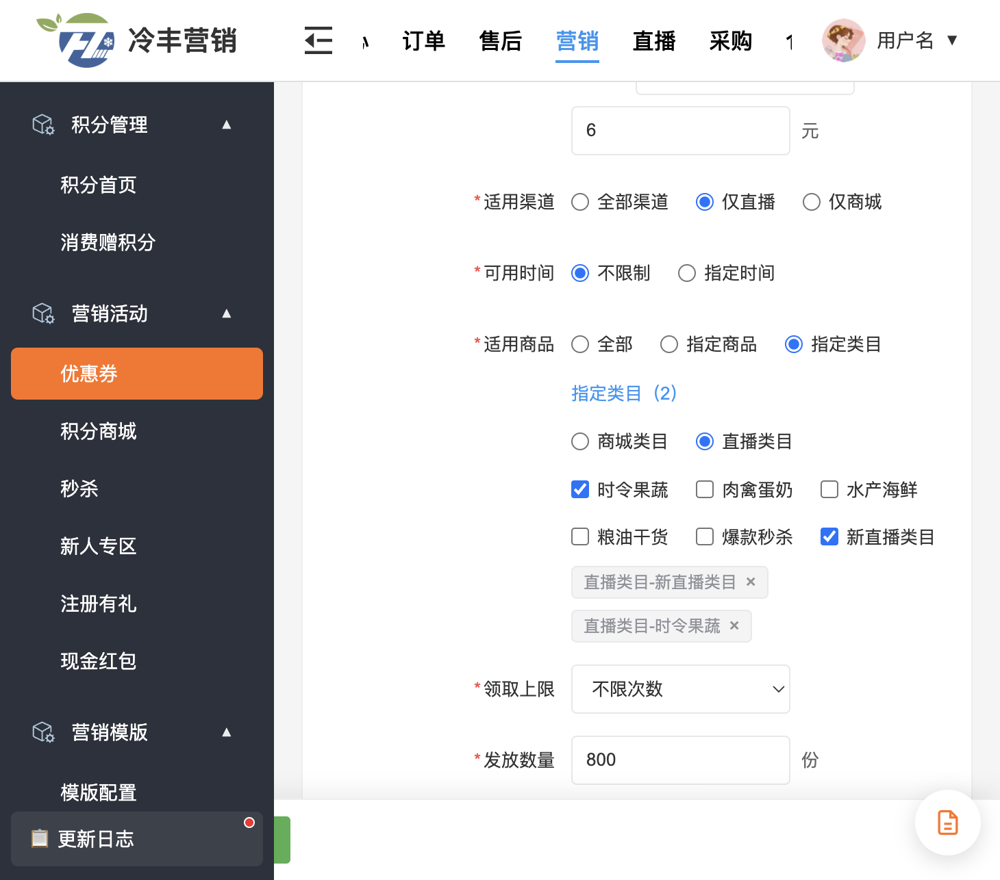

### 5.2 直播场次编辑

- 可绑定启用且含直播发券场景的优惠券。
- 无匹配时模板标签高亮 + 顶部「直播优惠券待补齐商品」提示。
- 保存不因该类提示失败。

**图 2：先绑券、后排品。** 未排品场次已绑定 CT10005，标签高亮且显示「直播优惠券待补齐商品」；该提示不影响保存，开播与实际发放另行校验。

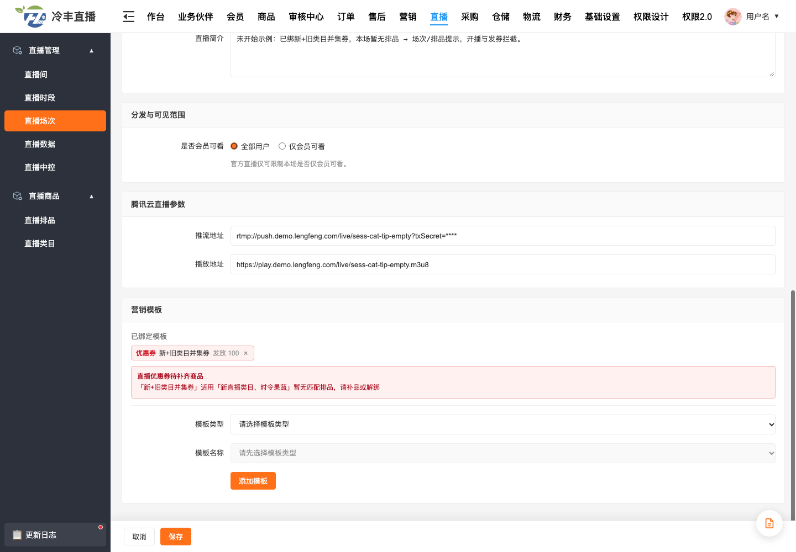

### 5.3 直播排品

- 本场存在不匹配的直播类目券（含间接）时展示提示。
- 在排品编辑中关联正确直播类目后，提示自动消失。

**图 3：尚未排品。** 场次 `sess-cat-tip-empty` 没有排品，展示问题券及适用直播类目。

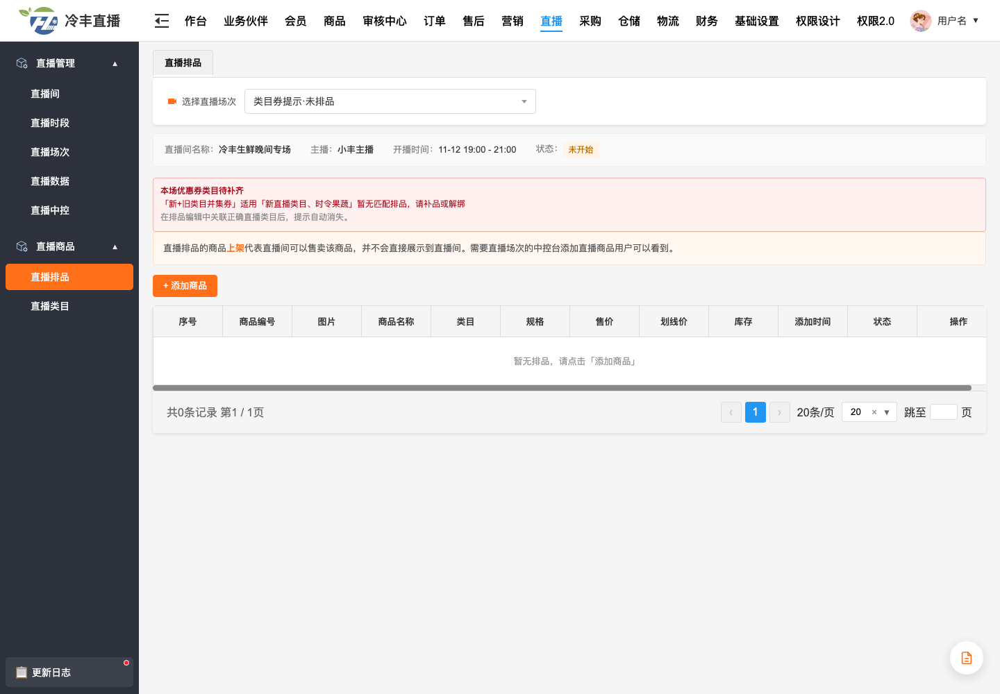

**图 4：有商品但未关联类目。** 场次 `sess-cat-tip-nocat` 已有商品，类目为空，仍然不匹配。

**图 5：关联直播类目的入口。** 在本场排品编辑页选择「时令果蔬」，完成表单必填并保存。匹配看本场排品的类目 ID；修改仅对本场生效。

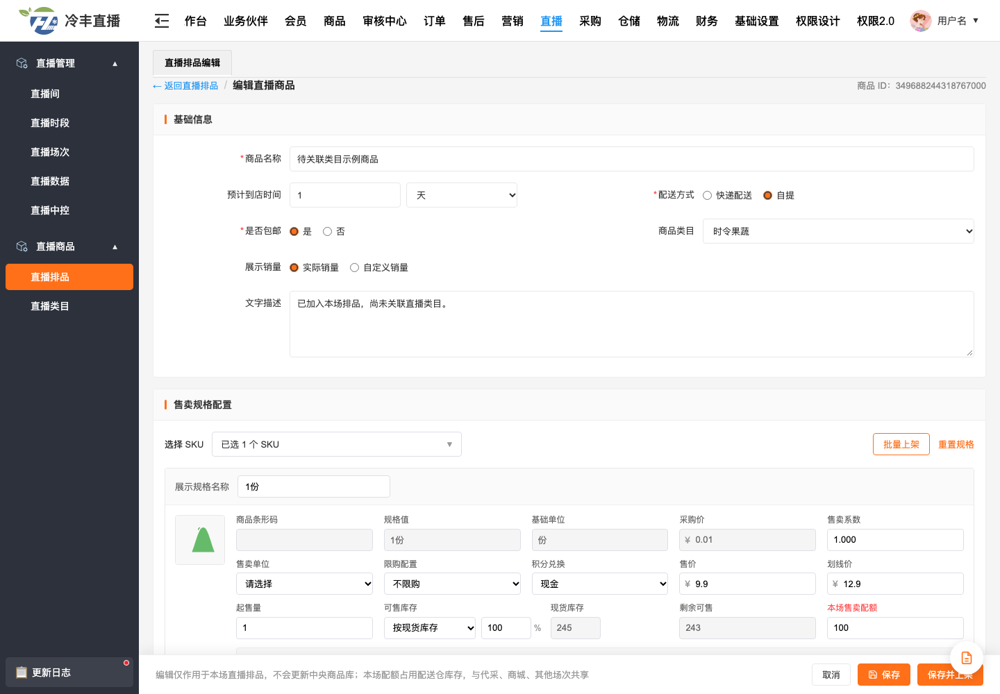

**图 6：并集命中后的对照。** 独立示例场次 `sess-cat-tip-ok` 有一个「时令果蔬」商品，已命中 CT10005 的任一所选直播类目，不再显示待补齐提示。无需把两个类目都排满，也不要求先加入小黄车。

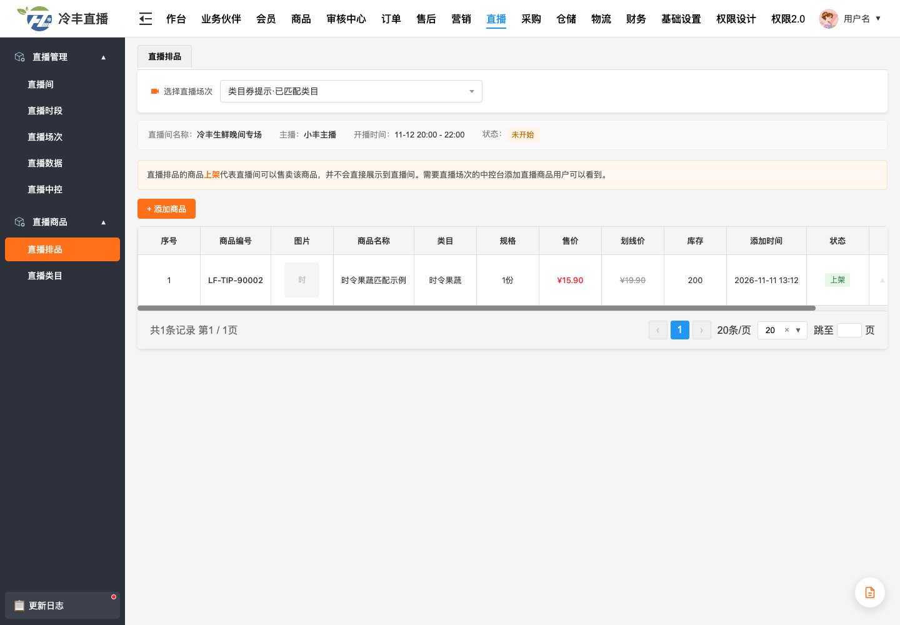

### 5.4 直播中控

- 开始直播：汇总本场绑定活动关联的类目券匹配问题，有则 toast「无法开始直播：…」并保持未开始。
- 立即发放（优惠券 / 福袋 / 签到 / 观看奖励）：有匹配问题则 toast「无法发券：…」。

**图 7：开播硬拦截。** 未排品场次点击「开始直播」，显示「无法开始直播」及问题券、类目；原型同时询问是否前往本场排品页，本图取消跳转后保留拦截提示，场次仍为未开始。

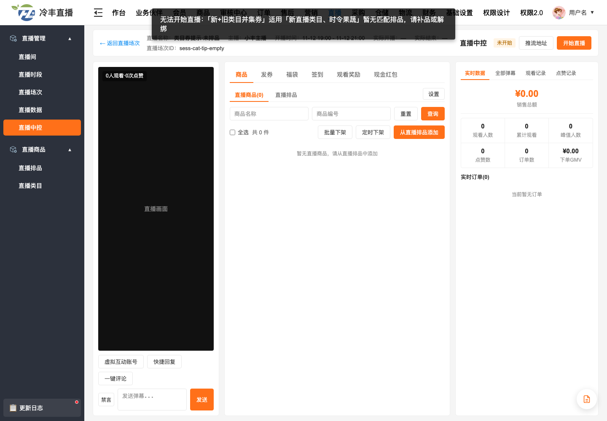

**图 8：直接发券硬拦截。** 在「发券」中选择 CT10005 并填写发放设置，点击「立即发放」显示「无法发券」，发放数量保持 0/100。

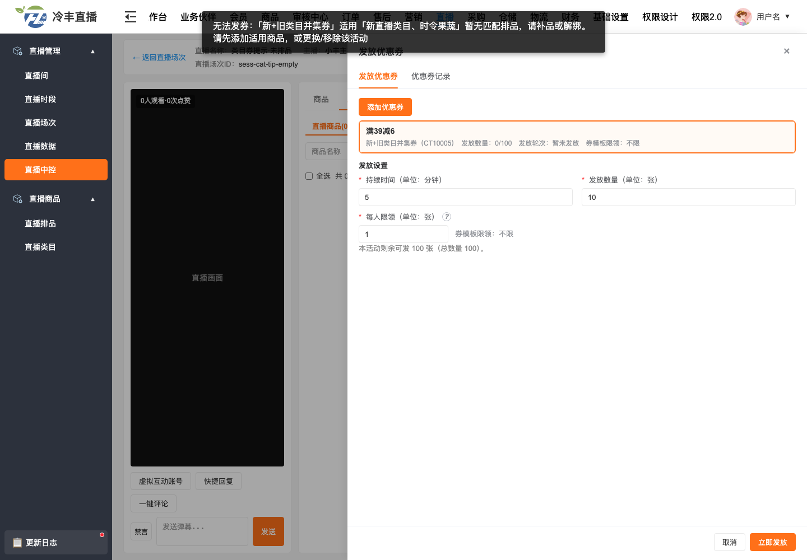

**图 9：福袋间接送券。** 场次 `sess-cat-tip-bag` 的 BT10005 奖品关联 CT10005，填写持续时间和中奖人数后点击「立即发放」，同样拦截。

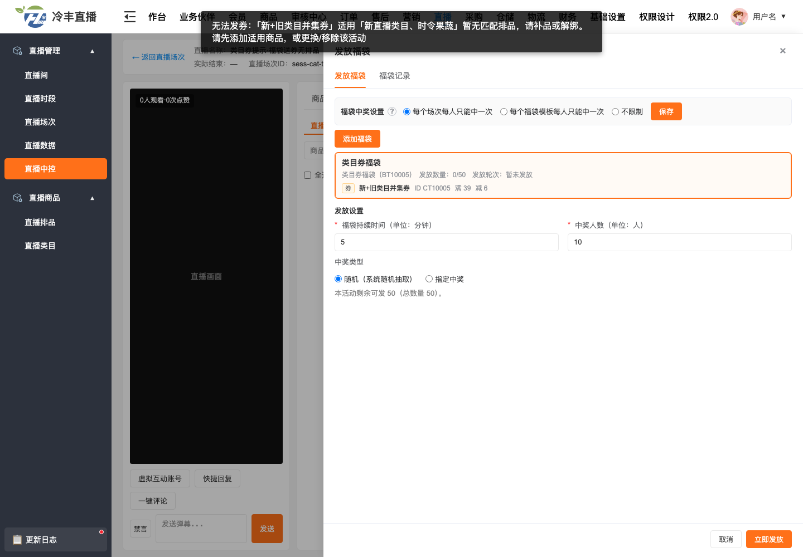

**图 10：签到间接送券。** 场次 `sess-cat-tip-sign` 的 ST10004 奖励包含 CT10005。活动整体参与校验，即使第一轮是积分，仍因所关联券无匹配排品而不能开闸。

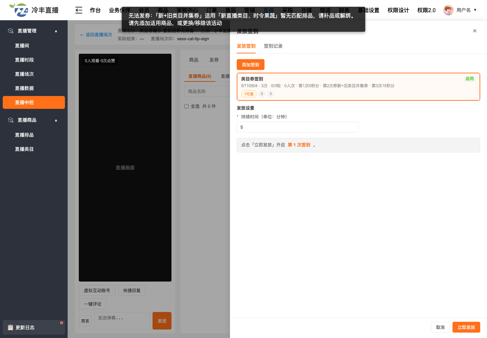

**图 11：观看奖励间接送券。** 场次 `sess-cat-tip-task` 的 WT10004 在 10 分钟档奖励 CT10005，无匹配时不启动奖励发放。

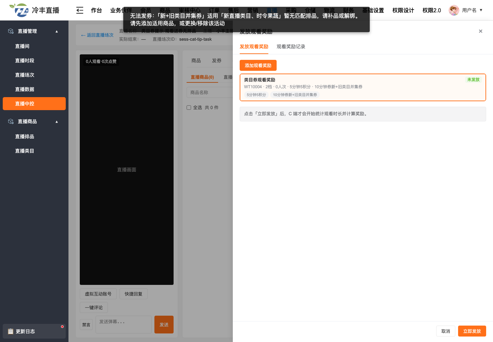

**图 12：匹配成功可开播。** 在 `sess-cat-tip-ok` 点击「开始直播」，显示「已开始直播」，状态变为「直播中」。商品尚未加入小黄车不影响类目匹配。

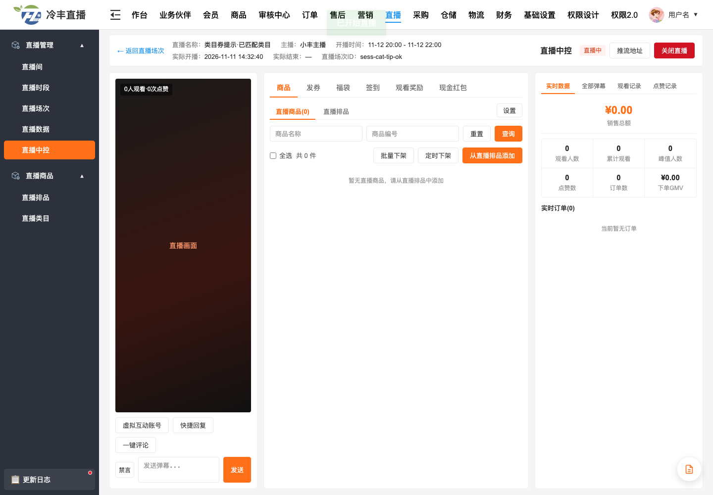

**图 13：匹配成功可发券。** 在已匹配示例中设置持续 5 分钟、发放 10 张、每人 1 张，立即发放后出现「开闸成功」和进行中的第 1 轮记录。此图独立演示匹配校验通过，不表示已完成真实用户领取。

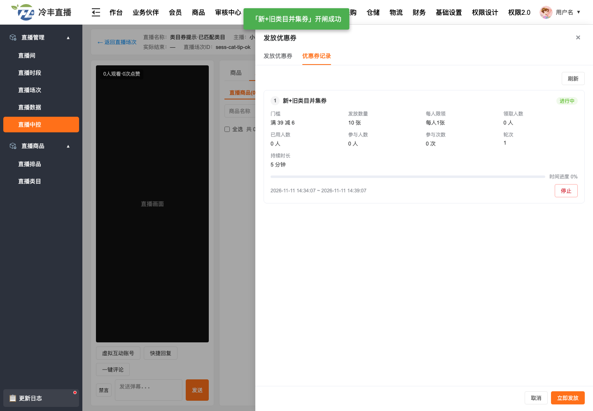

## 六、验收要点

1. 优惠券侧：类目已绑过商品档案则不判空；未绑过商品档案的类目也可建券并启用。
2. 场次可先绑券后排品；无匹配有提示，保存成功。
3. 多类目并集：命中任一所选直播类目即匹配。
4. 无匹配时开播与实际发券硬拦截；直接 / 间接入口一致。
5. 补匹配商品或解绑后，提示与拦截自动解除。
6. 无「使用设置」字段，无 UNKNOWN / 跨场推导分支。
7. 观看权限等场次参与范围不参与商品匹配。
