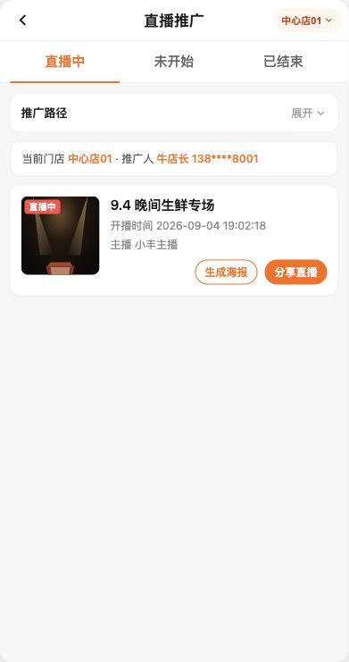
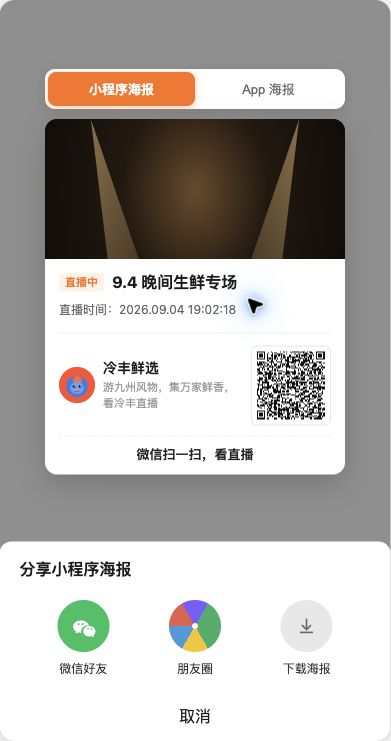
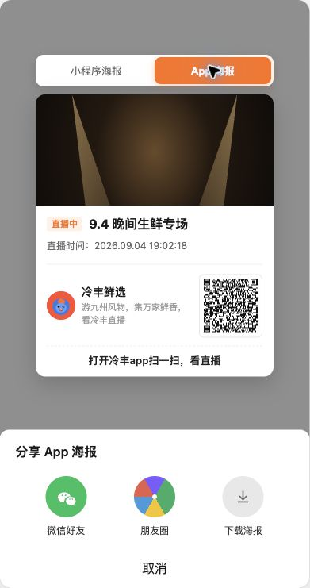
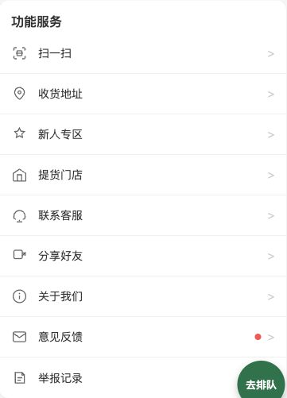
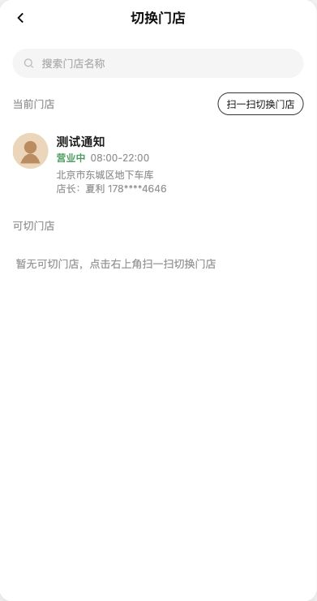
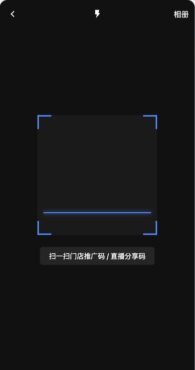
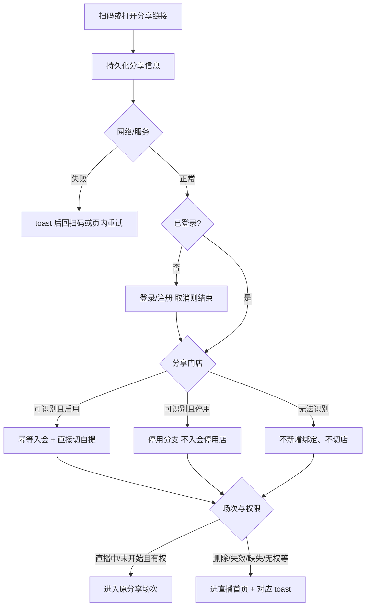
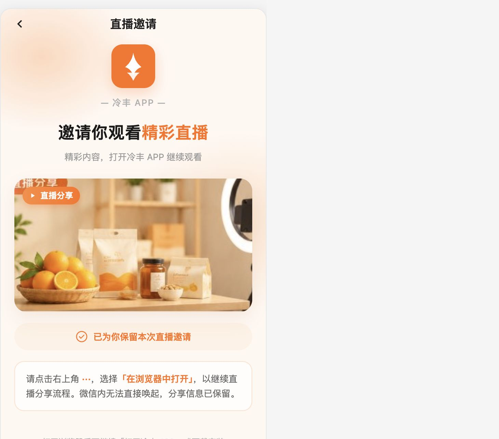
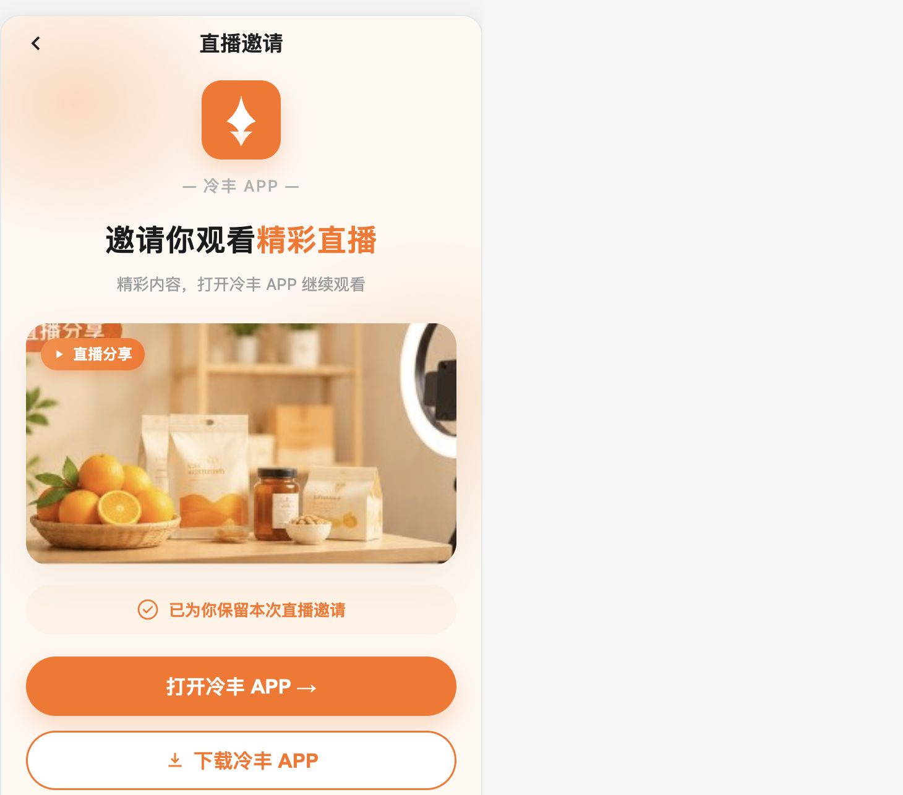
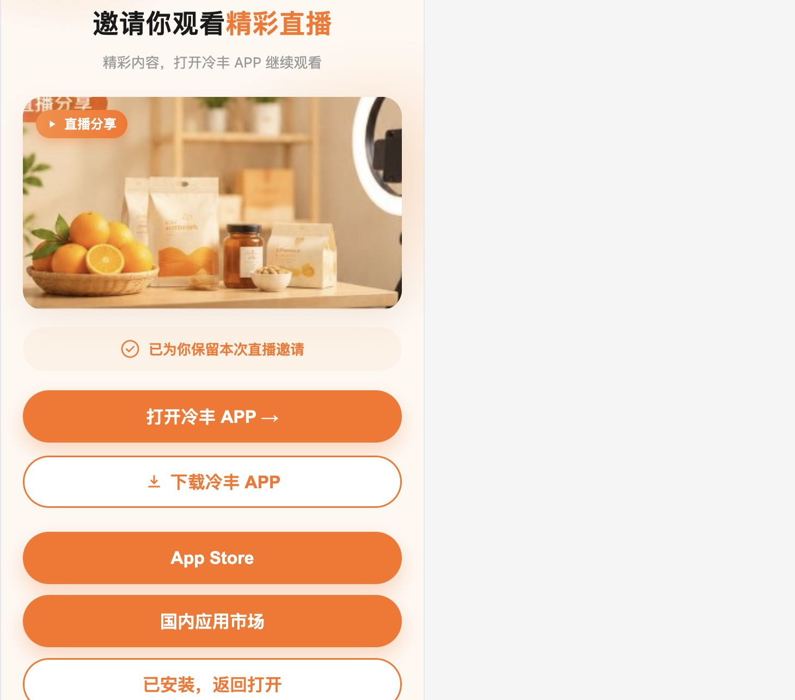

# 【门店直播分享二维码】

关联基线：【628】丰银宝直播推广带参绑店；【537】门店绑定与切店；【940】门店停启用。  
本期在门店/店员直播分享上补齐「小程序海报码 + App 海报码」、统一扫码入口与入会/切店/场次校验规则；既有 BD 分享入口保留、不扩展。

# 1. 概述

## 1.1 需求背景

门店已可分享直播场次，但海报二维码未区分小程序与 App 路径；用户 App 扫码入口主要在切店页，发现成本高；分享门店停用、场次异常、未登录回流、App 唤起与未安装下载等规则需与「门店会员关系 / 当前自提门店」分离模型对齐。本期落地可验收的 URL 码方案、扫码入口，以及异常场次进直播首页 toast 口径。

## 1.2 需求目标

1. 生成海报提供两套：**小程序海报**、**App 海报**，二维码内容分别为可解析 URL（`ch=mp` / `ch=app`），参数含场次、分享门店、店员账号。
2. 明确标注原型码为 **URL 二维码，不是微信官方小程序码**；官方小程序码跨端识别列为外部依赖。
3. 用户 App「我的 → 功能服务」新增【扫一扫】；保留切换门店页扫码入口；两处进入同一扫码页，支持门店推广码与直播分享码。
4. 未识别码前退出扫码：返回进入前页面，不绑定、不切店。
5. 主流程：保留分享信息 →（未登录先登录）→ 入会/切自提 → 场次可用且有权则进原分享场次；场次删除/失效/缺失/无权等按 3.5 进直播首页并 toast（无独立异常落地页）。
6. 门店会员关系与当前自提分离：多店并存、同店幂等不重置首次绑定时间；成功后直接切自提、无确认框。
7. 分享门店停用按用户情况分支回退/保留（见 3.4），**不新增停用分享门店的会员关系**；仅调整直播分享入口。
8. App 码：落地页为「直播邀请」视觉（品牌区、封面卡、「已为你保留本次直播邀请」）；微信中间页引导浏览器打开；浏览器同页提供「打开冷丰 APP / 下载冷丰 APP」，下载展开 App Store / 国内应用市场 /「已安装，返回打开」；一次唤起失败不直接判定未安装。补救：返回本页再打开，或 App 内再扫原码。
9. BD 分享：既有入口保留，业务规则不扩展（以【628】为准）。

## 1.3 管理范围

| 终端 | 模块 | 变更类型 |
|------|------|----------|
| 门店 APP | 直播推广 · 生成海报（小程序/App 两套） | 修改 |
| 门店 APP | 直播推广 · 推广路径说明 | 修改 |
| C 端用户 APP | 我的 · 功能服务 · 扫一扫 | 新增 |
| C 端用户 APP | 切换门店 · 扫一扫 | 保留 |
| C 端用户 APP | 统一扫码页 | 修改 |
| C 端用户 APP | 直播邀请落地 / 微信中间页 / 浏览器桥接与同页下载 | 新增 |
| C 端用户 APP | 登录回流与分享参数保留 | 修改 |

## 1.4 原型与预览

> 配图说明：以下图片于 2026-11-11 从本地原型实际页面截取，已裁去页面外侧验收面板（含直播邀请页最新视觉）。图中门店、账号、场次及二维码均为演示数据，不代表线上或 UAT 核验结果；打开 / 下载仅展示原型交互，不代表真实唤起、下载或安装后恢复已完成。

| 页面 | 路径 | 预览 |
|------|------|------|
| 直播推广 | `store-app/h5/live-promo.html` | `http://localhost:5173/store-app/h5/live-promo` |
| 我的 | `user-app/h5/profile.html` | `http://localhost:5173/user-app/h5/profile` |
| 扫一扫 | `user-app/h5/scan-store.html` | `http://localhost:5173/user-app/h5/scan-store?from=profile.html` |
| 切换门店 | `user-app/h5/switch-address.html` | `http://localhost:5173/user-app/h5/switch-address` |
| 直播邀请落地 | `user-app/h5/live-share.html` | 见下方示例 URL（标题「直播邀请」） |
| 直播间 | `user-app/h5/live-room.html` | 带参进入 |

示例：

- 小程序 URL 码：`http://localhost:5173/user-app/h5/live-share?ch=mp&sessionId=sess-live-01&storeId=HGH00002&staffId=STAFF-001&inviteName=牛店长&invitePhone=13812348001`
- App URL 码：同上，`ch=app`

**图片示例：门店端直播推广入口**

店长/员工视角：直播推广列表提供“生成海报”和“分享直播”，本次双海报从“生成海报”进入。

# 2. 码内容与海报

## 2.1 URL 参数

| 参数 | 必填 | 说明 |
|------|------|------|
| ch | Y | `mp` 小程序海报码；`app` App 海报码 |
| sessionId | Y | 原分享场次，不得误入后续其他场次 |
| storeId | Y | 分享门店（店员所属门店） |
| staffId | Y | 店员账号；仅记录邀请人，不写业绩归属 |
| inviteName | N | 邀请人姓名 |
| invitePhone | N | 邀请人手机号 |

落地页：`user-app/h5/live-share.html`。兼容历史带参打开 `live-room.html`。

## 2.2 生成海报（两套）

点「生成海报」预览顶部切换：

| 类型 | 二维码 | 海报内分享文案（原型） |
|------|--------|------------------------|
| 小程序海报 | `ch=mp` URL 码 | 微信扫一扫，看直播 |
| App 海报 | `ch=app` URL 码 | 打开冷丰app扫一扫，看直播 |

说明：均为可解析 URL 码（非微信官方小程序码）。小程序码可被小程序与 App 扫一扫识别；App 码微信扫进中间页 / 浏览器打开唤起。

分享文案写在海报卡片底部整行（不挤在二维码旁），保存/分享海报时一并带出；底栏「分享小程序海报 / 分享 App 海报」随当前选中切换；微信好友、朋友圈、下载针对当前海报（真实微信分享仍为 toast 演示）。

封面与版式沿用【628】海报规则（宽对齐、最大高度裁切等）。

**图片示例：小程序海报预览**

进入预览默认选中“小程序海报”；海报底部展示“微信扫一扫，看直播”，封面不再展示端类型角标。图中为 URL 二维码，不是微信官方小程序码。

**图片示例：App 海报预览**

切换为“App 海报”后，海报底部展示当前原型文案“打开冷丰app扫一扫，看直播”，底部分享面板标题同步变化。保存/分享结果应包含海报内操作提示。

## 2.3 分享直播（小程序卡片）

沿用【628】小程序卡片分享；标题规则见知页「门店分享直播展示信息」与【628】（场次名｜门店名）。App 路径以「App 海报」为主，不在卡片分享里再挂 App 码入口。

# 3. C 端识别与主流程

## 3.1 扫码入口

| 入口 | 位置 | 行为 |
|------|------|------|
| 新增 | 我的 → 功能服务首项 → 扫一扫 | 复用功能服务行样式，进入统一扫码页，`from=profile.html` |
| 保留 | 切换门店页 → 扫一扫切换门店 | 进入同一扫码页，`from=switch-address.html` |

**图片示例：我的—功能服务首项扫一扫**

扫一扫保留在功能服务首项（按本次确认），与其他服务行保持一致；点击直接进入统一扫码页，不经过切换门店页。

**图片示例：切换门店页扫码入口**

保留当前门店区域右侧的“扫一扫切换门店”入口，与“我的”入口共用同一扫码页。

**图片示例：统一扫一扫页面**

统一取景框支持门店推广码和直播分享码。顶部提供返回、手电筒及相册入口；未识别前返回，不执行绑定或切店。截图为扫码界面，不代表已完成相机实扫或官方小程序码识别验证。

统一扫码页支持：

- 门店推广码（`lengfeng-store:{storeId}` 等，规则沿用【537】）
- 直播分享 URL 码（`ch=mp|app`，规则见本章）

未识别前点返回：回到 `from` 对应页面，**不执行门店绑定或切换**。

## 3.2 主流程顺序

说明：

- 场次异常、信息缺失、无权等**不再使用独立拦截落地页与操作按钮**；按 3.5 进直播首页并 toast。
- 绑定门店不代表获得原异常场次的观看权限，不得绕过分发范围与观看权限校验。
- 未开始：复用封面与「直播即将开始」。

## 3.3 会员关系与自提门店

| 规则 | 说明 |
|------|------|
| 多店并存 | 用户可同时拥有多家门店会员关系 |
| 同店幂等 | 已绑定分享门店则复用，不重置首次绑定时间 |
| 他店 | 保留原关系，新增分享门店关系 |
| 切自提 | 正常流程绑定成功后直接切换当前自提为分享门店，无确认框 |
| 切店不影响会员 | 切换自提不得解除原会员关系 |
| 店员 | 只关联所属门店，不新增店员业绩归属 |
| 重试 | 重复扫码/点击/请求重试不得重复创建会员关系；绑定成功但切店或进直播失败时，重试续跑剩余步骤 |

未登录：保留分享门店、直播间及场次信息；登录/注册成功后重新校验并继续；取消登录不绑定、不切店；避免登录后默认选店或首页跳转覆盖分享目标。

## 3.4 分享门店停用分支（仅直播分享入口）

各分支均**不得新增已停用分享门店的会员关系**。

| 条件 | 处理 | 提示 |
|------|------|------|
| 分享门店启用 | 入会分享门店 + 直接切自提 → 进原场次 | — |
| 停用，且用户无任何门店绑定关系 | 绑定系统默认门店并设为当前自提 | 分享门店已停业，已自动绑定默认门店 |
| 停用，且已有正常可用的当前自提 | 保留原会员关系与当前店 | 分享门店已停业，已保留当前门店 |
| 当前店不可用，但有其他启用的绑定门店 | 复用现有可用门店选择规则；无现成规则则引导选择，不擅自指定 | — |
| 没有任何可用绑定门店 | 回退系统默认门店 | （同默认店绑定提示） |
| 默认门店不可用 | 提示暂无法进入；不能继续绑定或反复回退 | 暂无法进入，请稍后再试 |

回退或保留后，以**最终当前门店**校验原分享场次的分发范围与观看权限：通过则进原场次；不通过则提示并进入该门店直播首页。

> 与旧表述区别：不以「停用一律不绑不切」或「停业一律绑默认店」替代上表。

## 3.5 场次 / 信息 / 权限异常（进直播首页）

取消独立异常落地页与操作按钮。覆盖此前「异常时一律不绑定、不切店」方案。

### 3.5.1 场次已删除、链接失效、分享信息缺失、无法识别、分发范围或观看权限不满足

| 门店情况 | 处理 |
|----------|------|
| 能识别有效分享门店 | 按正常规则绑定并切换至该门店，进入该门店直播首页，**不进入异常场次** |
| 无法识别分享门店 | 不新增绑定、不切店，进入当前有效门店的直播首页；无有效当前店时走现有选店流程 |
| 分享门店已停用 | 沿用 3.4 门店兜底规则，再进最终当前门店的直播首页 |

到达直播首页后 toast：

| 场景 | toast |
|------|-------|
| 场次已删除或链接失效 | 该直播已失效，为您展示其他直播 |
| 分享信息缺失或无法识别 | 未识别到有效直播信息，请重新扫码 |
| 分发范围或观看权限不满足 | 暂无法观看本场直播，为您展示其他直播 |

说明：绑定门店不代表获得原异常场次的观看权限，不得绕过权限校验。未开始场次仍进原场次，封面 +「直播即将开始」。

### 3.5.2 网络或服务异常

| 项 | 规则 |
|----|------|
| toast | 加载失败，请稍后重新扫码 |
| 来自扫一扫 | 自动返回扫一扫页，恢复扫码能力，允许再次扫描 |
| 外部分享链接（无扫码来源） | 保留原链接并提示重试，**不**自动跳转扫码页 |
| 绑定时机 | 校验完成前不执行绑定、切店；已经成功的绑定不重复创建、不重置首次绑定时间 |

## 3.6 App 码路径

落地页标题为「直播邀请」，统一视觉：冷丰品牌区、「邀请你观看精彩直播」、封面卡（「直播分享」角标）、「已为你保留本次直播邀请」。

| 环境 | 行为 |
|------|------|
| App 内扫一扫 | 直接走主流程 |
| 微信扫一扫 | 同视觉中间页：引导右上角「在浏览器中打开」；分享信息保留 |
| 外部浏览器 | 同页主按钮「打开冷丰 APP →」、次按钮「下载冷丰 APP」；点下载展开 App Store / 国内应用市场 /「已安装，返回打开」；底部提示安装后回本页，并提供「无法打开？在 App 内重新扫码」 |
| 唤起失败 | 「未能打开 App。已安装请重试，未安装请下载安装。」；一次失败不直接判定未安装 |

**图片示例：微信中间页（直播邀请）**

微信内无法直接唤起时，保留邀请信息并引导用户「在浏览器中打开」。截图为本地原型。

**图片示例：外部浏览器 · 直播邀请打开页**

浏览器桥接页提供「打开冷丰 APP →」「下载冷丰 APP」；页面保留分享信息。本图为本地原型，不能据此认定真实 App 已成功唤起。

**图片示例：同页展开应用市场下载**

下载区在邀请页内展开：App Store、国内应用市场及「已安装，返回打开」。截图仅为原型演示，真实渠道跳转与安装后自动恢复仍需原生及渠道能力实现、验证。

补救：

1. 返回本页，点「打开冷丰 APP」
2. 在 App 内重新扫描原分享码（页内入口或自行打开扫一扫）

用户取消下载或中途退出：不提前绑定或切店；再次继续时重新校验目标状态。绑定失败保留分享信息可重试。

# 4. 验收要点

- 小程序海报码、App 海报码分别为两套 URL 码，注明非官方小程序码；海报内底部分享文案分别为「微信扫一扫，看直播」「打开冷丰app扫一扫，看直播」
- 我的扫一扫、切店页扫一扫均进入统一扫码页；退出未识别不绑不切
- 门店推广码与直播分享码均可识别并按规则处理
- 未登录 / 已登录；未绑 / 同店 / 他店；直接切店无确认；首次绑定时间不重置
- 停用分享门店各分支提示与默认店兜底正确；不新增停用店会员
- 场次删除/失效/缺失/无权：无独立拦截页；按门店规则处理后进直播首页并出现对应 toast；未开始展示即将开始
- 网络失败：扫码来源回扫一扫；外链保留原页可重试；校验前不绑不切
- App：直播邀请视觉；微信中间页、浏览器同页打开/下载与市场展开、唤起失败文案；补救两条可走通
- BD 分享入口保留、规则不扩展

# 5. 与【628】关系

【628】提供直播推广列表、分享卡片、带参登录回流与邀请人展示等基线。本 PRD 增量覆盖：双海报码、扫码入口、会员/自提分离、停用分支、异常进首页 toast、直播邀请落地视觉与 App 唤起/同页下载原型，并修正「异常一律不绑不切」旧口径。BD 相关能力以【628】为准且本期不扩展。
