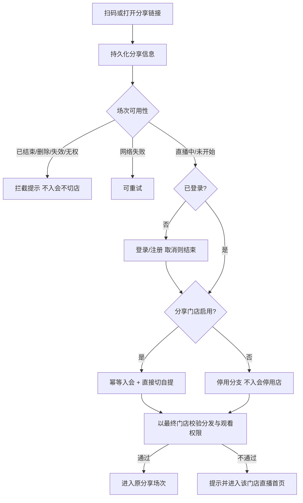

# 【门店直播分享二维码】

关联基线：【628】丰银宝直播推广带参绑店；【537】门店绑定与切店；【940】门店停启用。  
本期在门店/店员直播分享上补齐「小程序海报码 + App 海报码」、统一扫码入口与入会/切店/场次校验规则；既有 BD 分享入口保留、不扩展。

# 1. 概述

## 1.1 需求背景

门店已可分享直播场次，但海报二维码未区分小程序与 App 路径；用户 App 扫码入口主要在切店页，发现成本高；分享门店停用、场次异常、未登录回流、App 唤起与安装恢复等规则需与「门店会员关系 / 当前自提门店」分离模型对齐。本期落地可验收的 URL 码方案与扫码入口，并明确正式官方小程序码、安装后自动恢复等外部依赖。

## 1.2 需求目标

1. 生成海报提供两套：**小程序海报**、**App 海报**，二维码内容分别为可解析 URL（`ch=mp` / `ch=app`），参数含场次、分享门店、店员账号。
2. 明确标注原型码为 **URL 二维码，不是微信官方小程序码**；官方小程序码跨端识别列为外部依赖。
3. 用户 App「我的 → 功能服务」新增【扫一扫】；保留切换门店页扫码入口；两处进入同一扫码页，支持门店推广码与直播分享码。
4. 未识别码前退出扫码：返回进入前页面，不绑定、不切店。
5. 主流程：保留分享信息 →（未登录先登录）→ **先校验场次可用性** → 入会/切自提 → 以最终当前门店校验分发与观看权限 → 进入原分享场次。
6. 门店会员关系与当前自提分离：多店并存、同店幂等不重置首次绑定时间；成功后直接切自提、无确认框。
7. 分享门店停用按用户情况分支回退/保留（见 3.4），**不新增停用分享门店的会员关系**；仅调整直播分享入口，不整体改其他扫码停用处理。
8. App 码：微信中间页引导浏览器打开；浏览器提供打开/下载；一次唤起失败不直接判定未安装。安装后自动恢复为正式需求但原型未完成；补救为返回浏览器再打开、或 App 内再扫原码。

## 1.3 管理范围

| 终端 | 模块 | 变更类型 |
|------|------|----------|
| 门店 APP | 直播推广 · 生成海报（小程序/App 两套） | 修改 |
| 门店 APP | 直播推广 · 推广路径说明 | 修改 |
| C 端用户 APP | 我的 · 功能服务 · 扫一扫 | 新增 |
| C 端用户 APP | 切换门店 · 扫一扫 | 保留 |
| C 端用户 APP | 统一扫码页 | 修改 |
| C 端用户 APP | 直播分享落地 / 中间页 / 浏览器桥接 | 新增 |
| C 端用户 APP | 登录回流与分享参数保留 | 修改 |

本期不做 / 未完成：

- 微信官方小程序码生成与 App 真实解码
- 真实原生唤起、国内应用市场安装后自动恢复（正式需求保留）
- 店员业绩归属
- 整体改造非直播分享入口的停用处理
- 扩展 BD 分享业务规则（入口保留）
- Google Play / Install Referrer；剪贴板口令

## 1.4 原型与预览

| 页面 | 路径 | 预览 |
|------|------|------|
| 直播推广 | `store-app/h5/live-promo.html` | `http://localhost:5173/store-app/h5/live-promo` |
| 我的 | `user-app/h5/profile.html` | `http://localhost:5173/user-app/h5/profile` |
| 扫一扫 | `user-app/h5/scan-store.html` | `http://localhost:5173/user-app/h5/scan-store?from=profile.html` |
| 切换门店 | `user-app/h5/switch-address.html` | `http://localhost:5173/user-app/h5/switch-address` |
| 分享落地 | `user-app/h5/live-share.html` | 见下方示例 URL |
| 直播间 | `user-app/h5/live-room.html` | 带参进入 |

示例：

- 小程序 URL 码：`http://localhost:5173/user-app/h5/live-share?ch=mp&sessionId=sess-live-01&storeId=HGH00002&staffId=STAFF-001&inviteName=牛店长&invitePhone=13812348001`
- App URL 码：同上，`ch=app`

# 2. 码内容与海报

## 2.1 URL 参数

| 参数 | 必填 | 说明 |
|------|------|------|
| ch | Y | `mp` 小程序海报码；`app` App 海报码 |
| sessionId | Y | 原分享场次，不得误入后续其他场次 |
| storeId | Y | 分享门店（店员所属门店） |
| staffId | Y | 店员账号；仅记录邀请人，不写业绩归属 |
| inviteName | N | 邀请人姓名 |
| invitePhone | N | 邀请人手机号 |

落地页：`user-app/h5/live-share.html`。兼容历史带参打开 `live-room.html`。

## 2.2 生成海报（两套）

点「生成海报」预览顶部切换：

| 类型 | 二维码 | 底栏扫码提示（原型） |
|------|--------|----------------------|
| 小程序海报 | `ch=mp` URL 码 | 微信扫一扫，看直播 |
| App 海报 | `ch=app` URL 码 | 打开冷丰app扫一扫，看直播 |

说明：均为可解析 URL 码（非微信官方小程序码）。小程序码可被小程序与 App 扫一扫识别；App 码微信扫进中间页 / 浏览器打开唤起。

扫码提示展示在底部分享栏标题下方整行（不挤在海报二维码旁）；「分享小程序海报 / 分享 App 海报」随当前选中切换；微信好友、朋友圈、下载针对当前海报（真实微信分享仍为 toast 演示）。

封面与版式沿用【628】海报规则（宽对齐、最大高度裁切等）。

## 2.3 分享直播（小程序卡片）

沿用【628】小程序卡片分享；标题规则见知页「门店分享直播展示信息」与【628】（场次名｜门店名）。App 路径以「App 海报」为主，不在卡片分享里再挂 App 码入口。

# 3. C 端识别与主流程

## 3.1 扫码入口

| 入口 | 位置 | 行为 |
|------|------|------|
| 新增 | 我的 → 功能服务 → 扫一扫 | 复用功能服务行样式，进入统一扫码页，`from=profile.html` |
| 保留 | 切换门店页 → 扫一扫切换门店 | 进入同一扫码页，`from=switch-address.html` |

统一扫码页支持：

- 门店推广码（`lengfeng-store:{storeId}` 等，规则沿用【537】）
- 直播分享 URL 码（`ch=mp|app`，规则见本章）

未识别前点返回：回到 `from` 对应页面，**不执行门店绑定或切换**。

## 3.2 主流程顺序

说明：

- **先场次可用性，再入会/切店**；需会员身份才能判断的权限，在入会后复验。
- 不要写成「先绑定切店，再发现目标不可访问」的统一顺序。
- 未开始：复用封面与「直播即将开始」。
- 分享入口不得绕过既有分发范围与观看权限。

## 3.3 会员关系与自提门店

| 规则 | 说明 |
|------|------|
| 多店并存 | 用户可同时拥有多家门店会员关系 |
| 同店幂等 | 已绑定分享门店则复用，不重置首次绑定时间 |
| 他店 | 保留原关系，新增分享门店关系 |
| 切自提 | 正常流程绑定成功后直接切换当前自提为分享门店，无确认框 |
| 切店不影响会员 | 切换自提不得解除原会员关系 |
| 店员 | 只关联所属门店，不新增店员业绩归属 |
| 重试 | 重复扫码/点击/请求重试不得重复创建会员关系；绑定成功但切店或进直播失败时，重试续跑剩余步骤 |

未登录：保留分享门店、直播间及场次信息；登录/注册成功后重新校验并继续；取消登录不绑定、不切店；避免登录后默认选店或首页跳转覆盖分享目标。

## 3.4 分享门店停用分支（仅直播分享入口）

各分支均**不得新增已停用分享门店的会员关系**。

| 条件 | 处理 | 提示 |
|------|------|------|
| 分享门店启用 | 入会分享门店 + 直接切自提 → 进原场次 | — |
| 停用，且用户无任何门店绑定关系 | 绑定系统默认门店并设为当前自提 | 分享门店已停业，已自动绑定默认门店 |
| 停用，且已有正常可用的当前自提 | 保留原会员关系与当前店 | 分享门店已停业，已保留当前门店 |
| 当前店不可用，但有其他启用的绑定门店 | 复用现有可用门店选择规则；无现成规则则引导选择，不擅自指定 | — |
| 没有任何可用绑定门店 | 回退系统默认门店 | （同默认店绑定提示） |
| 默认门店不可用 | 提示暂无法进入；不能继续绑定或反复回退 | 暂无法进入，请稍后再试 |

回退或保留后，以**最终当前门店**校验原分享场次的分发范围与观看权限：通过则进原场次；不通过则提示并进入该门店直播首页。

> 与旧表述区别：不以「停用一律不绑不切」或「停业一律绑默认店」替代上表。

## 3.5 场次与权限异常（临时方案）

此前未最终确认，先按临时拦截：

| 场景 | 处理 |
|------|------|
| 原场次已结束 / 已删除 / 失效 / 无权访问 | 先校验拦截，提示具体原因；**暂不**新增会员关系、不切店；保留原有会员与当前店；提供返回直播首页 |
| 网络失败 | 允许重试 |
| 已明确删除/失效/已结束 | 不引导反复重试 |
| 未开始 | 封面 +「直播即将开始」 |

## 3.6 App 码路径

| 环境 | 行为 |
|------|------|
| App 内扫一扫 | 直接走主流程 |
| 微信扫一扫 | 中间页：引导右上角「在浏览器中打开」；分享信息保留 |
| 外部浏览器 | 「打开 App」「下载 App」；唤起失败文案：「未能打开 App。已安装请重试，未安装请下载安装。」 |
| 已安装 | 唤起后继续主流程（原型演示） |
| 未安装 | 跳转中国境内应用市场（非 Google Play）；安装后自动恢复为正式目标，**当前原型未完成** |

补救（可验收，不能代替自动恢复目标）：

1. 返回原浏览器页，点「打开 App」
2. 在 App 内重新扫描原分享码

用户取消下载或中途退出：不提前绑定或切店；再次继续时重新校验目标状态。绑定失败保留分享信息可重试。

# 4. 验收要点

- 小程序海报码、App 海报码分别为两套 URL 码，注明非官方小程序码；底栏提示分别为「微信扫一扫，看直播」「打开冷丰app扫一扫，看直播」
- 我的扫一扫、切店页扫一扫均进入统一扫码页；退出未识别不绑不切
- 门店推广码与直播分享码均可识别并按规则处理
- 未登录 / 已登录；未绑 / 同店 / 他店；直接切店无确认；首次绑定时间不重置
- 停用分享门店各分支提示与默认店兜底正确；不新增停用店会员
- 场次结束/删除/失效/无权：拦截且不入会不切店；未开始展示即将开始
- App：微信中间页、浏览器打开/下载、唤起失败文案；补救两条可走通
- 不将「模拟唤起 / 本地缓存」标为真实跨安装恢复已完成

# 5. 外部依赖与未完成项

| 项 | 状态 |
|----|------|
| 开放域名、落地页、微信中间页与浏览器桥接页配置 | 正式依赖 |
| 官方小程序码生成与 App 侧识别 | 未完成 |
| URL Scheme / App Links、真实唤起 | 未完成（原型演示） |
| 国内应用市场安装后首次打开自动恢复 | 正式需求，原型未完成 |
| 后端幂等入会、切自提、场次/门店/分发/权限接口 | 正式依赖 |
| 场次异常最终产品页去向（非临时拦截） | 待确认 |

# 6. 与【628】关系

【628】提供直播推广列表、分享卡片、带参登录回流与邀请人展示等基线。本 PRD 增量覆盖：双海报码、扫码入口、会员/自提分离、停用分支、场次先校验、App 唤起补救口径，并修正「停用一律绑默认店 / 一律不绑不切」类旧表述。BD 相关能力以【628】为准且本期不扩展。
