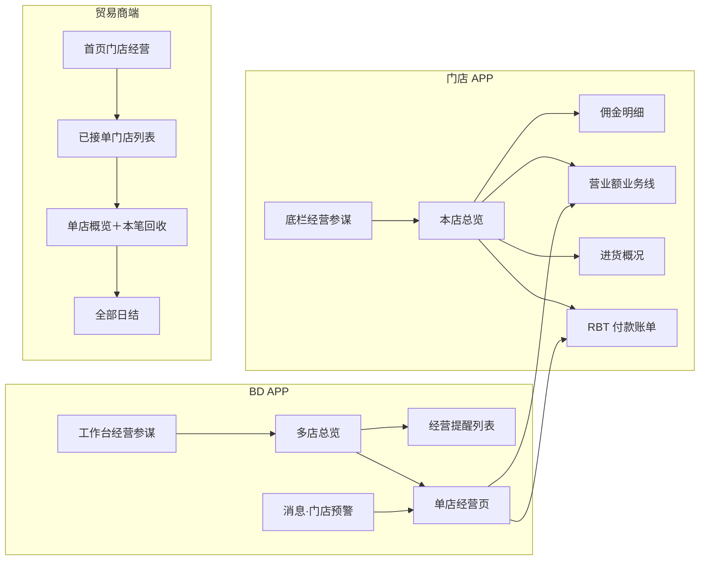
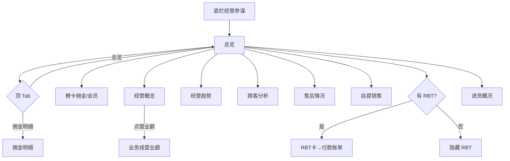

# 经营参谋（门店 APP · BD APP · 贸易商端）

按仓库已落地可点原型整理，合并**门店／BD／贸易商**三端经营查看说明。口径权威见 `docs/经营报表体系/`（01 信息架构 · 03 待确认规则 · 04 复核包 · 05 单店样式与参数）。  
**页内只透出面向用户的白话**；内部编号（如 AL-xx）、验收参数、处理流程说明、产品内部备注等不进界面正文。

| 字段 | 内容 |
|------|------|
| 文档版本 | v3.0 |
| 日期 | 2026-11-17 |
| 状态 | 已对齐可点原型（三端合并） |

## 0. 角色对照（一页看清）

| 项 | 门店 APP | BD APP | 贸易商端（RBT H5） |
|----|----------|--------|-------------------|
| 入口 | 底栏「经营参谋」 | 工作台宫格「经营参谋」 | 首页「门店经营」（无需求详情页） |
| 首屏 | 本店总览 | **多店总览**（经营提醒靠前）→ 下钻单店 | 多店列表 → 单店经营＋本笔回收 |
| 数据范围 | 当前登录门店 | 授权关联门店 | **仅本人已接单**相关门店 |
| 佣金橙卡／佣金明细／提现 | ✅ | ❌ | ❌ |
| 进货概况 | ✅ | ❌ | ❌ |
| 经营概览／趋势（营业额等） | ✅ | ✅ | ✅（GMV 系，§6.6） |
| 顾客分析 | ✅ | ✅ | ❌ |
| 售后情况（快递／自提） | ✅ | ✅ | ❌ |
| 自提销售（核销／排行） | ✅ | ✅ | ❌ |
| RBT 卡／付款账单 | ✅（有业务才出） | ✅（有业务才出） | **本笔联营回收**（付完周期；未支付空态；状态「支付中」） |
| 经营提醒／消息门店预警 | — | ✅（一期**仅提示**，无处理完结流程） | ❌ |
| 底栏四 Tab | ✅ | 多店有工作台底栏；**单店下钻无底栏**（二级／三级页） | 无底栏；二级／三级顶栏返回 |
| 顶栏 | 无额外角色条 | 单店：店名＋返回多店（无「只读／视角」等标注） | 门店经营标题 |

### 关联原型

| 页面 | 文件 | 预览 |
|------|------|------|
| 门店 · 总览 | `store-app/h5/biz-center.html` | http://localhost:5173/store-app/h5/biz-center |
| 门店 · 营业额（业务线） | `store-app/h5/biz-revenue.html` | http://localhost:5173/store-app/h5/biz-revenue |
| 门店 · 佣金明细 | `store-app/h5/biz-commission.html` | http://localhost:5173/store-app/h5/biz-commission |
| 门店 · 进货概况 | `store-app/h5/biz-restock-report.html` | http://localhost:5173/store-app/h5/biz-restock-report |
| 门店 · RBT 付款账单 | `store-app/h5/biz-rbt.html` | http://localhost:5173/store-app/h5/biz-rbt |
| RBT 验收开关 | 总览／账单右下 | 付款中／无RBT模块／已完成付款；或 `?rbt=paying\|none\|done` |
| BD · 工作台 | `MDM/mdm_bd_workbench.html` | http://localhost:5173/MDM/mdm_bd_workbench |
| BD · 多店总览 | `store-app/h5/biz-bd-home.html` | http://localhost:5173/store-app/h5/biz-bd-home?from=bd-app&role=bd |
| BD · 经营提醒 | `store-app/h5/biz-bd-alerts.html` | http://localhost:5173/store-app/h5/biz-bd-alerts?from=bd-app&role=bd |
| BD · 单店下钻示例 | 同上总览点门店 | `biz-center.html?role=bd&storeId=STORE-BJ&from=bd-app` |
| 贸易商 · H5 模块 | `RBT/rbt_h5_trader.html` | http://localhost:5173/RBT/rbt_h5_trader |
| 贸易商 · 经营／回收演示 | `RBT/rbt-trader-store-biz.js` | 随门店经营页加载 |

### 会话拆分（门店 vs BD）

同一套单店页（`biz-center.html`）按入口区分视角，**禁止**把店长／员工带进 BD 壳：

| 身份 | 入口 | 表现 |
|------|------|------|
| 店长／员工 | 工作台／底栏「经营参谋」→ `biz-center.html?from=store-app` | **本店**总览：佣金橙卡、进货、底栏四 Tab |
| BD | 工作台宫格 → 多店；或切店后带 `role=bd&from=bd-app&storeId` | 单店顶栏**店名**＋返回多店；无底栏；无佣金／进货 |

贸易商端经营见 **§3**（非门店／BD 复刻）。

---

# 1. 门店 APP · 经营参谋

## 1.1 概述

### 需求背景

门店老板／店长需要在手机端看清：本店佣金与可提现、卖得怎么样、顾客结构、售后（尤其自提）、自提核销销售、联营要付多少、普通进货花了多少。原先经营中心易把佣金与成交混读；本期做成可点总览＋下级页，**佣金与经营分栏**，问号收说明。

### 需求目标

1. **总览**：顶 Tab「总览 / 佣金明细」；橙卡只看佣金与会员；经营概览／趋势／顾客分析；售后情况；自提销售；有 RBT 才出 RBT 卡；入口进进货概况；点营业额进业务线页。
2. **佣金明细**：可提现＋去提现；下单日／入账日；预到账；筛单查单。
3. **进货概况**：实际支出＝进货支出−本期退款；与联营采购分开。
4. **RBT 付款账单**：约定／实付／剩余／状态／回本周期与按日扣款。
5. **展示**：金额千分位逗号；环比跟卡片时段；页内无内部黑话。

## 1.2 管理范围

| 终端 | 模块 | 变更类型 |
|------|------|----------|
| 门店 APP | 底栏 · 经营参谋 | 修改／强化 |
| 门店 APP | 总览／营业额／佣金／进货／RBT | 修改或新增 |
| 门店 APP | 总览 · 售后情况／自提销售 | 新增 |

本期不做：本页多店切换；进货与联营合并总数；门店端导出；改写交易／结算／日结流程；「代收待转」对门店展示。

呈现硬规则：

| # | 规则 |
|---|------|
| 1 | 佣金与经营分栏，禁止相加当「收入」 |
| 2 | 经营时段筛选不影响待结／可提现／RBT 时点进度 |
| 3 | 顾客分析独立时段；环比前缀与该筛选一致 |
| 4 | RBT 卡仅有有效联营业务时展示 |
| 5 | 页内禁止：口径、知页、临时、SKU、清分、代收待转、分栏等产品黑话 |

## 1.3 需求详细说明

### 1.3.1 总览

#### 功能点

店长从底栏进入总览，依次：佣金橙卡 → 数据截至 → 经营概览 → 经营趋势 → 顾客分析 → 售后情况 → 自提销售 →（可选）RBT → 进货概况入口。

#### 流程图

#### 界面结构

- 原型：`store-app/h5/biz-center.html`
- 顶 Tab：总览｜佣金明细
- 橙卡：待结佣金、本月佣金、年度佣金、会员数
- 经营概览：营业额／订单数／核销数／客单价（右上角时段）
- 经营趋势：营业额｜订单数｜新客数｜核销数
- 顾客分析：独立时段；新老客、复购、流失
- 售后情况、自提销售：见 §3
- RBT（条件）、进货概况入口
- 底栏：工作台｜AI｜经营参谋｜更多
- 验收：右下「RBT验收开关」（不对用户正文解释）

#### 橙卡指标

| 展示名 | 事件时间 | 白话 | 随经营时段 |
|--------|----------|------|------------|
| 待结佣金 | 当前 | 已产生、尚未入账成功 | 否 |
| 本月／年度佣金 | 入账成功 | 已记入收益，≠ 已提现 | 否 |
| 会员数 | 存量 | 本店会员 | 否 |

#### 经营概览指标

| 展示名 | 白话 |
|--------|------|
| 营业额 | 顾客实际支付；点进业务线页 |
| 订单数 | 支付成功主订单数 |
| 核销数 | 到店自提且已核销 |
| 客单价 | 营业额 ÷ 主订单数 |

#### 顾客分析指标

| 展示名 | 白话 |
|--------|------|
| 下单总人数 | 时段内本店支付顾客去重 |
| 新客／老客 | 首次本店支付／非新客 |
| 复购人数／率 | 历史本店支付≥2 次；率＝复购÷下单人数 |
| 流失会员 | 连续 30 天未在本店支付成功 |

#### 时段

今日／昨天／近七天／近 30 天／本月／自定义；环比前缀与所选一致（如近七天→较前7天）。经营默认今日；顾客默认近 30 天。

#### 逻辑要点

1. 改经营时段 → 刷新经营概览、趋势、售后、自提销售；不改橙卡与 RBT。
2. 改顾客时段 → 只刷新顾客分析。
3. `hasRbt=false` 隐藏 RBT 卡。
4. 金额：千分位 `,`，小数 `.`。

---

### 1.3.2 营业额（业务线）

从总览点营业额进入。已有：直播、商城；POS（堂食／外卖／团购核销）结构预留、接入前不进合计。  
原型：`biz-revenue.html`。合计＝已接入业务线之和。

---

### 1.3.3 佣金明细

可提现余额＋去提现；下单日期｜入账日期；预到账四格；筛单列表（履约态）；复制订单号／手机。结算五态：待结算｜结算中｜已结算｜结算失败｜已取消。页顶禁止「经营中心」字样。  
原型：`biz-commission.html`。

---

### 1.3.4 进货概况

实际支出＝进货支出−本期退款；退款拆货款／运费；趋势与商品排行；与 RBT 联营分开，不计入营业额／佣金。  
原型：`biz-restock-report.html`。

---

### 1.3.5 RBT 付款账单

约定付款／累计实付／剩余应付／状态／预计回本周期；按日扣款成功列表。汇总为当前进度，不随经营时段变。日结金额不固定时，经营侧预警看**回本周期是否明显拉长**（见 BD §2.3.5），不以单日扣款波动单独吓人。  
原型：`biz-rbt.html`。

---

## 1.4 门店验收要点

1. 橙卡与经营概览勿相加；问号说得清。
2. 营业额进业务线页，不进佣金明细。
3. 改经营时段，趋势／售后／自提跟着变；待结／RBT 不变。
4. 售后拆快递到家／到店自提；自提销售有核销与排行。
5. RBT 三态验收可用右下开关；仅一个「查看付款账单」入口。
6. 进货主指标为实际支出；与营业额／佣金互不计入。

---

# 2. BD APP · 经营参谋

## 2.1 概述

### 需求背景

BD 收入与关联门店经营好坏相关。需要先看到**哪些店异常、需要关注**，再下钻看单店经营（营业额、顾客、售后、自提销售、RBT），而不是替门店操作资金或进货。

### 需求目标

1. 工作台进入**多店总览**；**经营提醒靠前**。
2. 一期经营提醒／消息预警：**只提示**部分门店需 BD 关注，**无处理、完结、回写看板**流程；文案用「提醒／需关注」，不用「待协助」工单语感。
3. 下钻单店复用经营页能力，但裁剪资金与进货；无门店底栏。
4. 消息中心增加「门店预警」，可进对应门店经营页。

## 2.2 管理范围

| 终端 | 模块 | 变更类型 |
|------|------|----------|
| BD APP | 工作台 · 经营参谋 | 新增 |
| BD APP | 多店总览／经营提醒 | 新增 |
| BD APP | 消息 · 门店预警 | 新增 |
| 门店经营页 | `role=bd` 下钻裁剪 | 修改 |

本期不做：预警处理状态机；预警回写经营数；BD 佣金明细／提现／进货；ERP 另挂 BD 入口。

## 2.3 需求详细说明

### 2.3.1 工作台入口

宫格「经营参谋」→ `biz-bd-home.html?from=bd-app&role=bd`。

### 2.3.2 多店总览

原型：`biz-bd-home.html`。

**布局顺序（上→下）**

1. 顶栏：返回工作台；标题「经营参谋」
2. 副文案：关联门店经营 · 数据截至 …
3. **经营提醒入口**（靠前、有提醒时橙色强调）：条数＋部分摘要（提醒条数在此，不做顶部大数字卡）
4. 「关联门店」＋筛选：**全部 *N***｜**有预警 *M***（门店数挂在筛选上，取消顶部汇总三格占位）
5. 门店卡片列表

**门店卡**

| 元素 | 说明 |
|------|------|
| 店名｜正常／有预警 | 有预警高亮 |
| 近 7 天营业额｜预警条数｜RBT | 三列摘要 |
| 预警摘要 | 白话；连续无成交须含天数，如「连续 8 天无成交」 |
| 整卡点击 | 进入单店经营页 |

### 2.3.3 经营提醒列表

原型：`biz-bd-alerts.html`。列出各店提醒条目，点进对应单店。  
列表头：「共 N 条提醒 · 数据截至 …」。  
**不做**处理按钮、已处理态、回写经营数字。

### 2.3.4 单店下钻

URL：`biz-center.html?role=bd&storeId=xxx&from=bd-app`（下级页透传同参）。

| 项 | 行为 |
|----|------|
| 顶栏 | 返回多店；标题为店名 |
| 本店预警条 | 有则展示标题摘要；**不可点**（非跳转入口） |
| 可见区块 | 经营概览／趋势、顾客分析、售后、自提销售、RBT |
| 隐藏 | 顶 Tab、佣金橙卡、进货入口；误开佣金／进货 → 回总览 |
| 底栏 | **不展示** |
| RBT验收开关 | 保留（验收用） |
| 可下钻 | 营业额业务线、RBT 付款账单（带 BD 参数） |

### 2.3.5 提醒类型（页内白话；编号仅文档）

| 样例门店 | 页内标题 | 说明 |
|----------|----------|------|
| 悠悠生鲜超市 | （无） | — |
| 滨江鲜选店 | 营业额下降；自提售后偏多 | 售后须写清履约类型 |
| 城南生鲜店 | 连续 8 天无成交 | 天数必写 |
| 湖畔优选店 | 预计回本周期延长超 30 天 | 日结金额不固定，不以单日扣款波动报警；演示阈值：较约定延长 ≥30 天 |

### 2.3.6 消息 · 门店预警

工作台消息流与「消息通知」列表增加类型「门店预警」，文案提示关注跟进；详情可「查看门店经营」跳转对应 `storeId`。

## 2.4 BD 验收要点

1. 工作台能进多店；经营提醒在门店列表之上；筛选上带全部／有预警门店数，无顶部大汇总卡。
2. 文案为「提醒／需关注」，无「待协助」工单感；无处理完结操作。
3. 连续无成交含天数；自提售后偏多写明自提；回本周期延长含阈值语义。
4. 单店无底栏、无佣金／进货；有售后与自提销售；顶栏仅店名；返回多店。
5. 店长身份进经营参谋为本店样式，不被残留 BD 会话带偏。
6. 消息门店预警可进单店；页内无内部标注文案。

---

# 3. 贸易商端 · 门店经营

## 3.1 概述

### 需求背景

贸易商关心已接单门店**能不能付、大概何时付完**。RBT 场景多为**开业大礼包**：提需求时门店通常尚未营业，各方完成签署后才可能有经营数据。贸易商端**不是**门店／BD 经营参谋复刻。

### 需求目标

1. 首页「门店经营」进入**已接单相关**多店列表 → 单店。
2. 单店：GMV 系经营概览＋**本笔联营回收**（状态「支付中」，不用「还款」）。
3. 不开放佣金／提现／进货／顾客／售后；页内不加内部备注文案。
4. 需求大厅只做接单／签约／签署，**不做需求详情页**、不在大厅挂经营块。

## 3.2 管理范围

| 终端 | 模块 | 变更类型 |
|------|------|----------|
| 贸易商 H5 | 首页 · 门店经营 | 新增 |
| 贸易商 H5 | 多店／单店／全部日结 | 新增 |

本期不做：需求详情页；PC 运营需求详情挂经营；贸易商看佣金／提现／进货；预警处理状态机；结算导出。

## 3.3 需求详细说明

### 3.3.1 入口

`RBT/rbt_h5_trader.html` → 首页基础工具「门店经营」。  
登录／需求大厅／合同签署仍见 `RBT/docs/8-贸易商端移动端PRD.md`；**经营查看以本文 §3 为准**。

### 3.3.2 多店列表

* **可见门店**：仅本人**已接单**相关（不含待接单可见门店）
* 空列表：「暂无已接单相关门店」
* 门店卡：店名；近 30 天营业额／有成交天数（签署完成前为「—」）；有有效联营则剩余应付或「约 x 天付完」
* 不展示「已接单 N」角标；不加列表顶部内部备注

### 3.3.3 单店经营

1. **门店经营概览**
   * 开业大礼包：仅本人相关需求**各方完成签署**（待复核及之后）才可能有数；签署前空态，不伪造成交
   * 有数据：近 30 天／90 天／12 个月；营业额（支付 GMV）、退款、净成交额、支付订单数、客单价、最近成交日、有成交天数、简要趋势
2. **本笔联营回收**
   * 未进入支付：空态「尚未开始日结付款…」
   * 支付中／已完成：约定回收、累计实付、剩余应付、状态（**支付中**／已完成付款）、预计付完
   * 日结：默认最近 **5** 笔；超过出「全部日结（N）」→ 二级列表滚动看全部
3. 页内不加「辅助判断付款能力／佣金抽成链路」等内部说明

### 3.3.4 权限边界

* 不开放其他贸易商业务明细
* 业务结束后停止基于该笔持续看门店经营；历史可先查看、不做导出（Q-TR-01／Q-JV-12）
* 体系菜单：§6.6

演示数据：`RBT/rbt-trader-store-biz.js`。

## 3.4 贸易商验收要点

1. 店长式经营参谋与贸易商「门店经营」入口分离；贸易商列表只有已接单门店。
2. 未签署完成门店指标为「—」／空态；支付中单可见回收与预计付完。
3. 状态文案为「支付中」，无「还款」。
4. 日结超过 5 笔可进全部日结；页内无内部备注、无「已接单 N」。

---

# 4. 共用区块：售后情况 · 自提销售

门店总览与 BD 单店总览均展示；时段跟随经营概览。

### 4.1 售后情况

| 指标 | 说明 |
|------|------|
| 售后笔数／金额／占比 | 按时段内退款成功归期；占比相对同期营业额 |
| 快递到家 | 非自提履约的售后笔数与金额 |
| 到店自提 | 自提履约售后；与门店关联更强，拆列展示 |

问号说明履约拆分含义。**页内不堆「请优先核对…」类运营批注句**（指标本身已表达）。

### 4.2 自提销售

| 指标 | 说明 |
|------|------|
| 自提订单 | 支付成功的自提单数 |
| 已核销／待核销 | 到店完成核销／尚未核销 |
| 自提营业额 | 自提订单实付合计 |
| 商品排行 | 按自提成交额；展示销量与核销 |

---

# 5. 全局展示约定

| 项 | 约定 |
|----|------|
| 千分位 | `,` |
| 小数点 | `.` |
| 涨跌色 | 涨红跌绿 |
| 环比 | 与对应卡片时段一致；问号不解释「与右上角一致」 |
| 文案分层 | A 用户白话（页内）／B 内部口径（docs）／C 验收（开关／URL） |
| 禁止上屏 | 处理流程说明、只读视角标注、不改看板数字、AL 编号等 |

---

# 6. 关联文档

| 文档 | 用途 |
|------|------|
| [docs/经营报表体系/README.md](../docs/经营报表体系/README.md) | 体系索引 |
| [01-信息架构与菜单](../docs/经营报表体系/01-信息架构与菜单.md) | §6.4 门店；§6.6 贸易商；§6.7 BD |
| [贸易商端移动端 PRD](../RBT/docs/8-贸易商端移动端PRD.md) | 登录／大厅／签署；经营查看以本文 §3 为准 |
| [03-待确认规则清单](../docs/经营报表体系/03-待确认规则清单.md) | 拍板／暂缓（含 Q-AL） |
| [04-已确认口径复核包](../docs/经营报表体系/04-已确认口径复核包.md) | 流程图＋逻辑 |
| [05-单店经营报表样式与参数](../docs/经营报表体系/05-单店经营报表样式与参数.md) | 样式与 BD 下钻差异 |
| 经营中心佣金日期口径（禅道粘贴） | 佣金五态、下单日 vs 入账日 |

---

## 修订

| 版本 | 日期 | 说明 |
|------|------|------|
| v3.0 | 2026-11-17 | 合并门店／BD／贸易商三端 PRD；BD 汇总数下沉筛选；店长／BD 会话拆分；贸易商支付中／日结二级页 |
| v2.1 | 2026-11-17 | 增补贸易商视角对照与原型路径；交叉引用 §6.6／贸易商端 PRD |
| v2.0 | 2026-11-17 | 重梳门店＋BD 对照 PRD：范围表、多店提醒靠前、单店无底栏、售后／自提、提醒文案与回本周期阈值 |
| v1.6 | 2026-11-17 | 去标注；连续无成交天数；消息预警；售后／自提 |
| v1.5～v1.0 | 2026-11-17 | 迭代见 git 历史 |
